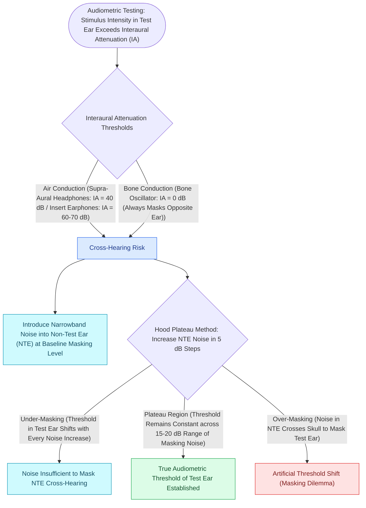

# Audiometric masking with the plateau method prevents shadow responses from the non-test ear

## Active Recall

> [!question]- What is the interaural attenuation for bone conduction testing?
> *Answer / Clinical Rationale*: **$0\text{ dB}$** (sound crosses skull bones to stimulate both cochleas equally).

> [!question]- When is masking mandatory during bone conduction audiometry?
> *Answer / Clinical Rationale*: Whenever there is an **air-bone gap $>10\text{ dB}$** in the test ear.

## Core Clinical & Mechanistic Principles
**Clinical masking** presents narrowband noise to the non-test ear (NTE) to isolate the test ear (TE) and prevent **crossover / shadow hearing**:
- **Interaural Attenuation (IA) Benchmarks**:
  - **Bone Conduction (BC)**: **$0\text{ dB}$** (IA is considered zero because skull vibrations [[Bone-anchored hearing implants BAHA stimulate the cochlea directly via bone conduction pathways|stimulate]] both cochleas simultaneously).
  - **Air Conduction (AC) Supra-aural Earphones (TDH-39)**: **$40\text{ dB}$**.
  - **Air Conduction (AC) Insert Earphones (ER-3A)**: **$60\text{–}70\text{ dB}$** (larger IA reduces need for masking).
- **Masking Rules**:
  - *AC Masking*: Required whenever $\text{AC}_{TE} - \text{BC}_{NTE} \ge \text{IA}$ ($40\text{ dB}$ for supra-aural, $60\text{ dB}$ for inserts).
  - *BC Masking*: Required whenever the **air-bone gap in the test ear exceeds $10\text{ dB}$** ($\text{ABG}_{TE} > 10\text{ dB}$).
- **The Hood Plateau Method**:
  1. Introduce masking noise to NTE at baseline threshold $+10\text{ dB}$.
  2. Re-test threshold in TE.
  3. Increase masking noise in $5\text{-dB}$ steps.
  4. The **plateau** is reached when TE threshold remains constant over at least three consecutive $5\text{-dB}$ increases in noise ($15\text{–}20\text{ dB}$ plateau width).

### Surgical Technique & Critical Safety Checks
- **Overmasking / Masking Dilemma**: Occurs when bilateral large conductive hearing losses exist; masking noise in NTE crosses skull via bone conduction and artificially elevates TE threshold.

## Connected Concepts & Graph Traversal
- **Stapes Fixation Artifact**: [[Carhart notch presents as an artificial bone-conduction dip at two thousand Hertz in stapes fixation|Carhart Notch]]
- **Acoustic Impedance Gains**: [[The middle ear transformer ratio provides twenty-seven decibels of acoustic impedance matching|Middle Ear Mechanics]]
- **Bone Conduction Alternative**: [[Bone-anchored hearing implants BAHA stimulate the cochlea directly via bone conduction pathways|BAHA Implants]]
- **Bedside Tuning Fork Checks**: [[Tuning fork tests utilize the 512-Hertz fork to differentiate conductive from sensorineural hearing loss via Weber and Rinne tests|Weber and Rinne Tuning Fork Tests]]
- **Tympanometric Pre-Assessment**: [[Tympanometry classifies middle ear compliance and pressure into Jerger Types A, As, Ad, B, and C|Jerger Middle Ear Compliance]]
