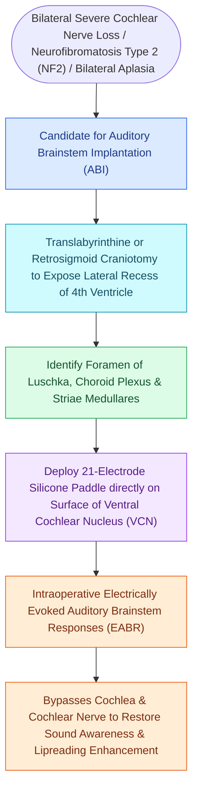

# Auditory Brainstem Implantation ABI bypasses the cochlea and cochlear nerve to stimulate the cochlear nucleus in NF2

## Active Recall

> [!question]- What specific central auditory structure is stimulated by an Auditory Brainstem Implant (ABI)?
> *Answer / Clinical Rationale*: The **cochlear nucleus complex** (in the lateral recess of the fourth ventricle via the foramen of Luschka).

> [!question]- What is the most common clinical indication for placing an Auditory Brainstem Implant?
> *Answer / Clinical Rationale*: **Neurofibromatosis Type 2 (NF2)** following surgical resection of bilateral vestibular schwannomas with cochlear nerve sacrifice.

## Core Clinical & Mechanistic Principles
The **Auditory Brainstem Implant (ABI)** is a surgically implanted neuroprosthetic device that restores sound sensation in patients with profound bilateral hearing loss where the cochlea or cochlear nerves are absent or non-functional:
- **Primary Indications**:
  1. **Neurofibromatosis Type 2 (NF2)**: Following bilateral [[Vestibular schwannomas arise from the Schwann cell sheath of the inferior or superior vestibular nerve|vestibular schwannoma]] resection where the cochlear nerves (CN VIII) are sacrificed or anatomically disrupted. In the United States, FDA approval for ABI in NF2 is designated for patients **age 12 years and older**.
  2. **Congenital Cochlear Nerve Aplasia** (or bilateral severe cochlear ossification/malformation).
- **Anatomical Target & Surgical Inset**:
  - The electrode paddle (containing 12–21 platinum electrodes) is placed directly on the surface of the **cochlear nucleus complex (specifically the dorsal and ventral cochlear nuclei)**.
  - **Surgical Approach**: Translabyrinthine or retrosigmoid approach to the cerebellopontine angle.
  - The surgeon identifies the **foramen of Luschka** and inserts the electrode paddle into the **lateral recess of the fourth ventricle**, resting over the cochlear nucleus on the lateral surface of the brainstem.
- **Auditory Outcomes**:
  - Provides environmental sound awareness, sound localization cues, and significant enhancement of **lip-reading capabilities** (open-set speech recognition is achieved in only $10\text{–}30\%$ of post-tumor NF2 patients, but is higher in non-tumor candidates).

### Surgical Technique & Critical Safety Checks
- **Intraoperative Monitoring**: Electrically evoked auditory brainstem responses (EABR) are recorded in the OR to confirm correct placement and rule out unwanted stimulation of adjacent cranial nerves (CN VII, IX, X).

## Connected Concepts & Graph Traversal
- **Cochlear Implantation Counterpart**: [[Cochlear implant candidacy criteria include severe to profound bilateral sensorineural hearing loss|Cochlear Implantation Candidacy]]
- **Pathological Indication**: [[Koos grading system classifies vestibular schwannomas from Stage I intracanalicular to Stage IV brainstem compression|Vestibular Schwannoma in NF2]]
- **Surgical Skull Base Corridor**: [[The translabyrinthine approach provides direct exposure of the internal auditory canal with complete hearing sacrifice|Translabyrinthine Approach]]
- **Electrophysiological Monitoring**: [[Auditory brainstem response waves I through V identify retrocochlear and brainstem pathology|EABR vs ABR Waveforms]]
- **Intracranial Tumor Syndromes**: [[Vestibular schwannomas arise from the Schwann cell sheath of the inferior or superior vestibular nerve|Bilateral Schwannomas in NF2]]
