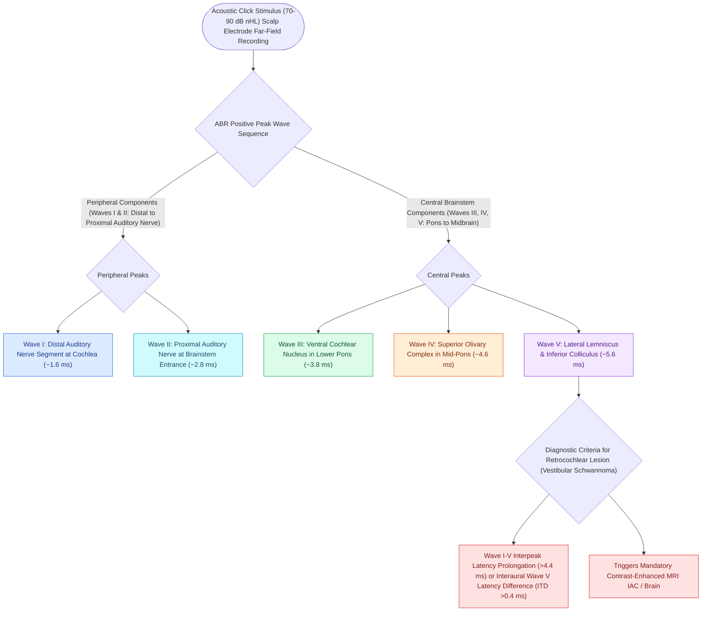

# Auditory brainstem response waves I through V identify retrocochlear and brainstem pathology

## Active Recall

> [!question]- What anatomical structure generates Wave I of the ABR?
> *Answer / Clinical Rationale*: The **distal segment of the cochlear nerve (CN VIII)** near the spiral lamina.

> [!question]- What interaural Wave V latency difference ($IT_5$) threshold suggests retrocochlear pathology (e.g., vestibular schwannoma)?
> *Answer / Clinical Rationale*: An **$IT_5 > 0.4\text{ ms}$** difference between ears.

## Core Clinical & Mechanistic Principles
The **Auditory Brainstem Response (ABR)** records far-field surface electrical potentials generated within the first **$10\text{ milliseconds}$** following [[Acoustic reflex thresholds and reflex decay testing identify retrocochlear lesions and facial nerve pathology|acoustic]] click stimulation:
- **Anatomical Wave Generators (E-COLI Mnemonic)**:
  - **Wave I**: Distal (cochlear) segment of the **Auditory Nerve (CN VIII)**.
  - **Wave II**: Proximal (brainstem) segment of the **Auditory Nerve** / **Cochlear Nucleus**.
  - **Wave III**: **Superior Olivary Complex (SOC)** in lower pons.
  - **Wave IV**: **Lateral Lemniscus** in mid-pons.
  - **Wave V**: **Inferior Colliculus** in midbrain / Lateral lemniscus termination.
- **Diagnostic Interpeak Latency Norms (Click at 70–80 dB nHL)**:
  - **I–III Interpeak Latency**: Normal $\approx 2.0\text{ ms}$.
  - **III–V Interpeak Latency**: Normal $\approx 1.8\text{ ms}$.
  - **I–V Interpeak Latency**: Normal $\approx 4.0\text{ ms}$.

### Surgical Technique & Critical Safety Checks
- **Retrocochlear Tumor Criteria**:
  1. Interaural Wave V latency difference (**$IT_5 > 0.4\text{ ms}$**).
  2. Absolute Wave V latency $>6.1\text{ ms}$.
  3. Prolonged I–V interpeak interval ($>4.4\text{ ms}$).
  4. Poor morphology or absence of waves III and V with intact Wave I.

## Connected Concepts & Graph Traversal
- **Wave Generators Anatomy**: [[Wave I of the ABR arises from the distal auditory nerve while wave V originates at the lateral lemniscus and inferior colliculus|ABR Generators]]
- **Retrocochlear Pathology**: [[Vestibular schwannomas arise from the Schwann cell sheath of the inferior or superior vestibular nerve|Vestibular Schwannoma Diagnosis]]
- **ANSD Differential**: [[Otoacoustic emissions evaluate outer hair cell integrity and differentiate cochlear from auditory neuropathy spectrum disorder|OAEs and ANSD]]
- **Stapedius Acoustic Reflex**: [[Acoustic reflex thresholds and reflex decay testing identify retrocochlear lesions and facial nerve pathology|Acoustic Reflex Decay Screening]]
- **Electrodiagnostic Cross-Check**: [[Electrocochleography SP to AP ratio exceeding zero point four indicates endolymphatic hydrops|ECoG vs ABR Far-Field Potentials]]
