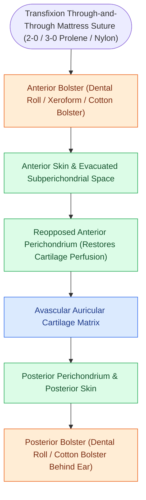
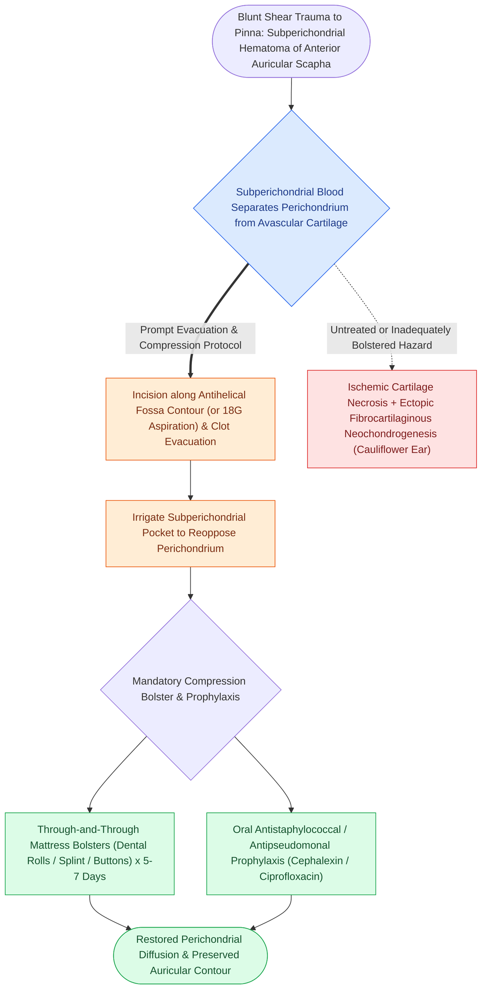

# Auricular hematoma evacuation and bolster compression prevents permanent cauliflower ear deformity

## Active Recall

> [!question]- Why does subperichondrial blood accumulation lead to irreversible cartilage necrosis within 48 to 72 hours if not decompressed?
> *Answer / Clinical Rationale*: Auricular cartilage possesses no intrinsic blood supply and relies strictly on diffusion across the perichondrial-cartilage interface. A subperichondrial hematoma physically strips the vascular perichondrium away from the cartilage, causing immediate ischemia, chondrocyte death, and subsequent stimulation of subperichondrial chondrogenesis leading to fibrocartilaginous hypertrophy ("cauliflower ear").

> [!question]- Why is through-and-through bolster placement mandatory following surgical incision and evacuation of an auricular hematoma?
> *Answer / Clinical Rationale*: The potential space between the elevated perichondrium and cartilage possesses high elastic recoil and vascular shearing potential; without continuous, uniform compressive coaptation from anterior and posterior bolsters, blood invariably reaccumulates within hours.

## Core Clinical & Mechanistic Principles

**Auricular hematoma** is an acute accumulation of blood within the subperichondrial space of the anterior auricle, typically resulting from blunt shearing trauma during contact sports (wrestling, rugby, martial arts). Because the avascular auricular cartilage depends entirely on diffusion from its overlying **perichondrium** for oxygen and nutrient delivery, subperichondrial blood accumulation mechanically separates the perichondrium from the underlying cartilage framework.

If left unevacuated, cartilage ischemia triggers **aseptic necrosis**, followed by fibroblastic proliferation and disorganized neocartilage deposition, yielding the permanent calcified, fibrotic deformity known as **"cauliflower ear"** (wrestler's ear). Furthermore, stagnant subperichondrial blood acts as a culture medium for secondary bacterial infection, precipitating [[Acute perichondritis of the auricle requires antipseudomonal therapy to prevent cartilage necrosis|auricular suppurative perichondritis]] or [[Relapsing polychondritis causes autoimmune auricular and laryngotracheal chondritis with sparing of the non-cartilaginous lobule|cartilage lysis]].

### Key Consultation Supplies
- Appropriate PPE including eye protection and sterile gloves
- Coaxial surgical headlight or loupes
- Povidone-iodine surgical skin prep
- Local anesthetic: 1% lidocaine with 1:100,000 epinephrine
- #15 blade scalpel and fine iris scissors
- Small ear curettes (Buck / Billeau) and 5 French Frazier suction tip
- Sterile normal saline flush with angiocatheter
- Dental cotton rolls, Xeroform gauze, or silastic buttons
- 3-0 or 4-0 non-absorbable monofilament sutures (nylon / Prolene) on Keith or straight needles
- Bacitracin or polymyxin-B ointment

> [!example]- **Operative Note Template: Incision and drainage of auricular hematoma with through-and-through bolster placement**
> **PROCEDURE**: Incision and drainage of auricular hematoma with through-and-through bolster placement
> **PRE-PROCEDURAL DIAGNOSIS**: Acute subperichondrial hematoma of the [right/left] auricle
> **POST-PROCEDURAL DIAGNOSIS**: Acute subperichondrial hematoma of the [right/left] auricle status-post evacuation and bolster compression
> **SURGEON**: [Surgeon Name, MD]
> **ASSISTANT**: [Resident/Fellow Name, MD]
>
> **PROCEDURE IN DETAIL**:
> Informed consent was obtained. The patient was positioned supine. The [right/left] auricle was prepped and draped in a sterile fashion using povidone-iodine. A regional field block around the base of the auricle was performed using 4 mL of 1% lidocaine with 1:100,000 epinephrine.
>
> A 1.5 cm curvilinear incision was placed strictly within the natural aesthetic contour line of the [antihelical fold / scaphoid fossa]. The skin and overlying perichondrium were elevated, exposing a large subperichondrial space filled with liquid blood and organized fibrin clot. The hematoma was suctioned and the cavity gently curetted using a small ear curette, exposing pristine white avascular cartilage without chondronecrosis. The pocket was copiously irrigated with sterile saline.
>
> To obliterate the subperichondrial dead space and prevent reaccumulation, two through-and-through horizontal mattress sutures of 3-0 Prolene were placed through the auricle, tying over sterile dental cotton rolls coated in bacitracin ointment placed on the anterior and posterior surfaces of the pinna. Hemostasis was complete, and normal auricular architectural contours were restored. The patient was placed on oral ciprofloxacin 500 mg BID and instructed to return in 5–7 days for bolster removal.

## References
1. Linstrom, C.J., Lucente, F.E. (2013). Diseases of the External Ear. In Johnson, J.J., Rosen, C.A. (Eds.), *Bailey’s Head and Neck Surgery-Otolaryngology* 5e (pp. 2333-2357). Baltimore, MD: Lippincott Williams & Wilkins.
2. Naples, J.G., Brant, J.A., Ruckenstein, M.J. (2020). Infections of the External Ear. In Flint, P.W., et al. (Eds.), *Cummings Otolaryngology Head and Neck Surgery* 7e (pp. 2093-2100). Philadelphia, PA: Elsevier.
3. Greywoode, J.D., et al. (2010). Management of auricular hematoma and the cauliflower ear. *Facial Plast Surg*, 26(6):451-455.

## Connected Concepts & Graph Traversal
- **Critical Safety & Infection**: [[Acute perichondritis of the auricle requires antipseudomonal therapy to prevent cartilage necrosis|Auricular Perichondritis]]
- **🔗 Differential Diagnosis (Laryngology)**: [[Relapsing polychondritis causes autoimmune auricular and laryngotracheal chondritis with sparing of the non-cartilaginous lobule|Relapsing Polychondritis]]
- **Otologic Trauma**: [[Temporal bone longitudinal and transverse fractures cause delayed or immediate facial paralysis|Temporal Bone Trauma]]
- **Anatomical Foundation**: [[Traumatic tympanic membrane perforations heal spontaneously in the majority of cases without early surgery|Traumatic TM Perforation]]
- **Surgical Craft**: [[Complete cortical mastoidectomy unroofs the mastoid antrum and establishes dependent middle ear drainage|Cortical Mastoidectomy]]
