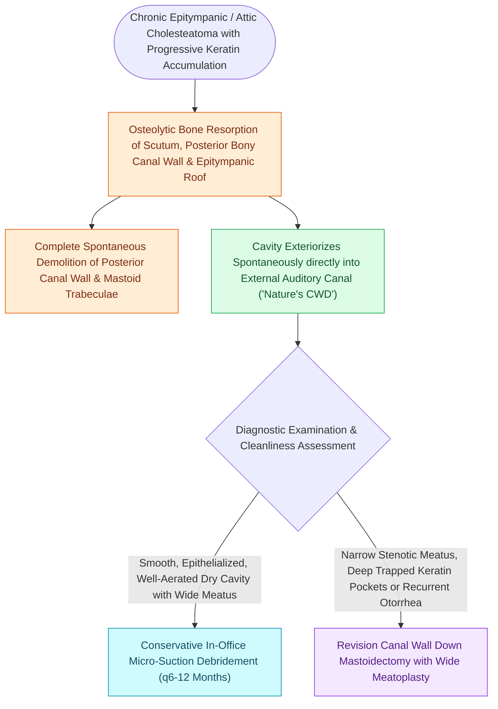

# Auto-mastoidectomy occurs when chronic expansive cholesteatoma exteriorizes spontaneously into the canal

## Active Recall

> [!question]- What is an auto-mastoidectomy?
> *Answer / Clinical Rationale*: Spontaneous **osteolytic resorption of the posterior canal wall and scutum by cholesteatoma**, resulting in a naturally exteriorized mastoid cavity.

> [!question]- When does a patient with an auto-mastoidectomy require surgical intervention?
> *Answer / Clinical Rationale*: When there is **stenosis of the meatus, persistent infection, residual hidden pockets, or a high facial ridge** preventing adequate self-cleaning.

## Core Clinical & Mechanistic Principles
An **auto-mastoidectomy (spontaneous / nature's mastoidectomy)** occurs when a long-standing, chronic expansive cholesteatoma completely resorbs the posterior bony canal wall and scutum, exteriorizing the mastoid air cells spontaneously into the external auditory meatus:
- **Pathophysiological Mechanism**:
  - Continuous pressure necrosis and osteoclast activation driven by collagenases and endotoxins erode the entire bony posterior canal wall, lateral attic wall, and mastoid cortex.
  - Eventually, the cholesteatoma matrix exteriorizes widely into the ear canal, sloughing its keratin contents naturally.
- **Clinical & Otoscopic Findings**:
  - The ear canal appears as a **massive, smooth, epithelized mastoid cavity** resembling a surgical [[Canal wall down mastoidectomy lowers the facial ridge and exteriorizes the mastoid into the ear canal|canal wall down mastoidectomy]].
  - The stapes footplate, facial nerve ridge, and promontory may be covered by a thin layer of healthy or atrophic squamous epithelium.
- **Management Protocol**:
  - If the cavity is **dry, wide, clean, and fully exteriorized**: Active surveillance and regular in-office microscopic cleaning without surgical intervention.
  - If **retention pockets, high facial ridge, or active infection** persist: Surgical revision ([[Wide meatoplasty provides adequate aeration and easy cleaning of a canal wall down mastoid cavity|meatoplasty]], [[Lowering the facial ridge flush with the facial nerve is essential to prevent dependent cavity pooling|facial ridge lowering]], and saucerization).

### Surgical Technique & Critical Safety Checks
- **Differential Diagnosis**: Extensive surgical canal wall down mastoidectomy, eosinophilic granuloma (LCH), or lateral temporal bone malignancy.

## Connected Concepts & Graph Traversal
- **Surgical Equivalent**: [[Canal wall down mastoidectomy lowers the facial ridge and exteriorizes the mastoid into the ear canal|Canal Wall Down Mastoidectomy]]
- **Meatal Aeration**: [[Wide meatoplasty provides adequate aeration and easy cleaning of a canal wall down mastoid cavity|Wide Meatoplasty]]
- **Cavity Contour Craft**: [[Lowering the facial ridge flush with the facial nerve is essential to prevent dependent cavity pooling|Facial Ridge Lowering]]
- **Acquired Pathogenesis**: [[Primary acquired cholesteatoma arises from retraction pocket invagination of the pars flaccida into Prussak space|Prussak Space Invagination]]
- **Erosion Complication**: [[Labyrinthine fistula from cholesteatoma erosions most frequently involves the lateral semicircular canal|Labyrinthine Fistula]]
