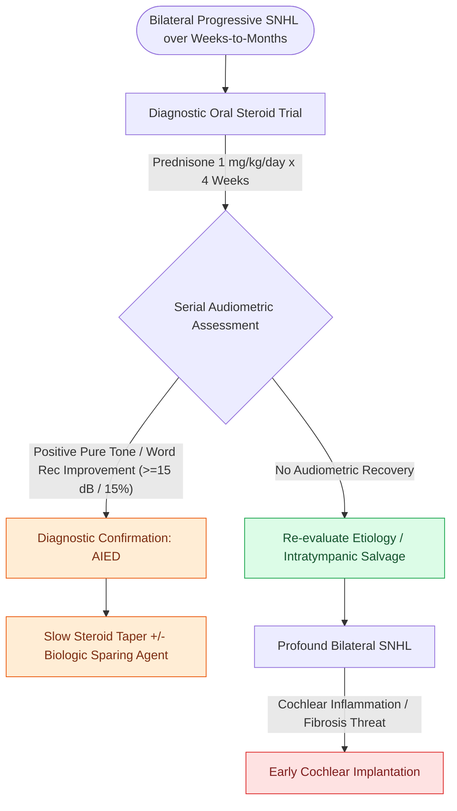

# Autoimmune inner ear disease causes rapidly progressive bilateral sensorineural loss responsive to corticosteroids

## Active Recall

> [!question]- What tempo of hearing loss defines AIED against its two main mimics?
> *Answer / Clinical Rationale*: Weeks-to-months bilateral progression — faster than age-related decline, slower than idiopathic sudden SNHL.

> [!question]- Name the syndrome pairing interstitial keratitis with audiovestibular dysfunction and its feared systemic lesion.
> *Answer / Clinical Rationale*: **Cogan syndrome**; aortitis with aortic insufficiency.

## Core Clinical & Mechanistic Principles
- **Signature Tempo**: Bilateral (often asymmetric and asynchronous) sensorineural hearing loss progressing rapidly over **weeks to months** — significantly faster than [[Presbycusis produces symmetric high-frequency sensorineural loss with disproportionate speech-in-noise decline|presbycusis]], yet slower than [[Idiopathic sudden sensorineural hearing loss requires prompt systemic corticosteroids and intratympanic salvage injection|idiopathic sudden SNHL]] — frequently accompanied by fluctuating aural fullness, tinnitus, and episodic vestibular instability.
- **Diagnostic High-Dose Steroid Challenge**: Because serological markers (ANA, anti-68 kDa / HSP-70 antibodies) lack definitive sensitivity and specificity, **responsiveness to an empirical 4-week trial of oral prednisone ($1\text{ mg/kg/day}$)** documented on serial audiometry serves as the primary clinical diagnostic criterion.
- **Cogan Syndrome**: Rare autoimmune vasculitis pairing interstitial keratitis with severe Meniere-like audiovestibular dysfunction in young adults, carrying high risk for systemic aortitis and aortic valvular insufficiency.
- **Secondary AIED**: Up to one-third of cases occur secondary to systemic rheumatologic disease (systemic lupus erythematosus, rheumatoid arthritis, or [[Granulomatosis with polyangiitis presents with necrotizing sinonasal granulomas and saddle nose|granulomatosis with polyangiitis (GPA)]]).

### Management & Critical Safety Checks
- **Steroid Maintenance & Sparing**: Positive responders require a very gradual multi-month corticosteroid taper; methotrexate, azathioprine, or biologics (e.g. rituximab, infliximab) are utilized for steroid dependence or frequent relapses.
- **Cochlear Implantation**: Patients with progressive profound loss unresponsive to immunosuppression are candidates for prompt [[Cochlear implant candidacy criteria include severe to profound bilateral sensorineural hearing loss|cochlear implantation]]; early surgery is necessary before chronic intracochlear labyrinthitis leads to fibrous or neo-osteogenesis (cochlear obliteration).

## Connected Concepts & Graph Traversal
- **Sudden SNHL Differential**: [[Idiopathic sudden sensorineural hearing loss requires prompt systemic corticosteroids and intratympanic salvage injection|Sudden SNHL vs AIED Progression]]
- **🔗 Vasculitic Otologic Overlap (Sinus)**: [[Granulomatosis with polyangiitis presents with necrotizing sinonasal granulomas and saddle nose|GPA & Vasculitic Sensorineural Loss]]
- **Syndromic Keratitis Differential**: [[Meniere disease is characterized by episodic vertigo, fluctuating low-frequency SNHL, tinnitus, and aural fullness|Meniere vs Cogan Syndrome]]
- **Rehabilitative Endpoint**: [[Cochlear implant candidacy criteria include severe to profound bilateral sensorineural hearing loss|Cochlear Implantation in AIED]]
- **Electrophysiological Auditory Baseline**: [[Otoacoustic emissions evaluate outer hair cell integrity and differentiate cochlear from auditory neuropathy spectrum disorder|OAEs in Autoimmune Cochleopathy]]
