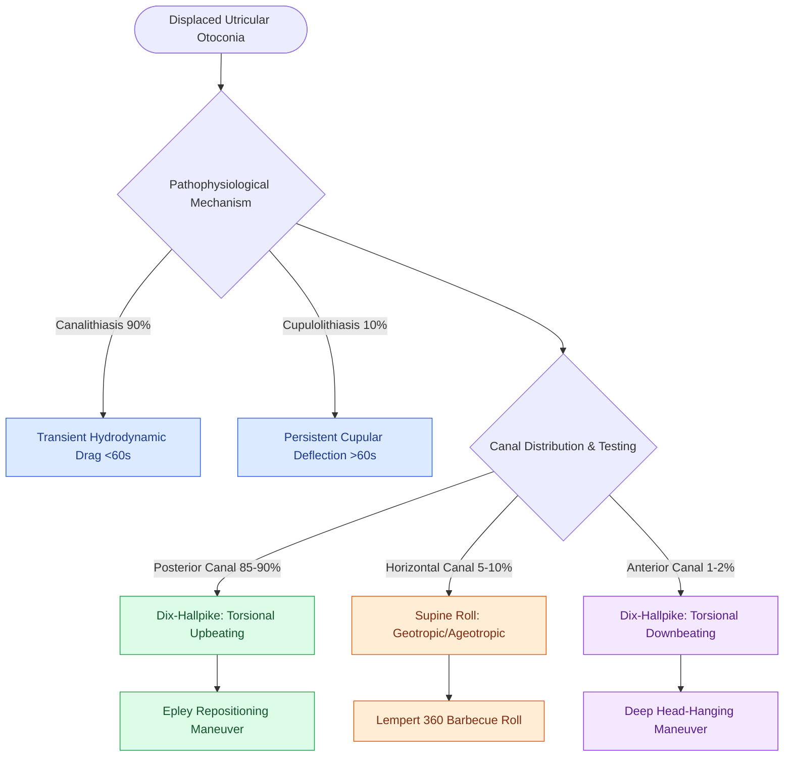

# Benign paroxysmal positional vertigo BPPV results from canalithiasis or cupulolithiasis in semicircular canals

## Active Recall

> [!question]- What is the difference in latency and duration between canalithiasis and cupulolithiasis?
> *Answer / Clinical Rationale*: **Canalithiasis has a 2–10 second latency and transient duration (<60 sec)**; **cupulolithiasis has immediate onset and persistent duration (>60 sec)**.

> [!question]- Which semicircular canal is most frequently affected in BPPV, and why?
> *Answer / Clinical Rationale*: The **posterior semicircular canal** ($>85\text{–}90\%$), because its anatomical location is the most gravity-dependent in both sitting and supine postures.

## Core Clinical & Mechanistic Principles
**Benign Paroxysmal Positional Vertigo (BPPV)** is the most common peripheral vestibular disorder, caused by displaced **calcium carbonate otoconia (otoliths)** from the utricular macula:
- **Two Pathophysiological Mechanisms**:
  1. **Canalithiasis ($>90\%$)**: Free-floating otoconial debris in the endolymph of a semicircular canal. Changing head position causes gravitational settling of the debris, creating hydrodynamic drag (piston effect) that deflects the cupula. Characterized by a **latency of $2\text{–}10\text{ seconds}$** and **transient paroxysmal nystagmus ($<60\text{ seconds}$)** that fatigues.
  2. **Cupulolithiasis ($<10\%$)**: Otoconia adhere directly to the gelatinous cupula, making the cupula gravity-sensitive. Characterized by **immediate onset with zero latency**, **persistent nystagmus ($>60\text{ seconds}$)** that does NOT fatigue.
- **Canal Frequency Distribution**:
  - **Posterior Semicircular Canal**: Involved in **$>85\text{–}90\%$** of cases (due to dependent anatomical position in the upright/supine head).
  - **Horizontal (Lateral) Canal**: $5\text{–}10\%$.
  - **Anterior (Superior) Canal**: $1\text{–}2\%$.

### Surgical Technique & Critical Safety Checks
- **Etiologies**: Idiopathic (50%), head trauma (most common cause of bilateral/refractory BPPV), prolonged bed rest, [[Vestibular neuritis causes acute spontaneous prolonged vertigo without auditory symptoms|vestibular neuritis]], and [[Meniere disease is characterized by episodic vertigo, fluctuating low-frequency SNHL, tinnitus, and aural fullness|Meniere]] disease.

## Connected Concepts & Graph Traversal
- **Posterior Canal Diagnostic Maneuver**: [[The Dix-Hallpike maneuver produces torsional upbeating nystagmus in posterior canal BPPV|Dix-Hallpike Maneuver]]
- **Posterior Canal Particle Repositioning**: [[The Epley particle repositioning maneuver clears otoconia from the posterior canal into the utricle|Epley Maneuver]]
- **Horizontal Canal Diagnostic & Repositioning**: [[Horizontal canal BPPV is diagnosed with the supine roll test and treated with the Lempert barbecue maneuver|Horizontal Canal BPPV & Lempert Roll]]
- **Vestibular Physiological Laws**: [[Ewald's laws and Alexander's law govern the directional dynamics and intensity of vestibular nystagmus|Ewald's Laws & Nystagmus Dynamics]]
- **Otolith Receptor Foundation**: [[Cervical and ocular vestibular evoked myogenic potentials test saccular and utricular otolith function|Otolith Organs & VEMP Testing]]
- **Acute Vertigo Differential**: [[The HINTS examination separates vestibular neuritis from posterior circulation stroke in acute vestibular syndrome|HINTS Bedside Examination]]
- **Refractory & Atypical Canal Repositioning**: [[Canalith repositioning maneuvers for atypical and refractory BPPV employ the Semont, Gufoni, and Yacovino maneuvers to clear debris from horizontal and vertical semicircular canals|Semont, Gufoni & Yacovino Maneuvers]]
