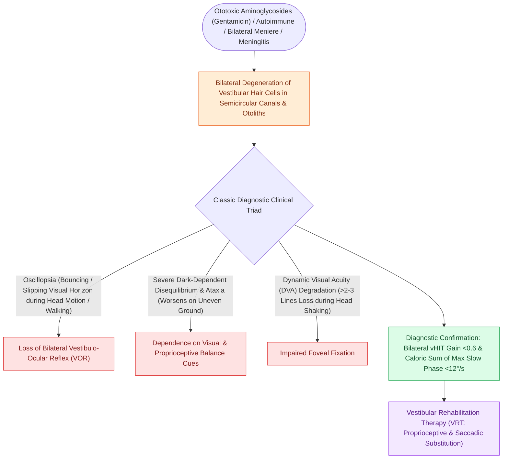

# Bilateral vestibulopathy causes oscillopsia and dark-dependent imbalance from bilateral hair cell loss

## Active Recall

> [!question]- Why do bilateral vestibulopathy patients lack spinning vertigo?
> *Answer / Clinical Rationale*: Vertigo requires left-right asymmetry; symmetric bilateral loss produces imbalance and oscillopsia without a rotational error signal.

> [!question]- Which bedside test quantifies the functional VOR deficit?
> *Answer / Clinical Rationale*: Dynamic visual acuity — loss of several optotype lines during head oscillation versus static acuity.

## Core Clinical & Mechanistic Principles
- Two complaints define it: **oscillopsia with head movement** (the world bounces while walking — a failed VOR) and **imbalance that collapses in darkness or on soft ground**, when the visual and somatosensory crutches are removed.
- Leading causes: **[[Platinum and aminoglycoside ototoxicity mandates baseline and serial high-frequency audiometric monitoring|aminoglycoside vestibulotoxicity]]** (gentamicin), bilateral Meniere, bilateral neuritis/autoimmune, and idiopathic age-related decline; sequential unilateral insults sum to the same syndrome.
- Bedside: dynamic visual acuity drops several lines with head shaking; head impulse abnormal both directions; caloric and vHIT confirm bilaterally reduced gains.
- Notably vertigo-free at steady state — symmetric loss produces no asymmetric error signal, so patients report unsteadiness, not spinning.

### Management & Critical Safety Checks
- No pharmacologic fix exists: management is [[Vestibular rehabilitation exploits adaptation habituation and substitution to recalibrate gaze and posture|vestibular rehabilitation]] emphasizing **substitution** (saccadic and somatosensory strategies), fall-proofing, and absolute avoidance of vestibular suppressants and further ototoxins.
- Counsel on driving at night and swimming alone — the dark-water scenario is the classic disaster.

## Connected Concepts & Graph Traversal
- **Iatrogenic Ototoxicity**: [[Platinum and aminoglycoside ototoxicity mandates baseline and serial high-frequency audiometric monitoring|Aminoglycoside Vestibulotoxicity]]
- **Chemical Ablation Caution**: [[Intratympanic dexamethasone and gentamicin provide non-ablative and chemical ablative control of Meniere vertigo|Gentamicin Ablation Caution]]
- **Vestibular Rehabilitation**: [[Vestibular rehabilitation exploits adaptation habituation and substitution to recalibrate gaze and posture|Substitution Strategies]]
- **High-Frequency VOR Testing**: [[The video head impulse test vHIT identifies high-frequency angular vestibulo-ocular reflex deficits|vHIT Angular Gain Reductions]]
- **Low-Frequency Rotational Testing**: [[Rotary chair testing assesses low-frequency bilateral vestibular hypofunction and central compensation|Rotary Chair Evaluation]]
