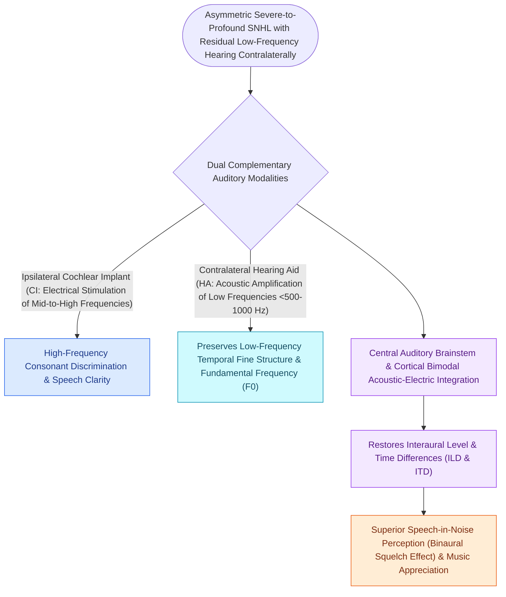

# Bimodal stimulation combines a contralateral hearing aid with an ipsilateral cochlear implant

## Active Recall

> [!question]- What complementary auditory cues are provided by the hearing aid vs. the cochlear implant in bimodal stimulation?
> *Answer / Clinical Rationale*: The hearing aid provides **low-frequency acoustic fine structure (pitch, voice melody, music)**, while the cochlear implant provides **high-frequency electric clarity (speech consonants)**.

> [!question]- What are the four classic binaural hearing phenomena restored by bimodal stimulation?
> *Answer / Clinical Rationale*: **Binaural squelch**, **binaural summation**, **elimination of the head shadow effect**, and **sound localization via ITD/ILD cues**.

## Core Clinical & Mechanistic Principles
**Bimodal stimulation** refers to the simultaneous use of a **cochlear implant (CI) in one ear** and a conventional **acoustic hearing aid (HA) in the contralateral ear**:
- **Acoustic and Electric Synergy**:
  - **Electric Stimulation (CI)**: Provides high-frequency [[Intraoperative neural response telemetry NRT confirms auditory nerve fiber stimulation|auditory]] cues, restoring consonant recognition and speech clarity.
  - **Acoustic Stimulation (HA)**: Preserves fine low-frequency spectral and temporal fine structure (fundamental frequency $F_0$, voice pitch, vowel formants, and musical timbre).
- **Binaural Advantages**:
  1. **Binaural Squelch**: The central auditory system compares signals from both ears to suppress background noise.
  2. **Binaural Summation**: Sound heard in both ears is perceived as **$3\text{–}6\text{ dB}$ louder** than monaural stimulation.
  3. **Head Shadow Effect Elimination**: Prevents the head from attenuating high-frequency sounds arriving at the non-implanted side (recovering $10\text{–}15\text{ dB}$).
  4. **Interaural Time & Level Differences (ITD / ILD)**: Enhances sound localization in horizontal space.

### Surgical Technique & Critical Safety Checks
- **Bimodal vs. Bilateral CI**: When contralateral ear has usable residual low-frequency hearing ($\le 60\text{–}70\text{ dB HL}$ at $250\text{–}500\text{ Hz}$), bimodal hearing often outperforms bilateral electric CIs for music appreciation and speech in complex noise.

## Connected Concepts & Graph Traversal
- **CI Candidacy**: [[Cochlear implant candidacy criteria include severe to profound bilateral sensorineural hearing loss|Cochlear Implant Candidacy]]
- **Intraoperative Verification**: [[Intraoperative neural response telemetry NRT confirms auditory nerve fiber stimulation|Neural Response Telemetry]]
- **Acoustic Bone Conduction**: [[Bone-anchored hearing implants BAHA stimulate the cochlea directly via bone conduction pathways|BAHA Implants]]
- **Binaural Acoustic Gain**: [[Single-sided deafness is rehabilitated via CROS hearing aids, osseointegrated bone conduction implants, and cochlear implantation|Binaural SNHL Rehabilitation]]
- **Audiometric Verification**: [[Hearing aid selection is driven by audiometric configuration and verified with real-ear measurement|Real-Ear Verification for Hearing Aids]]
