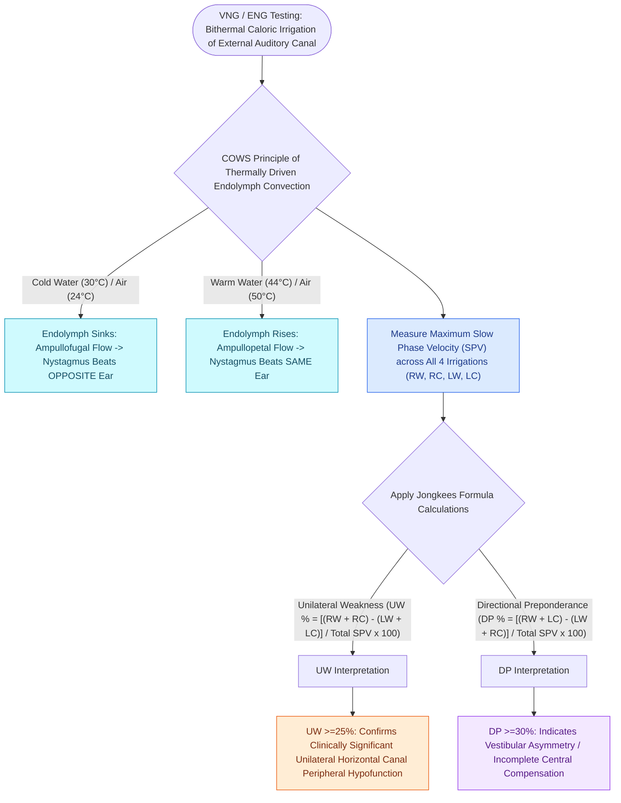

# Bithermal caloric testing calculates Jongkees formula to quantify unilateral vestibular paresis

## Active Recall

> [!question]- What is the COWS mnemonic in caloric testing?
> *Answer / Clinical Rationale*: **Cold = Opposite, Warm = Same** (cold irrigation produces nystagmus beating to opposite ear; warm produces nystagmus beating to same ear).

> [!question]- What percentage of unilateral weakness on Jongkees formula indicates significant vestibular hypofunction?
> *Answer / Clinical Rationale*: A **unilateral weakness $\ge 25\%$**.

## Core Clinical & Mechanistic Principles
**Bithermal caloric irrigations** (part of videonystagmography / VNG) test the horizontal semicircular canal at ultra-low frequencies (**$0.003\text{ Hz}$**):
- **Mechanism (COWS Mnemonic)**:
  - **Warm Water ($44^\circ\text{C}$)** / Air ($45.5^\circ\text{C}$): Endolymph rises (ampullopetal flow) $\r\r\rightarrow$ excitation $\r\r\rightarrow$ **nystagmus beating TOWARD stimulated ear**.
  - **Cold Water ($30^\circ\text{C}$)** / Air ($27.5^\circ\text{C}$): Endolymph sinks (ampullofugal flow) $\r\r\rightarrow$ inhibition $\r\r\rightarrow$ **nystagmus beating AWAY from stimulated ear (to Opposite ear)**.
- **Jongkees Formula for Unilateral Weakness (UW)**:
  $$\text{UW (\%)} = \frac{|(R_{warm} + R_{cold}) - (L_{warm} + L_{cold})|}{R_{warm} + R_{cold} + L_{warm} + L_{cold}} \times 100$$
- **Diagnostic Criteria**:
  - **Unilateral Weakness $\ge 25\%$**: Defines clinically significant unilateral horizontal canal paresis (e.g., [[Vestibular schwannomas arise from the Schwann cell sheath of the inferior or superior vestibular nerve|vestibular schwannoma]], Meniere disease, [[Vestibular neuritis causes acute spontaneous prolonged vertigo without auditory symptoms|vestibular neuritis]]).
  - **Directional Preponderance $\ge 30\%$**: Non-specific asymmetry in right vs. left beating nystagmus.

### Surgical Technique & Critical Safety Checks
- **Bilateral Weakness**: Total slow phase eye velocity across all 4 irrigations $<12\text{–}20^\circ/\text{s}$ indicates bilateral vestibular hypofunction (mandates [[Rotary chair testing assesses low-frequency bilateral vestibular hypofunction and central compensation|rotary chair]] evaluation).

## Connected Concepts & Graph Traversal
- **Rotary Chair Low-Frequency Testing**: [[Rotary chair testing assesses low-frequency bilateral vestibular hypofunction and central compensation|Rotary Chair Diagnostics]]
- **High-Frequency Angular Testing**: [[The video head impulse test vHIT identifies high-frequency angular vestibulo-ocular reflex deficits|vHIT Testing]]
- **Fluctuating Hydrops Differential**: [[Meniere disease is characterized by episodic vertigo, fluctuating low-frequency SNHL, tinnitus, and aural fullness|Meniere Disease]]
- **Nystagmus Biophysical Laws**: [[Ewald's laws and Alexander's law govern the directional dynamics and intensity of vestibular nystagmus|Ewald Laws of Endolymph Flow]]
- **Acute Neuritis Differential**: [[Vestibular neuritis causes acute spontaneous prolonged vertigo without auditory symptoms|Vestibular Neuritis]]
