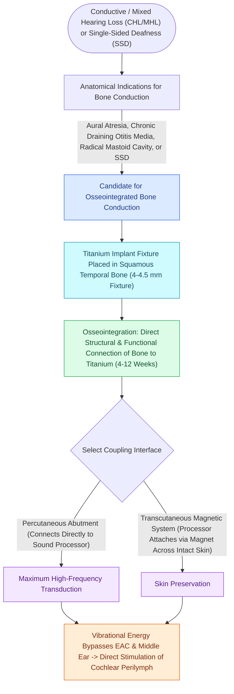

# Bone-anchored hearing implants BAHA stimulate the cochlea directly via bone conduction pathways

## Active Recall

> [!question]- Why is surgical implantation of a bone-anchored hearing aid (BAHA) contraindicated in children under five years of age?
> *Answer / Clinical Rationale*: Children $<5\text{ years}$ have **thin skull bone ($<2.5\text{–}3\text{ mm}$)** and immature diploic architecture, resulting in high rates of dural contact and failed osseointegration; they must be managed with a **non-surgical BAHA softband**.

> [!question]- What are the audiometric threshold requirements for the contralateral ear in a patient receiving a BAHA for Single-Sided Deafness (SSD)?
> *Answer / Clinical Rationale*: The contralateral normal-hearing ear must have an **air-conduction pure-tone average (AC PTA) $\le 20\text{ dB HL}$** to receive the transcranially routed acoustic signal efficiently.

## Core Clinical & Mechanistic Principles
**Bone-Anchored Hearing Implants (BAHA)** utilize osseointegrated titanium fixtures implanted into the calvarium to transmit acoustic energy directly to the cochlea via bone conduction:
- **Biomechanical Mechanism & Transcranial Routing**:
  - The external sound processor captures acoustic signals, converts them into mechanical vibrations, and drives the titanium calvarial implant.
  - Vibrations propagate through the skull bones directly to the **cochlear otic capsule**, stimulating the perilymph by fluid compression and inertial displacement, completely bypassing the external auditory canal and middle ear.
  - **Transcranial Attenuation**: Bone-conducted acoustic energy experiences approximately **$5\text{–}10\text{ dB}$ of transcranial attenuation** crossing from one side of the skull to the other.
- **Audiometric Candidacy Criteria**:
  1. **Conductive or Mixed Hearing Loss**:
     - Indicated when middle ear reconstruction fails or is contraindicated (e.g., bilateral canal atresia, chronic draining ears in CSOM, severe mixed loss).
     - **Air-Bone Gap (ABG)**: Typically $>30\text{ dB HL}$.
     - **Bone-Conduction (BC) Thresholds in Target Ear**:
       - Standard processor: $\text{BC PTA} \le 45\text{ dB HL}$.
       - Power processor: $\text{BC PTA} \le 55\text{ dB HL}$.
       - SuperPower processor: $\text{BC PTA} \le 65\text{ dB HL}$.
  2. **Single-Sided Deafness (SSD)**:
     - Profound unilateral SNHL (post-[[Vestibular schwannomas arise from the Schwann cell sheath of the inferior or superior vestibular nerve|acoustic neuroma]] resection, sudden SNHL, trauma).
     - BAHA placed on the deaf side **transcranially routes sound to the normal hearing contralateral cochlea**, eliminating the head shadow effect.
     - **Contralateral Hearing Threshold**: The good ear must have an **Air-Conduction (AC) $\text{PTA} \le 20\text{ dB HL}$**.
- **Pediatric Age Restrictions & Softband Protocol**:
  - **FDA Age Cutoff for Surgical Implantation**: **$\ge 5\text{ years of age}$**.
  - *Anatomical Rationale*: Children $<5\text{ years}$ have thin calvarial bone ($<2.5\text{–}3.0\text{ mm}$), soft diploic bone with poor mineralization, and higher risks of dural injury or failure of osseointegration.
  - *Infant & Toddler Solution*: Non-surgical **BAHA Softband or elastic headband** holds the transducer against the skull with calibrated tension to provide immediate auditory stimulation during critical speech acquisition windows.

### Surgical Technique & Critical Safety Checks
- **Surgical Fixture Placement**: The titanium fixture is placed **$5.0\text{–}6.0\text{ cm}$ posterior and superior to the external auditory canal** at a $45^\circ$ angle along the sinodural axis, ensuring clearance from pinna movement and eyeglasses.

## Connected Concepts & Graph Traversal
- **Transcutaneous BAHA Systems**: [[Transcutaneous and percutaneous bone conduction implants bypass conductive and mixed hearing losses|Transcutaneous vs Percutaneous BAHA]]
- **Cochlear Implantation Candidacy**: [[Cochlear implant candidacy criteria include severe to profound bilateral sensorineural hearing loss|Cochlear Implant Candidacy]]
- **🔗 Universal Newborn Screening (Pediatrics)**: [[Connexin 26 mutations in GJB2 and congenital CMV infection are leading causes of non-syndromic pediatric sensorineural hearing loss|Newborn Hearing Screening & JCIH 1-3-6]]
- **Vestibular Schwannoma Management**: [[Vestibular schwannomas arise from the Schwann cell sheath of the inferior or superior vestibular nerve|Acoustic Neuroma & Single-Sided Deafness]]
- **Non-Osseointegrated Implant Alternative**: [[Active middle ear implants drive ossicular vibration via floating mass transducers to rehabilitate sensorineural and mixed hearing loss without external canal occlusion|Active Middle Ear Implants]]
