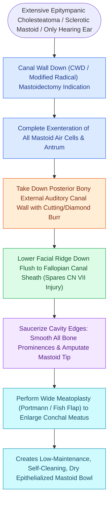

# Canal wall down mastoidectomy lowers the facial ridge and exteriorizes the mastoid into the ear canal

## Active Recall

> [!question]- Why does a "high facial ridge" cause a chronic draining (wet) mastoid cavity following CWD mastoidectomy?
> *Answer / Clinical Rationale*: It acts as a mechanical barrier creating a **dependent, unventilated sump** posteroinferiorly where moisture, mucus, and desquamated keratin accumulate, preventing complete epithelialization.

> [!question]- What are three absolute indications for performing a Canal Wall Down (CWD) mastoidectomy?
> *Answer / Clinical Rationale*: Cholesteatoma in an **only hearing ear**, presence of an extensive **lateral canal labyrinthine fistula**, and **unresectable sinus tympani matrix** that cannot be visualized or cleared.

> [!question]- What is the purpose of performing a wide conchomeatoplasty in CWD surgery?
> *Answer / Clinical Rationale*: To match the external meatal opening to the internal cavity volume, **ensuring laminar aeration, humidity evaporation, and in-office cleaning access**.

## Core Clinical & Mechanistic Principles
**Canal Wall Down (CWD / Modified Radical / Radical) Mastoidectomy** converts the mastoid, epitympanum, and external auditory canal into a single exteriorized, self-cleaning cavity:

- **The Relational Decision Inputs**:
  - **Unresectable Sinus Tympani Disease**: Cholesteatoma matrix extending deep into the posterior sinus tympani medial to the descending facial nerve that cannot be cleared even with 45°/70° endoscopes.
  - **Labyrinthine Fistula on an Only-Hearing Ear**: Matrix over a large lateral semicircular canal dome fistula is exteriorized and left in situ as a protective epithelial barrier, avoiding labyrinthine evulsion and deafness.
  - **Extensive Posterior Canal Wall Destruction**: [[Auto-mastoidectomy occurs when chronic expansive cholesteatoma exteriorizes spontaneously into the canal|Natural exteriorization]] (auto-mastoidectomy) or massive erosion by expansive cholesteatoma.

- **The Three Pillars & The Sump Rule**:
  1. **Lowering the Facial Ridge (The Sump Rule)**:
     - The **facial ridge** (the bony bridge overlying the descending mastoid segment of [[The facial nerve traverses six distinct anatomical segments from the pons to the parotid gland|CN VII]]) must be lowered with diamond burrs **flush with the plane of the nerve sheath**.
     - *Pathophysiological Failure Mode*: A **high facial ridge** acts as a dam, creating an isolated, dependent, poorly ventilated posteroinferior recess (the "sump") that collects desquamated keratin, prevents mucosal epithelialization, and produces the **chronic wet cavity** syndrome.
  2. **Complete Saucerization & Tip Amputation**: Drill all peripheral air cell tracts down to smooth, beveled dural and sinus plates; amputate or completely hollow out the mastoid tip to prevent dependent retention.
  3. **Calibrated Conchomeatoplasty**: Perform an aggressive conchomeatoplasty (excising conchal cartilage and creating a wide, epithelialized meatus proportional to the total volume of the cavity). An undersized meatus impedes air circulation and humidity evaporation, causing persistent weeping.

### Surgical Technique & Critical Safety Checks
- **Facial Nerve Protection During Ridge Lowering**: Use large diamond burrs running strictly parallel to the vertical facial nerve with continuous cold saline irrigation; never use cutting burrs over the nerve.

## Connected Concepts & Graph Traversal
- **Facial Nerve Aphorisms**: [[The facial nerve traverses six distinct anatomical segments from the pons to the parotid gland|CN VII Intratemporal Ledger]]
- **Otic Capsule Foundation**: [[The otic capsule is an immutable endochondral bone that provides fixed surgical reference landmarks|Otic Capsule Invariant]]
- **Cortical Mastoidectomy**: [[Complete cortical mastoidectomy unroofs the mastoid antrum and establishes dependent middle ear drainage|Mastoidectomy Gate Sequence]]
- **Labyrinthine Fistula**: [[Labyrinthine fistula from cholesteatoma erosions most frequently involves the lateral semicircular canal|Labyrinthine Fistula Management]]
- **Endoscopic Sorter**: [[Transcanal endoscopic ear surgery TEES provides line-of-sight visualization into the sinus tympani and epitympanum|TEES in Sinus Tympani]]
- **Facial Ridge Lowering**: [[Lowering the facial ridge flush with the facial nerve is essential to prevent dependent cavity pooling|Facial Ridge Lowering & Sump Rule]]
- **Canal Wall Up Alternative**: [[Canal wall up mastoidectomy preserves the posterior bony external auditory canal wall|Canal Wall Up Mastoidectomy]]
