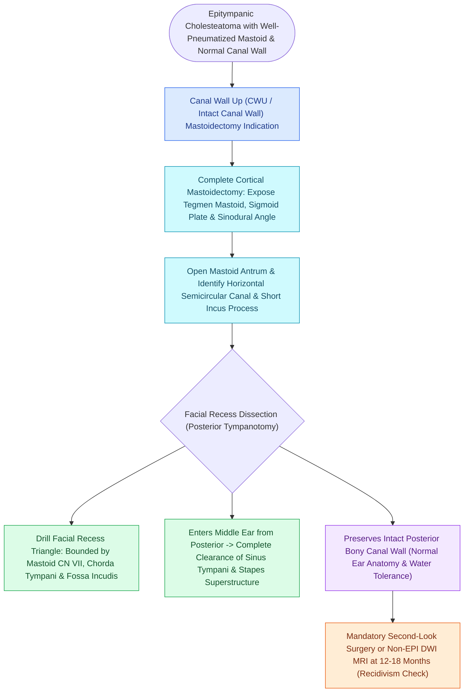

# Canal wall up mastoidectomy preserves the posterior bony external auditory canal wall

## Active Recall

> [!question]- What is the primary oncologic disadvantage of a Canal Wall Up (CWU) mastoidectomy?
> *Answer / Clinical Rationale*: A significantly higher **recidivism rate ($20\text{–}35\%$)** compared to canal wall down procedures, necessitating planned second-look surgery or MRI surveillance.

> [!question]- What are the main quality-of-life benefits of a CWU mastoidectomy?
> *Answer / Clinical Rationale*: **Normal ear canal anatomy**, **no mastoid bowl to clean**, and **freedom to swim without water precautions**.

## Core Clinical & Mechanistic Principles
**Canal Wall Up (CWU / Intact Canal Wall) Mastoidectomy** preserves the posterior and superior bony external auditory canal walls during cholesteatoma eradication:
- **Major Clinical Advantages**:
  - Maintains normal external ear canal anatomy and physiology.
  - No open cavity to clean; patients can swim and shower without earplugs (water-tolerant).
  - Facilitates standard hearing aid fitting and optimal acoustic resonance.
- **Major Disadvantages & Limitations**:
  - **Higher Recidivism Rate ($20\text{–}35\%$)**:
    - *Residual Cholesteatoma*: Microscopic squamous cells left behind in blind spots (sinus tympani, anterior epitympanum).
    - *Recurrent Cholesteatoma*: Continued [[Eustachian tube dysfunction divides into dilatory and patulous forms with opposite treatment goals|Eustachian tube dysfunction]] causes a new retraction pocket in the reconstructed attic.
- **The Mandatory Second-Look Protocol**:
  - Because the intact canal wall prevents direct visual inspection of the mastoid and attic, patients require **[[Second-look surgery or non-EPI DWI MRI is indicated twelve to eighteen months after canal wall up mastoidectomy|second-look surgery]] or non-echo-planar DWI MRI at 12–18 months**.

### Surgical Technique & Critical Safety Checks
- **Facial Recess Opening**: Combined with [[Posterior tympanotomy facial recess approach opens the corridor between CN VII and chorda tympani|posterior tympanotomy]] to access the middle ear from behind while keeping the bony bridge intact.

## Connected Concepts & Graph Traversal
- **CWD Master Alternative**: [[Canal wall down mastoidectomy lowers the facial ridge and exteriorizes the mastoid into the ear canal|Canal Wall Down Mastoidectomy]]
- **Second-Look Surveillance**: [[Second-look surgery or non-EPI DWI MRI is indicated twelve to eighteen months after canal wall up mastoidectomy|Second-Look Surgery & Non-EPI MRI]]
- **Surgical Keyhole Corridor**: [[Posterior tympanotomy facial recess approach opens the corridor between CN VII and chorda tympani|Facial Recess Posterior Tympanotomy]]
- **Cortical Mastoid Foundation**: [[Complete cortical mastoidectomy unroofs the mastoid antrum and establishes dependent middle ear drainage|Cortical Mastoid Landmarks]]
- **Disease Pathology**: [[Primary acquired cholesteatoma arises from retraction pocket invagination of the pars flaccida into Prussak space|Prussak Space Retraction Cholesteatoma]]
