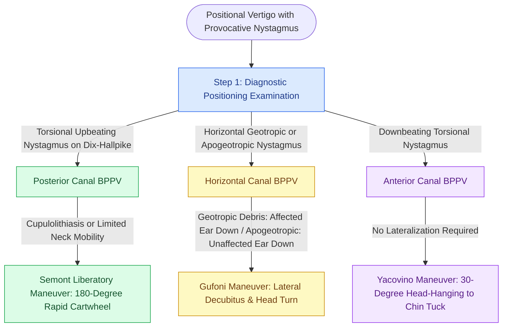

# Canalith repositioning maneuvers for atypical and refractory BPPV employ the Semont, Gufoni, and Yacovino maneuvers to clear debris from horizontal and vertical semicircular canals

## Active Recall

> [!question]- Why is the Semont liberatory maneuver uniquely indicated over the Epley maneuver in cases of posterior canal cupulolithiasis?
> *Answer / Clinical Rationale*: While the Epley maneuver relies on slow, gravity-dependent rolling of free-floating canalithiasis debris around the canal lumen, the Semont liberatory maneuver employs a rapid 180-degree cartwheel swing of the patient's torso from the affected side to the unaffected side. The abrupt deceleration at the terminal position generates strong inertial and centrifugal forces that detach otoconia directly adhered to the cupula (cupulolithiasis), converting it into free-floating debris that drops into the utricle.
>
> [!question]- How does the Gufoni maneuver differentiate treatment between geotropic and apogeotropic horizontal canal BPPV?
> *Answer / Clinical Rationale*: In horizontal canal BPPV, geotropic nystagmus indicates canalithiasis in the posterior arm of the lateral canal, treated by taking the patient to the unaffected side in lateral decubitus and turning the head 45 degrees downward toward the floor. Apogeotropic nystagmus indicates cupulolithiasis or canalithiasis in the anterior arm near the ampulla, treated by taking the patient to the affected side in lateral decubitus and turning the head 45 degrees upward or downward to free debris toward the utricle.

## Core Clinical & Mechanistic Principles

Benign paroxysmal positional vertigo (BPPV) represents the single most common cause of peripheral vestibular vertigo. While classic posterior semicircular canal canalithiasis is reliably identified by [[The Dix-Hallpike maneuver produces torsional upbeating nystagmus in posterior canal BPPV|Dix-Hallpike testing]] and cleared with the [[The Epley particle repositioning maneuver clears otoconia from the posterior canal into the utricle|Epley maneuver]], up to 15% to 20% of patients present with atypical variants, refractory cupulolithiasis, or horizontal/anterior semicircular canal involvement. Standard Epley repositioning fails in these scenarios and can induce canalith jam or iatrogenic canal conversion.

For posterior canal cupulolithiasis—characterized by persistent, non-fatiguing torsional upbeating nystagmus without latency—the **Semont Liberatory Maneuver** is the premier mechanical intervention. The patient begins seated, turns their head 45 degrees toward the *unaffected* ear, is rapidly taken onto the *affected* side (looking up at 45 degrees), held for 2 minutes, and then forcefully swung through a 180-degree arc into the contralateral lateral decubitus position (looking down at the examination table) in less than 1.5 seconds. The sudden deceleration as the contralateral shoulder strikes the bed provides the necessary kinetic momentum to break otolithic adhesions off the cupular gelatin.

Horizontal canal BPPV, diagnosed with the [[Horizontal canal BPPV is diagnosed with the supine roll test and treated with the Lempert barbecue maneuver|supine roll test]], requires canal-specific repositioning. When patients cannot tolerate the full 360-degree rotational roll of the Lempert barbecue maneuver due to severe cervical arthrosis or morbid obesity, the **Gufoni Maneuver** provides an elegant, highly effective alternative requiring minimal neck manipulation. Similarly, anterior semicircular canal BPPV (downbeating positional nystagmus) is addressed via the **Yacovino Maneuver**, which relies on deep head hanging in the sagittal midline, eliminating the need to identify the affected lateralizing ear.

### Execution Protocol for Specialized Maneuvers

1. **Semont Maneuver for Right Posterior Canal**:
   - Patient seated upright, head rotated 45 degrees to the *left*.
   - Quickly drop patient onto right side (facing ceiling); hold for 2 minutes.
   - Rapidly move patient through sitting to left lateral decubitus (facing floor) in under 1.5 seconds; hold for 2 minutes.
   - Slowly return patient to upright sitting position.
2. **Gufoni Maneuver for Geotropic Lateral Canal (Left Ear)**:
   - Patient seated upright on examination couch.
   - Quickly move patient onto the *healthy* (right) side into lateral decubitus; maintain for 2 minutes.
   - Quickly rotate patient's head 45 degrees downward toward the table; maintain for 2 minutes.
   - Return patient to seated position with head tilted forward.
3. **Yacovino Maneuver for Anterior Canal**:
   - Patient seated upright facing straight ahead.
   - Move patient rapidly straight back into head-hanging position at least 30 degrees below horizontal; hold for 60 seconds.
   - Briskly flex neck to bring chin directly to chest (30 degrees above horizontal) while still supine; hold for 60 seconds.
   - Return patient to upright seated position with chin maintained on chest.

## Connected Concepts & Graph Traversal
- **Pathophysiological Basis**: [[Benign paroxysmal positional vertigo BPPV results from canalithiasis or cupulolithiasis in semicircular canals]]
- **Physiological Basis**: [[Ewald's laws and Alexander's law govern the directional dynamics and intensity of vestibular nystagmus]]
- **Diagnostic Maneuver**: [[Horizontal canal BPPV is diagnosed with the supine roll test and treated with the Lempert barbecue maneuver]]
- **Provocative Testing**: [[The Dix-Hallpike maneuver produces torsional upbeating nystagmus in posterior canal BPPV]]
- **Rehabilitation Adjunct**: [[Vestibular rehabilitation exploits adaptation habituation and substitution to recalibrate gaze and posture]]
