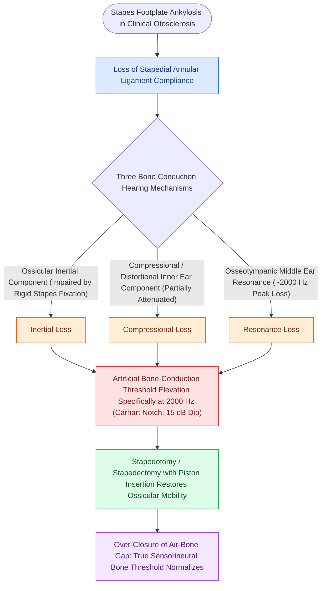

# Carhart notch presents as an artificial bone-conduction dip at two thousand Hertz in stapes fixation

## Active Recall

> [!question]- At what audiometric frequency is the Carhart notch deepest in patients with otosclerosis?
> *Answer / Clinical Rationale*: At **$2,000\text{ Hz}$** (demonstrating an artificial $\approx 15\text{-dB}$ bone-conduction threshold elevation).

> [!question]- Why does the Carhart notch occur in stapes fixation?
> *Answer / Clinical Rationale*: Because stapes ankylosis **abolishes the inertial component of bone conduction** (which resonates maximally at $2\text{ kHz}$).

## Core Clinical & Mechanistic Principles
The **Carhart notch** is a pathognomonic audiometric phenomenon observed in patients with stapes footplate fixation ([[Otosclerosis is characterized by abnormal bone remodeling of the otic capsule causing stapes fixation|otosclerosis]]):
- **Audiometric Manifestation**:
  - A characteristic **apparent elevation (worsening) of bone-conduction (BC) thresholds**, with a maximum dip centered specifically at **$2,000\text{ Hz}$** ($5\text{ dB}$ at $500\text{ Hz}$, $10\text{ dB}$ at $1,000\text{ Hz}$, **$15\text{ dB}$ at $2,000\text{ Hz}$**, $5\text{ dB}$ at $4,000\text{ Hz}$).
- **The "Mechanical Artifact" Pathophysiology**:
  - Normal bone-conduction hearing is composed of three distinct mechanisms:
    1. **Inertial Component**: Skull vibration causes the ossicular chain to lag behind due to inertia, driving the stapes in and out of the oval window (dominant at $1\text{–}2\text{ kHz}$).
    2. **Compressional Component**: Skull vibrations compress the cochlear capsule directly, displacing fluid.
    3. **Osseotympanic Component**: Vibrations of the bony canal radiate into the air canal.
  - **Stapes Ankylosis abolishes the Inertial Ossicular Component**: The fixed stapes cannot vibrate relative to the skull, artificially elevating the bone conduction threshold at the resonant frequency of the ossicular chain ($2,000\text{ Hz}$).

### Surgical Technique & Critical Safety Checks
- **Postoperative Resolution**: Following successful stapedotomy/[[Stapedotomy utilizes a micro-drill or laser fenestration of the posterior footplate|stapedectomy]], the inertial ossicular mechanism is restored, and the **Carhart notch completely resolves (recovering 10–15 dB of bone conduction)**.

## Connected Concepts & Graph Traversal
- **Otosclerosis Pathology**: [[Otosclerosis is characterized by abnormal bone remodeling of the otic capsule causing stapes fixation|Otosclerosis Footplate Pathology]]
- **Definitive Surgical Repair**: [[Stapedotomy utilizes a micro-drill or laser fenestration of the posterior footplate|Stapedotomy Micro-Fenestration]]
- **Audiometric Masking Validation**: [[Audiometric masking with the plateau method prevents shadow responses from the non-test ear|Hood Plateau Masking]]
- **Middle Ear Transformer Physics**: [[The middle ear transformer ratio provides twenty-seven decibels of acoustic impedance matching|Middle Ear Transformer Ratio]]
- **Tuning Fork Evaluation**: [[Tuning fork tests utilize the 512-Hertz fork to differentiate conductive from sensorineural hearing loss via Weber and Rinne tests|Weber & Rinne Fork Tests]]
