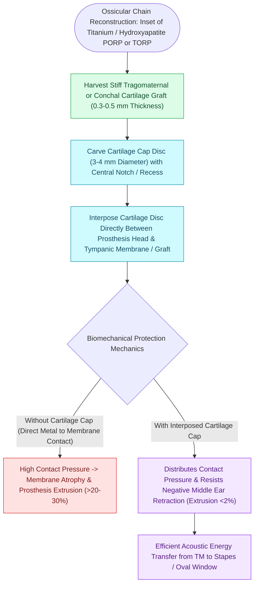

# Cartilage interposition over ossicular prostheses prevents extrusion through the tympanic membrane

## Active Recall

> [!question]- Why is a cartilage shield placed over alloplastic ossicular prostheses?
> *Answer / Clinical Rationale*: To distribute pressure and provide a biological barrier, preventing **pressure necrosis of the TM and prosthesis extrusion**.

> [!question]- How far should the cartilage graft extend relative to the head plate of the prosthesis?
> *Answer / Clinical Rationale*: It should **overlap the edges of the head plate by at least $1.0\text{–}2.0\text{ mm}$** in all directions.

## Core Clinical & Mechanistic Principles
Placing a rigid **cartilage interposition graft (cartilage shield)** between an alloplastic ossicular prosthesis ([[Partial ossicular replacement prosthesis PORP requires an intact and mobile stapes superstructure|PORP]], TORP, or hydroxyapatite) and the tympanic membrane is mandatory to prevent extrusion:
- **Mechanism of Prosthesis Extrusion**:
  - The vibrating tympanic membrane is thin ($0.1\text{ mm}$) and constantly subjected to atmospheric pressure changes, mucosal retraction, and epithelial migration.
  - Direct contact between hard synthetic biomaterials (titanium, plastipore, ceramic) and the tympanic membrane causes focal pressure necrosis of the fibrous layer, leading to **erosion and extrusion in $10\text{–}30\%$ of cases** without cartilage.
- **The Cartilage Shield Principle**:
  - A disc of tragal or conchal cartilage ($0.2\text{–}0.5\text{ mm}$ thickness) is harvested and sized to **completely overlap the edges of the prosthesis head plate by at least $1.0\text{–}2.0\text{ mm}$**.
  - Distributes contact pressure over a broad surface area and provides a biological collagenous barrier that resists necrosis.
  - Reduces extrusion rates to **$<1.5\text{–}2.0\%$** over 10-year follow-up.

### Surgical Technique & Critical Safety Checks
- **Acoustic Impact**: When thinned to $<0.5\text{ mm}$, the mass of the cartilage adds minimal acoustic damping, preserving high-frequency hearing transmission.

## Connected Concepts & Graph Traversal
- **Partial Prosthetic Reconstruction**: [[Partial ossicular replacement prosthesis PORP requires an intact and mobile stapes superstructure|PORP Reconstruction]]
- **Total Prosthetic Reconstruction**: [[Total ossicular replacement prosthesis TORP bridges the malleus or tympanic membrane to the stapes footplate|TORP Reconstruction]]
- **Cartilage Graft Stiffening**: [[Cartilage island tympanoplasty resists negative middle ear pressure and recurrent retraction|Cartilage Island Tympanoplasty]]
- **Ossicular Classification**: [[The Austin-Kartush classification categorizes ossicular chain defects based on the presence of the malleus handle and stapes arch|Austin-Kartush Classification]]
- **Fascial Grafting Technique**: [[Underlay and overlay tympanoplasty techniques have distinct advantages and complication profiles|Underlay vs Overlay Grafting]]
