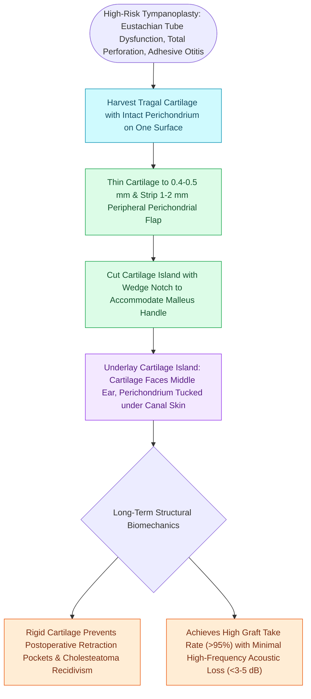

# Cartilage island tympanoplasty resists negative middle ear pressure and recurrent retraction

## Active Recall

> [!question]- What is the target thickness for a cartilage island graft to optimize acoustic transmission while preventing retraction?
> *Answer / Clinical Rationale*: **$0.4\text{ to }0.5\text{ mm}$** of cartilage thickness.

> [!question]- Why is cartilage superior to temporalis fascia in patients with severe Eustachian tube dysfunction?
> *Answer / Clinical Rationale*: Because its rigid extracellular matrix **resists retraction and resorption under persistent negative middle ear pressure**.

## Core Clinical & Mechanistic Principles
**Cartilage tympanoplasty** (utilizing tragal or conchal cartilage) provides rigid structural support to prevent recurrent tympanic membrane retraction, atelectasis, and reperforation:
- **Biomechanical Properties**:
  - Cartilage is nourished by diffusion (bradytrophic tissue), surviving in poorly vascularized beds and severe middle ear atelectasis.
  - Highly resistant to infection, enzymatic degradation by collagenases, and negative middle ear pressure from [[Eustachian tube dysfunction divides into dilatory and patulous forms with opposite treatment goals|Eustachian tube dysfunction]].
- **Indications**:
  - Recurrent or adhesive atelectasis / retraction pockets.
  - Revision tympanoplasty with prior fascia graft failure.
  - Total or subtotal perforations with severe Eustachian tube dysfunction.
  - Cholesteatoma reconstruction of the scutum / posterosuperior quadrant.
- **Graft Preparation Techniques**:
  - **Cartilage-Perichondrium Island (Dornhoffer Technique)**: Tragal cartilage thinned to **$0.4\text{–}0.5\text{ mm}$** with a cartilage slicer; a wedge is excised for the malleus handle; attached perichondrial flap unrolls onto the canal wall.
  - **Palisade / Mosaic Technique**: Cartilage cut into parallel strips and placed side-by-side like a fence.

### Surgical Technique & Critical Safety Checks
- **Acoustic Performance**: Cartilage thinned to **$<0.5\text{ mm}$** provides acoustic impedance and vibratory characteristics nearly identical to temporalis fascia, with no significant difference in postoperative air-bone gaps.

## Connected Concepts & Graph Traversal
- **Grafting Techniques**: [[Underlay and overlay tympanoplasty techniques have distinct advantages and complication profiles|Underlay vs Overlay Tympanoplasty]]
- **Acoustic Gain Dynamics**: [[The tympanic membrane areal ratio of seventeen to one provides the primary impedance gain|Tympanic Membrane Areal Ratio]]
- **Eustachian Tubal Collapse**: [[Eustachian tube dysfunction divides into dilatory and patulous forms with opposite treatment goals|Eustachian Tube Dysfunction]]
- **Retraction Pocket Pathology**: [[Primary acquired cholesteatoma arises from retraction pocket invagination of the pars flaccida into Prussak space|Pars Flaccida Retraction Pocket]]
- **Prosthetic Interposition**: [[Cartilage interposition over ossicular prostheses prevents extrusion through the tympanic membrane|Cartilage Cap for Ossiculoplasty]]
- **Sibling Cartilage Technique**: [[Cartilage palisade and butterfly inlay tympanoplasty techniques reinforce the reconstructed tympanic membrane against eustachian tubal negative pressure while preserving acoustic transmission|Palisade & Butterfly Inlay Cartilage Tympanoplasty]]
