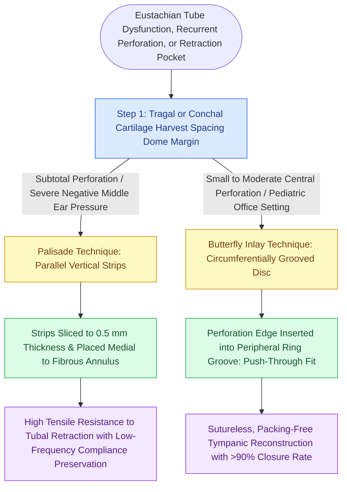

# Cartilage palisade and butterfly inlay tympanoplasty techniques reinforce the reconstructed tympanic membrane against eustachian tubal negative pressure while preserving acoustic transmission

## Active Recall

> [!question]- How does the cartilage palisade technique optimize both mechanical resistance to negative middle ear pressure and acoustic vibrational compliance?
> *Answer / Clinical Rationale*: While a solid full-thickness cartilage plate can introduce excessive acoustic mass and stiffness that dampens high-frequency vibratory transfer, the **palisade technique** utilizes parallel strips of tragal or conchal cartilage (approximately 0.5 mm thick and 1 to 1.5 mm wide) placed vertically side-by-side like a picket fence. The fibrous tissue that forms between the parallel palisades creates flexible hinge zones that allow acoustic wave flexure across speech frequencies (500 to 2000 Hz) while maintaining exceptional rigid structural resistance against eustachian-tube-driven negative middle ear pressures, preventing recurrent retraction pocket formation.
>
> [!question]- What surgical design makes the butterfly inlay cartilage tympanoplasty ideal for office-based or pediatric tympanic membrane perforations?
> *Answer / Clinical Rationale*: The butterfly inlay technique (described by Eavey) utilizes an island of tragal cartilage shaped slightly larger than the perforation, with a circumferential 360-degree groove (approximately 1 mm deep) carved into its outer cartilaginous edge between the perichondrial leaves. The graft is pushed directly into the perforation so that the deep cartilaginous leaf rests medial to the drum margin, the perichondrium rests lateral, and the perforation rim snaps securely into the groove. This creates an instantaneous, self-retaining seal without requiring tympanomeatal flap elevation, canal skin incisions, or middle ear packing.

## Core Clinical & Mechanistic Principles

Tympanoplasty using temporalis fascia or perichondrium has historically served as the gold standard for repairing tympanic membrane perforations, achieving success rates above 85% in pristine middle ear environments. However, in patients with persistent Eustachian tube dysfunction, recurrent adhesive otitis, total or subtotal perforations, or revision operations, conventional fascia grafts are vulnerable to atrophy, posterosuperior retraction pocket invagination, and re-perforation. [[Cartilage island tympanoplasty resists negative middle ear pressure and recurrent retraction|Cartilage island grafting]] addresses this challenge by providing structural rigidity that resists middle ear negative pressures.

To refine the balance between structural durability and acoustic performance, advanced cartilage techniques—specifically the **Palisade Technique** and the **Butterfly Inlay Technique**—were engineered. Traditional thick cartilage plates were criticized for producing conductive hearing deficits through excessive mass loading. Comparative laser Doppler vibrometry demonstrates that slicing cartilage to a standardized thickness of 0.4 to 0.5 mm preserves sound transmission to within 2 to 4 dB of intact fascia across the speech frequencies (500 to 2000 Hz). This preserves the crucial [[The tympanic membrane areal ratio of seventeen to one provides the primary impedance gain|areal transformer ratio]] while preventing the graft displacement observed in classic [[Underlay and overlay tympanoplasty techniques have distinct advantages and complication profiles|underlay fascia techniques]].

The **Palisade Technique** (pioneered by Tos and Heermann) segments harvested cartilage into multiple parallel vertical strips placed from the anterior fibrous annulus to the malleus handle, and from the malleus to the posterior annulus. The intervening fibrous scar bonds the palisades into a unified, non-retracting acoustic diaphragm. Conversely, the **Butterfly Inlay Technique** employs a single contoured cartilage disc with an equatorial circumferential groove. Pushing the butterfly graft directly into a freshened perforation achieves instantaneous mechanical stabilization without requiring middle ear packing or canal incisions.

### Operative Execution Protocols

1. **Tragal Cartilage Harvest**: A 1.5 cm incision is placed 2 mm medial to the dome of the tragal pointer, strictly preserving the dome cartilage to avoid cosmetic ear canal deformity. A 10 x 15 mm rectangle of cartilage with intact perichondrium is excised.
2. **Palisade Slicing and Positioning**:
   - The cartilage is stripped of perichondrium on one side and thinned to 0.5 mm using a Kurz cartilage cutter or scalpel blade.
   - The cartilage is sliced into 4 to 6 vertical strips, each 1.0 to 1.5 mm wide.
   - Following tympanomeatal flap elevation and ossicular chain mobility testing, the palisades are aligned vertically medial to the malleus handle and tympanic annulus.
   - A perichondrium graft is draped over the lateral aspect of the palisades to foster rapid epithelial migration.
3. **Butterfly Inlay Crafting**:
   - The perforation edge is freshened with a pick to expose bleeding subepithelial connective tissue.
   - Tragal cartilage with perichondrium attached to both surfaces is harvested.
   - The cartilage is shaped with a #11 blade to match the geometry of the perforation, adding 1.5 to 2.0 mm in diameter.
   - An equatorial circumferential groove (0.5 to 1.0 mm deep) is incised around the entire perimeter between the perichondrial leaves.
   - The graft is pushed into the perforation using an alligator forceps; the inner cartilaginous flange springs open medially into the middle ear while the outer flange rests laterally over the tympanic remnant, locking the graft securely in place without Gelfoam packing.

## Connected Concepts & Graph Traversal
- **Precipitating Pathology**: [[Primary acquired cholesteatoma arises from retraction pocket invagination of the pars flaccida into Prussak space]]
- **Classification System**: [[The Austin-Kartush classification categorizes ossicular chain defects based on the presence of the malleus handle and stapes arch]]
- **Reconstructive Alternative**: [[Medial underlay fascia grafting avoids anterior blunting and lateral graft displacement]]
- **Acoustic Biomechanics**: [[The middle ear transformer ratio provides twenty-seven decibels of acoustic impedance matching]]
- **Extrusion Safeguard**: [[Cartilage interposition over ossicular prostheses prevents extrusion through the tympanic membrane]]
