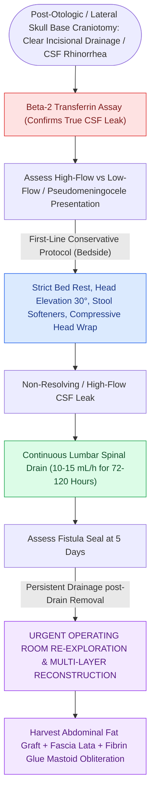

# Cerebrospinal fluid CSF leak and pseudomeningocele require lumbar drainage, fat obliteration, and re-exploration

## Active Recall

> [!question]- What diagnostic biochemical test definitively confirms that clear fluid draining from the ear or nose is cerebrospinal fluid?
> *Answer / Clinical Rationale*: **Beta-2 transferrin assay** (or Beta-trace protein).

> [!question]- What is the first-line interventional procedure for managing a postoperative lateral skull base CSF leak?
> *Answer / Clinical Rationale*: Placement of a **continuous lumbar subarachnoid drain** (diverting $10\text{–}15\text{ mL/hr}$ for 3–5 days).

## Core Clinical & Mechanistic Principles
**Cerebrospinal fluid (CSF) fistula** occurs in $5\text{–}10\%$ of lateral skull base surgical procedures ([[The translabyrinthine approach provides direct exposure of the internal auditory canal with complete hearing sacrifice|translabyrinthine]], retrosigmoid, MCF), carrying a high risk of bacterial meningitis:
- **Clinical Presentation Forms**:
  - **CSF Otorrhea**: Leakage of clear watery fluid through the postauricular incision or external auditory canal.
  - **CSF Rhinorrhea**: Fluid tracking from the mastoid/IAC through the middle ear and **Eustachian tube into the nasopharynx** (presents as salty taste in throat or clear nasal drip upon leaning forward).
  - **Pseudomeningocele**: Fluctuant, ballottable subcutaneous fluid collection under the postauricular skin flap.
- **Stepwise Treatment Algorithm**:
  1. **Conservative Management (First 48–72 Hours)**:
     - Strict bed rest with head of bed elevated $30\text{–}45^\circ$, avoidance of straining/Valsalva, stool softeners, compressive pressure dressing.
     - **Continuous Lumbar Subarachnoid Drainage**: Divert CSF at **$10\text{–}15\text{ mL/hr}$ (150–250 mL/day)** for 3–5 days to lower hydrostatic pressure and allow the dural seal to heal. Successfully resolves $>70\text{–}80\%$ of leaks.
  2. **Surgical Re-exploration**:
     - Indicated if leak persists $>4\text{–}5\text{ days}$ or in high-volume leaks.
     - Reopen wound; identify dural breach; pack mastoid/IAC with **fresh autologous abdominal adipose fat graft**, fascia lata, and vascularized muscle flap; seal with fibrin glue and tight multilayer closure.

### Surgical Technique & Critical Safety Checks
- **Beta-2 Transferrin Assay**: The gold standard diagnostic laboratory test to confirm suspected fluid is CSF (highly specific for CSF/perilymph).

## Connected Concepts & Graph Traversal
- **Translabyrinthine Route Leak**: [[The translabyrinthine approach provides direct exposure of the internal auditory canal with complete hearing sacrifice|Translabyrinthine Approach]]
- **Retrosigmoid Route Leak**: [[The retrosigmoid suboccipital approach allows hearing preservation for small to medium vestibular schwannomas|Retrosigmoid Approach]]
- **Tegmen Dehiscence Repair**: [[Spontaneous CSF otorrhea from tegmen dehiscence requires multilayer middle fossa or transmastoid repair|Tegmen Middle Fossa Repair]]
- **🔗 Biochemical Confirmation (Sinus)**: [[Beta-2 transferrin and high-resolution CT localize sinonasal CSF fistulas|Beta-2 Transferrin Assay]]
- **🔗 Spontaneous IIH Overlap (Sinus)**: [[Spontaneous CSF leaks are strongly associated with idiopathic intracranial hypertension and elevated BMI|Spontaneous Leaks & IIH]]
