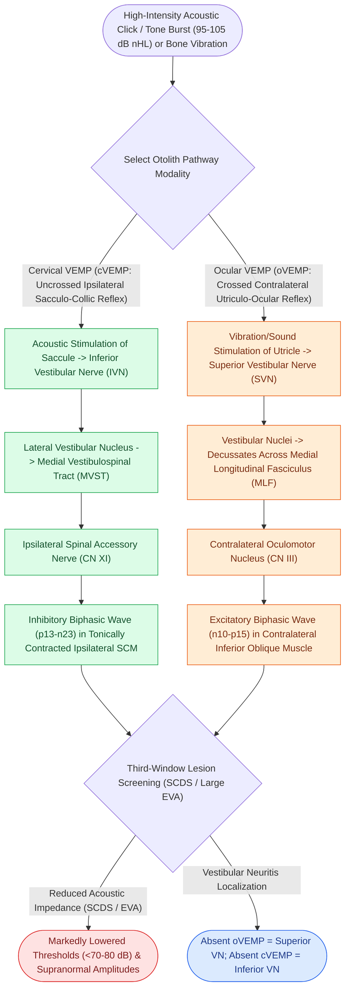

# Cervical and ocular vestibular evoked myogenic potentials test saccular and utricular otolith function

## Active Recall

> [!question]- Which otolith organ and vestibular nerve branch are evaluated by cVEMP vs. oVEMP?
> *Answer / Clinical Rationale*: **cVEMP evaluates the Saccule and Inferior Vestibular Nerve**; **oVEMP evaluates the Utricle and Superior Vestibular Nerve**.

> [!question]- What VEMP finding is pathognomonic for Superior Semicircular Canal Dehiscence (SCDS)?
> *Answer / Clinical Rationale*: **Pathologically lowered threshold ($<70\text{–}80\text{ dB nHL}$)** and abnormally large peak amplitudes.

## Core Clinical & Mechanistic Principles
**Vestibular Evoked Myogenic Potentials (VEMPs)** provide frequency-specific, non-invasive assessment of the otolith organs and their corresponding vestibular nerve branches:
- **Anatomical Complementarity**:
  - **Cervical VEMP (cVEMP)**: Tests the **Saccule** and **Inferior Vestibular Nerve (IVN)** via an uncrossed inhibitory reflex to the ipsilateral sternocleidomastoid (SCM) muscle.
  - **Ocular VEMP (oVEMP)**: Tests the **Utricle** and **Superior Vestibular Nerve (SVN)** via a crossed excitatory reflex to the contralateral inferior oblique (IO) extraocular muscle.
- **Acoustic Activation of Otoliths**:
  - High-intensity acoustic clicks or $500\text{-Hz}$ tone bursts ($95\text{–}100\text{ dB nHL}$) vibrate fluid across the maculae, triggering otolith firing.

### Surgical Technique & Critical Safety Checks
- **Third Mobile Window Phenomenon**: In Superior Semicircular Canal Dehiscence ([[Superior semicircular canal dehiscence SCDS presents with Tullio phenomenon and sound-induced vertigo|SCDS]]), acoustic impedance is lowered, producing **pathologically reduced VEMP thresholds ($<70\text{–}80\text{ dB nHL}$)** and massive amplitudes.

## Connected Concepts & Graph Traversal
- **Saccular Diagnostic Mechanics**: [[cVEMP evaluates the saccule and inferior vestibular nerve via uncrossed sternocleidomastoid inhibition|cVEMP Mechanics]]
- **Utricular Diagnostic Mechanics**: [[oVEMP evaluates the utricle and superior vestibular nerve via crossed inferior oblique excitation|oVEMP Mechanics]]
- **Third-Window Acoustic Sensitivity**: [[Superior semicircular canal dehiscence SCDS presents with Tullio phenomenon and sound-induced vertigo|SCDS Third-Window Sound Evocation]]
- **Fluctuating Hydrops Staging**: [[Electrocochleography SP to AP ratio exceeding zero point four indicates endolymphatic hydrops|ECoG in Endolymphatic Hydrops]]
- **Vestibular Neuritis Localization**: [[Vestibular neuritis causes acute spontaneous prolonged vertigo without auditory symptoms|Superior vs Inferior Vestibular Neuritis]]
