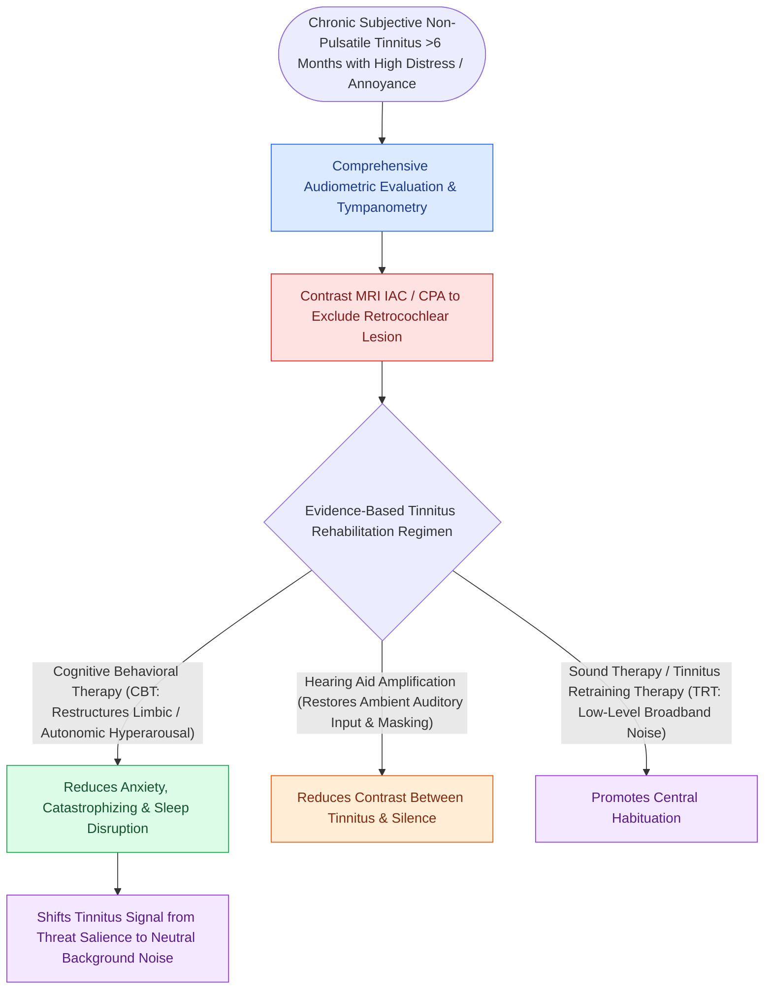

# Chronic subjective tinnitus is managed with cognitive behavioral and sound-based therapy rather than cure

## Active Recall

> [!question]- Why is CBT the best-evidenced tinnitus treatment when it does not change the percept?
> *Answer / Clinical Rationale*: Because morbidity lives in the limbic and attentional response; CBT reduces distress and functional impact, the actual disease burden.

> [!question]- Name the two tinnitus characteristics that trigger objective workup pathways.
> *Answer / Clinical Rationale*: Unilateral tinnitus with asymmetric SNHL (retrocochlear imaging) and pulsatile tinnitus (vascular evaluation).

## Core Clinical & Mechanistic Principles
- Model: peripheral deafferentation (usually high-frequency hearing loss) drives central gain increase and limbic coupling — tinnitus is a brain phenomenon wearing an ear's clothes, which is why sectioning the nerve does not silence it.
- Evidence hierarchy: **cognitive behavioral therapy has the strongest evidence** for distress reduction; sound therapy/masking and [[Hearing aid selection is driven by audiometric configuration and verified with real-ear measurement|hearing aids]] (which treat the deafferentation) help; no medication treats tinnitus itself.
- Red flags routing out of 'chronic subjective': unilateral tinnitus with asymmetric SNHL (retrocochlear workup), pulsatile character (vascular workup), and tinnitus with new neurologic signs.
- Screen what tinnitus does to the patient: sleep disruption, anxiety, depression — severity indices (THI) track the suffering, not the sound.

### Management & Critical Safety Checks
- First visit deliverables: audiogram, red-flag triage, and an honest frame — management targets the reaction and the audibility, and most patients habituate substantially.
- Amplification is dual-purpose in tinnitus with hearing loss: it treats the loss and masks/de-afferents the generator.

## Connected Concepts & Graph Traversal
- **Pulsatile Workup Differential**: [[Pulsatile tinnitus is differentiated into arterial and venous etiologies by auscultation, jugular compression, and targeted vascular imaging|Pulsatile Tinnitus Workup]]
- **Retrocochlear Screening**: [[Auditory brainstem response waves I through V identify retrocochlear and brainstem pathology|ABR Retrocochlear Screening]]
- **Acoustic Masking Amplification**: [[Hearing aid selection is driven by audiometric configuration and verified with real-ear measurement|Amplification for Tinnitus]]
- **High-Frequency SNHL Etiology**: [[Presbycusis produces symmetric high-frequency sensorineural loss with disproportionate speech-in-noise decline|Presbycusis Sensory Loss]]
- **Vestibular Schwannoma Presentation**: [[Vestibular schwannomas arise from the Schwann cell sheath of the inferior or superior vestibular nerve|Unilateral Tinnitus in CPA Tumors]]
