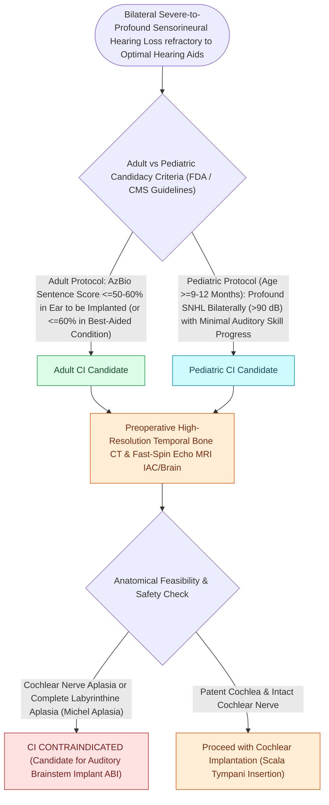

# Cochlear implant candidacy criteria include severe to profound bilateral sensorineural hearing loss

## Active Recall

> [!question]- What is the Medicare / CMS AzBio sentence recognition threshold for adult cochlear implant candidacy?
> *Answer / Clinical Rationale*: An **AzBio sentence recognition score $\le 60\%$** in the best-aided condition.

> [!question]- What is the minimum FDA-approved age for cochlear implantation in infants with profound bilateral sensorineural hearing loss?
> *Answer / Clinical Rationale*: **9 months of age** (with evidence of failure of auditory milestone development with hearing aids).

## Core Clinical & Mechanistic Principles
**Cochlear Implantation (CI)** bypasses damaged or absent inner ear hair cells to directly stimulate the spiral ganglion cells of the auditory nerve electrically:
- **Adult Candidacy Criteria (FDA & CMS / Medicare Guidelines)**:
  - **Audiometric Thresholds**: Moderate-to-profound (or severe-to-profound) bilateral sensorineural hearing loss.
  - **Speech Discrimination Scores (in Best-Aided Condition)**:
    - *Traditional FDA Criteria*: $\le 50\%$ sentence recognition in the ear to be implanted and $\le 60\%$ in the contralateral ear / binaural condition on open-set sentence testing (HINT / AzBio).
    - *CMS / Medicare (2022 Expanded Criteria)*: **$\le 60\%$ on AzBio sentence testing in quiet or noise**.
  - Limited benefit from properly fitted bilateral [[Hearing aid selection is driven by audiometric configuration and verified with real-ear measurement|hearing aids]].
- **Pediatric Candidacy Criteria**:
  - **Infants (9 to 24 Months)**: Bilateral profound SNHL ($\ge 90\text{ dB HL}$); lack of auditory skill progression with hearing aids.
  - **Children (2 to 17 Years)**: Bilateral severe-to-profound SNHL; **$\le 30\%$ on open-set word/sentence testing (PBK / MLNT / LNT)**.

### Surgical Technique & Critical Safety Checks
- **Expanded Indications**: Single-Sided Deafness (SSD), asymmetric hearing loss, and hybrid / electro-acoustic stimulation (EAS) for preserved low-frequency hearing.

## Connected Concepts & Graph Traversal
- **Round Window Insertion Craft**: [[Round window and extended round window insertions minimize intracochlear acoustic trauma|Round Window Insertion]]
- **Scala Tympani Preservation**: [[Scala tympani electrode array placement preserves residual hearing and avoids basilar membrane translocation|Scala Tympani Placement]]
- **Electrophysiological Telemetry**: [[Intraoperative neural response telemetry NRT confirms auditory nerve fiber stimulation|Neural Response Telemetry]]
- **Preoperative Meningitis Prophylaxis**: [[Streptococcus pneumoniae vaccination is mandatory prior to cochlear implantation to prevent post-implantation bacterial meningitis|Pneumococcal Vaccination in CI Recipients]]
- **Alternative Brainstem Stimulation**: [[Auditory Brainstem Implantation ABI bypasses the cochlea and cochlear nerve to stimulate the cochlear nucleus in NF2|Auditory Brainstem Implantation]]
- **Device Failure Workup**: [[Cochlear implant failure is categorized into hard failure and soft failure requiring systematic integrity testing before revision explantation and reimplantation|Hard vs Soft CI Failure]]
- **Hybrid Candidacy for Residual Hearing**: [[Electroacoustic stimulation preserves residual low-frequency acoustic hearing while providing high-frequency electrical cochlear stimulation for steep high-frequency sensorineural loss|Electroacoustic Stimulation / Hybrid CI]]
