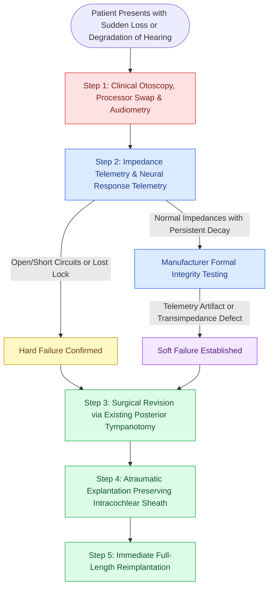

# Cochlear implant failure is categorized into hard failure and soft failure requiring systematic integrity testing before revision explantation and reimplantation

## Active Recall

> [!question]- What constitutes a "soft failure" in cochlear implantation, and how is it investigated when initial telemetry is normal?
> *Answer / Clinical Rationale*: A soft failure is defined as an unexplained, progressive decline in auditory performance, new-onset sound distortion, intermittent stimulation, facial nerve twitching, or painful shock sensations in the absence of obvious external hardware faults or overt open/short circuits on standard impedance telemetry. Investigation requires comprehensive audiologic testing, replacing external processors, psychological assessment, high-resolution temporal bone CT to verify electrode positioning, and manufacturer specialized integrity testing (averaging surface potentials, transimpedance matrix analysis, and radiofrequency signal lock testing).
>
> [!question]- Why is preservation of the intracochlear fibrous sheath critical during revision cochlear implant explantation?
> *Answer / Clinical Rationale*: Following primary implantation, a thin, stable fibrous connective tissue sheath envelops the electrode array within the scala tympani. Sparing this sheath during explantation provides an unobstructed, pre-formed lumen that guides the immediate insertion of the replacement electrode array. Disrupting the sheath risks tearing the osseous spiral lamina, translocating into the scala vestibuli, inducing new osteoneogenesis, or permanently obliterating apical access.

## Core Clinical & Mechanistic Principles

As cochlear implantation has expanded across pediatric and geriatric populations with decades of expected device use, revision cochlear implantation has become an essential surgical competency. Device failure occurs in approximately 2.5% to 5% of implantees over a 10-year period. Systematic consensus guidelines categorize device failures into **Hard Failures** and **Soft Failures**, establishing clear criteria for revision surgery.

A **Hard Failure** is defined as an unequivocal malfunction of the internal receiver-stimulator or electrode array confirmed by objective device testing that falls outside manufacturer specifications. Hard failures result from physical head trauma fracturing ceramic housings, loss of the titanium hermetic seal allowing fluid ingress, cracked electrode wires, or internal electronic component breakdown. Diagnostic [[Intraoperative neural response telemetry NRT confirms auditory nerve fiber stimulation|telemetry measurements]] demonstrate high-impedance open circuits (> 20 to 30 kOhms) or low-impedance short circuits (< 0.5 to 1.0 kOhms), or a complete loss of radiofrequency transcutaneous communication.

A **Soft Failure** represents a far more challenging clinical scenario: the patient experiences an insidious or sudden decline in speech perception, poor sound quality, intermittent buzzing, or intolerable non-auditory stimulation (such as facial twitching or pain), yet routine clinical telemetry remains deceptively within normal impedance limits. In pediatric patients, soft failure manifests as sudden behavioral refusal to wear the processor, loss of language production, or regression in auditory tracking. If exhaustive audiologic remapping, speech therapy evaluation, medical imaging, and external processor exchanges fail to resolve symptoms, formal specialized manufacturer integrity testing is performed.

### Surgical Craft of Revision Explantation & Reimplantation

1. **Incision and Calvarial Pocket Re-entry**: The prior postauricular incision is reopened. Dissection proceeds through the subcutaneous plane to the subperiosteal pocket. Dense fibrous encapsulation over the receiver-stimulator is sharply incised, and tie-down sutures are released.
2. **Mastoid & Facial Recess Identification**: The previous mastoidectomy and [[Posterior tympanotomy facial recess approach opens the corridor between CN VII and chorda tympani|posterior tympanotomy facial recess]] are reopened. Granulation tissue or scar surrounding the electrode lead is meticulously dissected under high magnification, strictly maintaining visualization of the descending facial nerve and chorda tympani.
3. **Round Window / Cochleostomy Unroofing**: Fibrous tissue over the round window entry is cleared until the array entry point is visualized.
4. **Atraumatic Explantation**: Gentle, constant linear traction is applied along the exact axis of the basal turn insertion vector. The electrode array must be extracted slowly without jerking, allowing the array to slide smoothly out of its intracochlear fibrous sheath.
5. **Immediate Reimplantation**: The replacement electrode array is introduced immediately into the pre-existing fibrous track. Inserting immediately prevents intracochlear collapse or bleeding. A full-length insertion is confirmed visually and verified with intraoperative telemetry and transorbital radiography.

## Connected Concepts & Graph Traversal
- **Infection Prophylaxis**: [[Streptococcus pneumoniae vaccination is mandatory prior to cochlear implantation to prevent post-implantation bacterial meningitis]]
- **Array Positioning**: [[Scala tympani electrode array placement preserves residual hearing and avoids basilar membrane translocation]]
- **Surgical Approach**: [[Posterior tympanotomy facial recess approach opens the corridor between CN VII and chorda tympani]]
- **Diagnostic Telemetry**: [[Intraoperative neural response telemetry NRT confirms auditory nerve fiber stimulation]]
- **Complication Rescue**: [[High-stakes lateral skull base neurotologic complications require rapid multimodal emergency salvage]]
