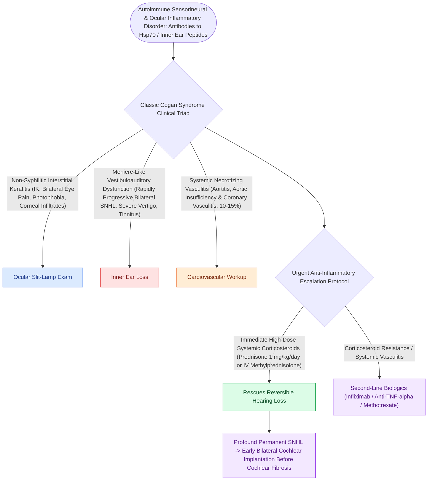

# Cogan syndrome is characterized by interstitial keratitis, vestibuloauditory dysfunction, and systemic vasculitis

## Active Recall

> [!question]- What is the hallmark diagnostic pairing of typical Cogan syndrome, and how quickly must vestibuloauditory symptoms follow ocular symptoms?
> *Answer / Clinical Rationale*: Typical Cogan syndrome is characterized by **non-syphilitic interstitial keratitis (IK)** paired with **Ménière-like vestibuloauditory dysfunction** (sudden episodic vertigo, ataxia, nausea, vomiting, tinnitus, and rapidly progressive sensorineural hearing loss), with both ocular and auditory features manifesting within **$2\text{ years}$ of each other**.

> [!question]- What life-threatening systemic vascular complication develops in 10–15% of patients with Cogan syndrome?
> *Answer / Clinical Rationale*: **Systemic vasculitis affecting large and medium vessels**, most notably **aortitis leading to aortic insufficiency, aortic root dilation, aortic aneurysm, and coronary arteritis / myocardial infarction**. Routine echocardiography and CT/MR angiography of the thoracic aorta are mandatory.

> [!question]- What is the urgent pharmacological management to prevent irreversible profound sensorineural deafness?
> *Answer / Clinical Rationale*: **Immediate high-dose systemic corticosteroids (oral Prednisone $1\text{–}2\text{ mg/kg/day}$ or IV pulse Methylprednisolone $1\text{ g/day} \times 3\text{ days}$)** must be initiated at the earliest sign of auditory involvement. Delay leads to rapid irreversible fibrosis and osteoneogenesis within the scala tympani. Refractory cases require steroid-sparing biologics (**TNF-alpha inhibitors like Infliximab, or Methotrexate/Cyclophosphamide**); bilateral profound deafness mandates prompt **cochlear implantation** before cochlear ossification completes.

## Core Clinical & Mechanistic Principles
[[Autoimmune inner ear disease causes rapidly progressive bilateral sensorineural loss responsive to corticosteroids|Cogan syndrome]] is a rare, presumed autoimmune chronic systemic vasculitis/endotheliopathy predominantly affecting young Caucasian adults (average age 20–30):

### Auditory Rehabilitation & Cochlear Implantation Pearls
- **Cochlear Fibrosis Risk**:
  - Autoimmune [[Endolymphatic hydrops results from impaired resorption of endolymph within the endolymphatic sac|endolymphatic hydrops]] and endarteritis lead to rapid fibro-osseous obliteration of the fluid spaces of the cochlea (labyrinthitis ossificans).
  - High-resolution T2-weighted MRI of the IAC/labyrinth is essential to assess fluid signal in the scala tympani.
- **Urgent Cochlear Implantation**:
  - If high-dose steroids and biologics fail to halt hearing deterioration, **urgent cochlear implantation** must be performed before progressive osteoneogenesis precludes standard electrode array insertion.

## Connected Concepts & Graph Traversal
- **Autoimmune Inner Ear Disease**: [[Autoimmune inner ear disease causes rapidly progressive bilateral sensorineural loss responsive to corticosteroids|Autoimmune Inner Ear Disease]]
- **Cochlear Implantation**: [[Cochlear implant candidacy criteria include severe to profound bilateral sensorineural hearing loss|Cochlear Implantation in AIED]]
- **Ménière Disease Differential**: [[Low-sodium diet, hydrochlorothiazide, and betahistine form the first-line medical therapy for Meniere disease|Ménière Disease Medical Management]]
- **🔗 Systemic Vasculitis Differential (Sinus)**: [[Granulomatosis with polyangiitis presents with necrotizing sinonasal granulomas and saddle nose|GPA / Wegener Vasculitis]]
- **Vestibular Evaluation**: [[Rotary chair testing assesses low-frequency bilateral vestibular hypofunction and central compensation|Vestibular Hypofunction Evaluation]]
