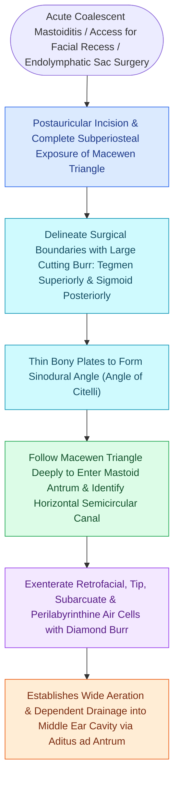

# Complete cortical mastoidectomy unroofs the mastoid antrum and establishes dependent middle ear drainage

## Active Recall

> [!question]- What anatomical surface landmarks define Macewen's (suprameatal) triangle, what deep structure does it triangulate, and what is Körner's septum?
> *Answer / Clinical Rationale*: Macewen's triangle is bounded by (1) the **temporal line (linea temporalis)** superiorly, (2) the **posterosuperior bony external auditory canal margin (spine of Henle)** anteriorly, and (3) a **tangent drawn vertical to the posterior canal wall** posteriorly; drilling through it leads into the **mastoid antrum** ($\approx 1.5\text{ cm}$ deep in adults). **Körner's septum** is a persistent **petrosquamous suture lamina** that forms a false bony floor lateral to the true antrum, trapping the surgeon in a superficial air cell and leaving deeper antral disease behind unless perforated.

> [!question]- What are the four primary bony and dural boundaries that must be systematically skeletonized during a complete cortical mastoidectomy, and what structure serves as the ultimate depth governor?
> *Answer / Clinical Rationale*: (1) **Tegmen mastoideum / tympani** superiorly; (2) **Sigmoid sinus bony plate** posteriorly; (3) **Sinodural angle of Citelli** (junction of tegmen and sigmoid sinus); (4) **Posterior bony external auditory canal wall** anteriorly. The hard, white endochondral bone of the **lateral semicircular canal (LSCC) dome** serves as the immutable depth governor.

> [!question]- Why must the incus buttress (posterior bony bridge) be left intact and drill contact with the incus short process scrupulously avoided during a standard cortical mastoidectomy?
> *Answer / Clinical Rationale*: The incus buttress stabilizes the **fossa incudis** and the short process of the incus (which points directly toward the second genu of CN VII); inadvertent rotating drill burr contact with the short process of the incus transmits violent mechanical and acoustic energy across the ossicular chain to the stapes footplate and cochlea, causing **permanent sensorineural hearing loss, ossicular subluxation, or vertigo**.

## Core Clinical & Mechanistic Principles
**Complete (cortical / canal-wall-up / simple / Schwartze) mastoidectomy** is the foundational surgical procedure of otology, designed to exenterate all mastoid pneumatic cell tracts from the mastoid cortex to the antrum while preserving an intact bony external auditory canal and middle ear framework:

- **Indications**:
  - [[Acute coalescent mastoiditis causes trabecular osteoclasis and subperiosteal abscess formation|Acute coalescent mastoiditis]] refractory to medical therapy or presenting with subperiosteal abscess.
  - Initial staging step for posterior tympanotomy ([[The facial recess is bounded by the facial nerve, chorda tympani, and fossa incudis|facial recess]] approach for cochlear implantation).
  - Exposure corridor for lateral skull base approaches ([[The translabyrinthine approach provides direct exposure of the internal auditory canal with complete hearing sacrifice|translabyrinthine]], retrolabyrinthine).
  - Traumatic facial nerve decompression or temporal bone CSF leak repair.
- **Surgical Landmarks & Relational Geometry**:
  - **Spine of Henle (Spina suprameatum)**: Bony projection at the posterosuperior canal edge.
  - **Mastoid Antrum**: The largest constant air cell ($1\text{ cm}^3$ volume), located $\approx 15\text{ mm}$ deep to the cortex in adults (more superficial in infants) and separated laterally in some temporal bones by **Körner's septum** (persistent petrosquamous suture).
  - **Lateral Semicircular Canal (LSCC) Dome**: Forms the medial wall of the aditus ad antrum in immutable endochondral [[The otic capsule is an immutable endochondral bone that provides fixed surgical reference landmarks|otic capsule]] bone; serves as the constant depth governor and landmark for the tympanic segment and second genu of [[The facial nerve traverses six distinct anatomical segments from the pons to the parotid gland|CN VII]].

### Stepwise Operative Execution & Safety Rules
1. **Incision & Exposure**:
   - Postauricular C-incision $5\text{ mm}$ posterior to the postauricular sulcus.
   - Elevate a anteriorly based musculoperiosteal flap (Palva flap) to expose the mastoid cortex from the zygomatic root to the mastoid tip.
2. **Saucerization Drilling**:
   - Using a large cutting burr ($5\text{–}6\text{ mm}$) with continuous irrigation, bevel (saucerize) the cortical edges widely to avoid "tunnel vision".
   - Identify the dural plate of the **tegmen tympani** superiorly and the bony plate over the **sigmoid sinus** posteriorly.
   - Drill into the **sinodural angle of Citelli** (between tegmen and sigmoid).
3. **Antrotomy & Visualizing the Invariants**:
   - Deepen drilling in Macewen's triangle to unroof the **mastoid antrum**.
   - Identify the yellowish, dense bone of the **lateral semicircular canal (LSCC)** dome.
   - Identify the **fossa incudis** and the short process of the incus pointing directly to the second genu of the facial nerve.
4. **Exenterating Peripheral Cell Tracts**:
   - Clear retrofacial cells, subarcuate cells, and mastoid tip cells down to the smooth white **digastric ridge** (which courses anteromedially to deliver the stylomastoid foramen).
5. **Gate-Skipping Failure Modes & Sclerotic Mastoid Safeguards**:
   - *Sclerotic Mastoid Rule*: In contracted, chronically inflamed ears, a **forward-displaced sigmoid sinus and low-hanging tegmen** shrink the working corridor, requiring early skeletonization of the sinodural angle and sinus plate.
   - *Tegmen Perforation / Sigmoid Sinus Tear*: Prevented by wide cortical saucerization; sigmoid bleeding is controlled with extraluminal Surgicel packing, head elevation, and diamond burr polishing.
   - *Labyrinthine Fistula & Acoustic Trauma*: Prevented by identifying the hard white LSCC dome early and avoiding any rotating burr contact with the incus short process in the fossa incudis.

## Connected Concepts & Graph Traversal
- **Pathophysiologic Indication**: [[Acute coalescent mastoiditis causes trabecular osteoclasis and subperiosteal abscess formation|Coalescent Mastoiditis]]
- **Otic Capsule Constant**: [[The otic capsule is an immutable endochondral bone that provides fixed surgical reference landmarks|Otic Capsule Foundation]]
- **Canal Wall Up Technique**: [[Canal wall up mastoidectomy preserves the posterior bony external auditory canal wall|Canal Wall Up Mastoidectomy]]
- **Canal Wall Down Alternative**: [[Canal wall down mastoidectomy lowers the facial ridge and exteriorizes the mastoid into the ear canal|Canal Wall Down Mastoidectomy]]
- **Facial Recess & Cochlear Implantation**: [[The facial recess is bounded by the facial nerve, chorda tympani, and fossa incudis|Facial Recess Anatomy]]
- **Facial Nerve Landmarks**: [[The facial nerve traverses six distinct anatomical segments from the pons to the parotid gland|Facial Nerve Segments]]
- **Lateral Skull Base Corridors**: [[The translabyrinthine approach provides direct exposure of the internal auditory canal with complete hearing sacrifice|Translabyrinthine Approach]]
