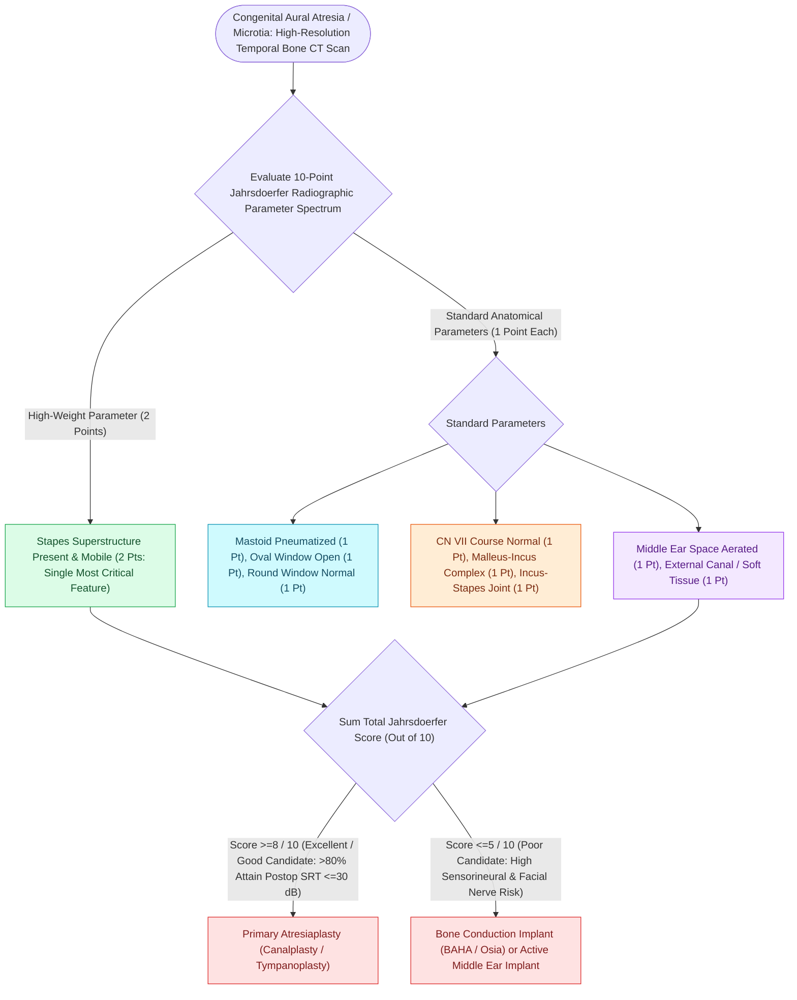

# Congenital aural atresia candidacy is graded by the ten-point Jahrsdoerfer scale

## Active Recall

> [!question]- What Jahrsdoerfer score threshold favors atresiaplasty, and which structure scores double?
> *Answer / Clinical Rationale*: Score of **seven or more** of ten; the **stapes** carries two points.

> [!question]- Why does the facial nerve endanger the drilled neocanal in atresia?
> *Answer / Clinical Rationale*: Without a tympanic ring the mastoid segment migrates **anterolaterally**, into the path of canal creation.

## Core Clinical & Mechanistic Principles
- **The Nerve as Pathfinder**: In congenital aural atresia, failure of tympanic ring development leaves the mastoid segment of the facial nerve without its normal bony posterior canal wall boundary. The nerve drifts **anteriorly and laterally**, traversing the intended surgical neo-canal drill corridor.
- **Otic Capsule Stability**: Because the otic capsule ossifies fully by 20 weeks gestation, the lateral semicircular canal, oval window, and [[The cochleariform process serves as the constant middle ear landmark triangulating the geniculate ganglion, tympanic CN VII, and tensor tympani tendon|cochleariform process]] remain reliable anatomic invariants even when surface and middle ear anatomy are severely distorted.
- The **Jahrsdoerfer scale** scores ten CT features (stapes counts two; oval window, middle ear space, facial nerve course, malleus-incus complex, mastoid pneumatization, incus-stapes connection, round window, external ear appearance one each); **seven or more** predicts a hearing-worthwhile [[Congenital aural atresiaplasty utilizes an anterior surgical approach along the glenoid fossa with split-thickness skin grafting to reconstruct the external auditory canal|atresiaplasty]].
- The absent tympanic ring lets the **mastoid facial nerve drift anterolateral** — it commonly crosses the drilling path of the neocanal, the central hazard of the operation.
- Atresia is graded with the microtia it accompanies; inner ear structures are usually normal because the capsule develops separately (invariant embryology).
- Bone-conduction implants are the alternative for low scores or family preference, with excellent audiologic outcomes.

### Management & Critical Safety Checks
- Sequence with microtia reconstruction: autologous framework first (virgin, unscarred skin), atresiaplasty after — or a bone-conduction device sidestepping the sequencing entirely.
- Intraoperative facial nerve monitoring is mandatory; the nerve is assumed displaced until proven otherwise.

## Connected Concepts & Graph Traversal
- **🔗 Auricular Reconstruction Staging (FPRS)**: [[Microtia reconstruction spans staged autologous costal cartilage frameworks and porous polyethylene implants|Microtia Reconstruction]]
- **Bone Conduction Pathway**: [[Bone-anchored hearing implants BAHA stimulate the cochlea directly via bone conduction pathways|BAHA Systems]]
- **🔗 Branchial Cleft Lineage (Pediatrics)**: [[First branchial cleft Work Type I and Type II anomalies require superficial parotidectomy with facial nerve dissection|Work I and II Anomalies]]
- **Facial Nerve Course Distortion**: [[The infant mastoid lacks a developed tip placing the facial nerve in a subcutaneous vulnerable position at the stylomastoid foramen|Aberrant Fallopian Canal Course]]
- **Middle Ear Transformer Mechanics**: [[The middle ear transformer ratio provides twenty-seven decibels of acoustic impedance matching|Middle Ear Transformer Gain]]
- **🔗 Surgical Technique (Pediatrics)**: [[Congenital aural atresiaplasty utilizes an anterior surgical approach along the glenoid fossa with split-thickness skin grafting to reconstruct the external auditory canal|Congenital Aural Atresiaplasty]]
