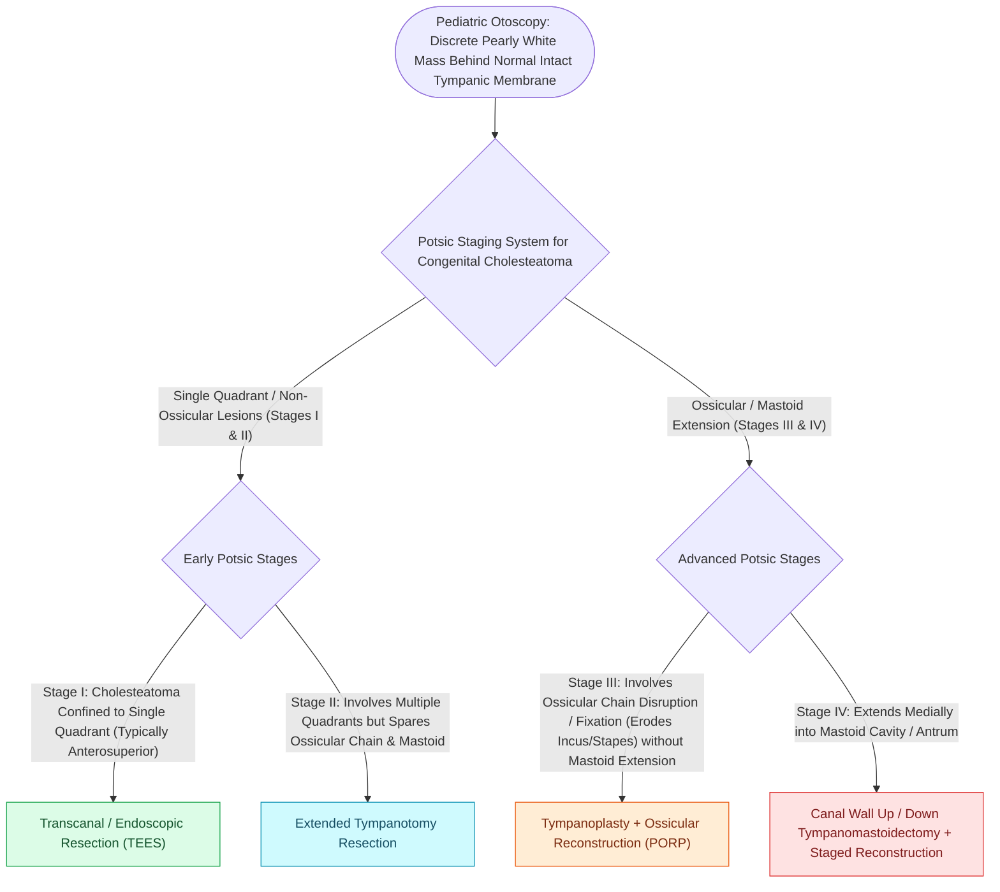

# Congenital cholesteatoma presents as an anterosuperior white mass behind an intact tympanic membrane

## Active Recall

> [!question]- Where does congenital cholesteatoma classically sit and behind what kind of drum?
> *Answer / Clinical Rationale*: **Anterosuperior quadrant**, medial to an **intact** tympanic membrane.

> [!question]- Which staging system grades congenital cholesteatoma and what does it predict?
> *Answer / Clinical Rationale*: **Potsic staging** — quadrant/ossicle/mastoid extent predicting residual disease risk.

## Core Clinical & Mechanistic Principles
- **Derlacki-Clemis criteria**: white mass medial to an intact TM with no history of perforation, otorrhea, or prior otologic surgery; epithelial rest theory places the anlage at the **anterosuperior mesotympanum**.
- Often found incidentally in a child at well-visit otoscopy; hearing loss appears late once the mass reaches the ossicular chain.
- **Potsic staging** grades by quadrant involvement and ossicular/mastoid extension and predicts residual disease risk.
- Distinguish from primary acquired disease by site and drum integrity: congenital is anterosuperior behind an intact drum; acquired is attic/posterosuperior with retraction.

### Management & Critical Safety Checks
- Management is surgical excision with ossicular preservation when possible; higher Potsic stages carry meaningful residual rates, so staged second look or non-echo-planar DWI surveillance follows.
- Counsel families that an intact, dry drum does not exclude [[Primary acquired cholesteatoma arises from retraction pocket invagination of the pars flaccida into Prussak space|cholesteatoma]] — the pathology predates the drum's history.

## Connected Concepts & Graph Traversal
- **Acquired Cholesteatoma Counterpart**: [[Primary acquired cholesteatoma arises from retraction pocket invagination of the pars flaccida into Prussak space|Primary Acquired Cholesteatoma]]
- **Mastoid Exteriorization Craft**: [[Canal wall down mastoidectomy lowers the facial ridge and exteriorizes the mastoid into the ear canal|CWD Mastoidectomy]]
- **Ossicular Superstructure Repair**: [[Partial ossicular replacement prosthesis PORP requires an intact and mobile stapes superstructure|PORP Reconstruction]]
- **Transcanal Endoscopic Removal**: [[Transcanal endoscopic ear surgery TEES provides line-of-sight visualization into the sinus tympani and epitympanum|TEES Endoscopic Ear Surgery]]
- **Epidermoid Rest Pathogenesis**: [[Second-look surgery or non-EPI DWI MRI is indicated twelve to eighteen months after canal wall up mastoidectomy|Non-EPI DWI MRI Surveillance]]
