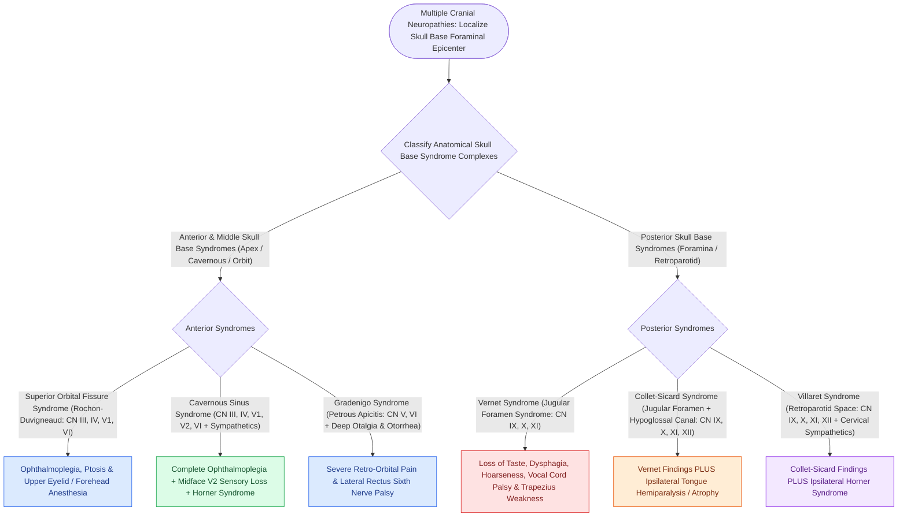

# Cranial nerve polyneuropathies of the skull base are localized by specific anatomical foramen involvement

## Active Recall

> [!question]- What specific cranial nerves and sympathetic pathways are affected in Vernet, Collet-Sicard, Villaret, and Tapia syndromes?
> *Answer / Clinical Rationale*: - **Vernet syndrome (Jugular Foramen syndrome)**: **CN IX, X, XI** (loss of taste post-1/3 tongue, absent gag reflex, vocal fold paralysis, dysphagia, SCM/trapezius weakness). - **Collet-Sicard syndrome**: **CN IX, X, XI, XII** (Vernet + ipsilateral tongue paralysis/deviation to affected side from hypoglossal canal involvement). - **Villaret syndrome (Retroparotid Space syndrome)**: **CN IX, X, XI, XII + Horner syndrome** (cervical sympathetic chain disruption). - **Tapia syndrome**: **CN X (recurrent laryngeal nerve) and CN XII** (isolated ipsilateral vocal fold and tongue paralysis, typically from endotracheal intubation pressure against the anterior process of the C1 transverse process or rigid suspension laryngoscopy).

> [!question]- What anatomical boundaries differentiate superior orbital fissure syndrome from orbital apex syndrome and cavernous sinus syndrome?
> *Answer / Clinical Rationale*: - **Superior Orbital Fissure syndrome (Rochon-Duvigneaud)**: **CN III, IV, V1, VI** (total ophthalmoplegia, ptosis, forehead hypoesthesia) with **intact vision**. - **Orbital Apex syndrome (Rollet)**: **CN II, III, IV, V1, VI** (superior orbital fissure findings **PLUS optic nerve involvement -> progressive visual loss / optic disc edema**; distinct from **Petrosphenoidal syndrome [Jacod]**, which involves **CN II, III, IV, V, VI** at the retrosphenoidal space / middle cranial fossa). - **Cavernous Sinus syndrome**: **CN III, IV, V1, V2, VI $\pm$ ocular sympathetic fibers** (ophthalmoplegia, proptosis, maxillary hypoesthesia [V2], Horner or dilated pupil).

> [!question]- What clinical physical examination findings confirm involvement of the jugular foramen vs the hypoglossal canal?
> *Answer / Clinical Rationale*: Jugular foramen involvement (CN IX–XI) produces **loss of the ipsilateral palatal elevation (curtain sign: uvula deviates to normal side)**, absent ipsilateral gag reflex, **hoarseness/aspiration (vocal fold paramedian fixation)**, and weakness of shoulder shrug (trapezius) and head rotation to the opposite side (SCM). Hypoglossal canal involvement (CN XII) adds **ipsilateral tongue atrophy, fasciculations, and protrusion deviation toward the side of the lesion**.

## Core Clinical & Mechanistic Principles
Skull base cranial neuropathies are classified by anatomical compartment and exiting neurovascular bundles:

### Diagnostic Evaluation & Management
1. **High-Resolution Neuroimaging**:
   - Thin-cut temporal bone / skull base CT with contrast: evaluates bony foramen expansion, erosion, or destructive lesions ([[Fisch classification categorizes temporal bone and skull base paragangliomas from Class A to Class D|paragangliomas]], schwannomas, chordomas, metastases).
   - MRI Brain/Skull Base with gadolinium and MR angiography/venography: evaluates perineural tumor spread, dural enhancement, and vascular patency (e.g., jugular bulb thrombosis).
2. **Airway & Swallowing Protection**:
   - High aspiration risk due to unilateral pharyngolaryngeal denervation (CN IX/X).
   - Early FEES / videofluoroscopy swallowing study.
   - Early vocal fold medialization injection thyroplasty to restore glottic closure and enhance cough mechanics.

## Connected Concepts & Graph Traversal
- **Jugular Paragangliomas**: [[Jugular paragangliomas arise from the glomus body in the adventitia of the jugular bulb|Jugular Foramen Paragangliomas]]
- **🔗 Vocal Fold Medialization (Laryngology)**: [[Type I thyroplasty medializes the vocal fold with conscious voice tuning|Type I Thyroplasty for Vagus Palsy]]
- **Facial Nerve Segments**: [[The facial nerve traverses six distinct anatomical segments from the pons to the parotid gland|CN VII Segmental Anatomy]]
- **Acoustic Neuroma Differential**: [[Koos grading system classifies vestibular schwannomas from Stage I intracanalicular to Stage IV brainstem compression|Vestibular Schwannoma Staging]]
- **Eagle Syndrome Differential**: [[Eagle syndrome causes recurrent cervicopharyngeal pain and foreign body sensation from an elongated styloid process|Eagle Syndrome Glossopharyngeal Irritation]]
