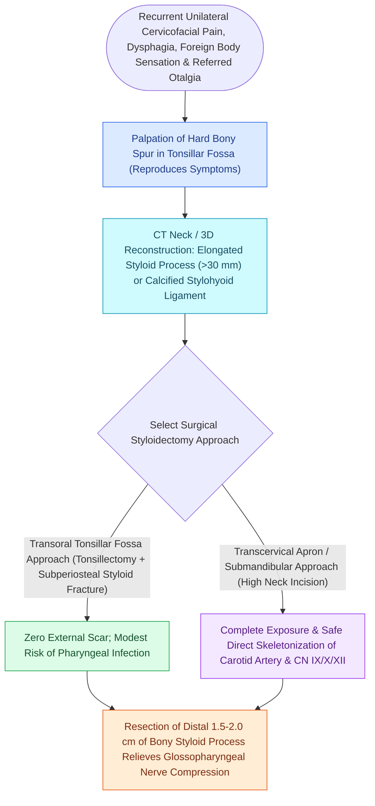

# Eagle syndrome causes recurrent cervicopharyngeal pain and foreign body sensation from an elongated styloid process

## Active Recall

> [!question]- What anatomical dimension defines an elongated styloid process, and what are the two distinct clinical subtypes of Eagle syndrome?
> *Answer / Clinical Rationale*: Normal styloid process length is $2.0\text{–}3.0\text{ cm}$; a length **$>3.0\text{ cm}$** (or calcification/ossification of the stylohyoid ligament) is defined as elongated. The two subtypes are: - **Classic Eagle syndrome**: Typically follows **tonsillectomy** (scar tissue tightens around the elongated styloid in the tonsillar fossa), causing traction/irritation of **cranial nerve IX (glossopharyngeal nerve)** manifesting as recurrent unilateral throat pain, foreign body sensation (globus), odynophagia, otalgia, and dysphagia. - **Stylocarotid / Vascular Eagle syndrome**: The elongated styloid impinges directly on the **internal or external carotid artery and perivascular sympathetic plexus**, producing parietal/orbital pain, visual disturbances, syncope, transient ischemic attacks (TIAs), or spontaneous internal carotid artery dissection during head rotation.

> [!question]- What physical examination maneuver and diagnostic test confirm Eagle syndrome?
> *Answer / Clinical Rationale*: **Transoral palpation of the tonsillar fossa** reproduces the patient's exact radiating cervicopharyngeal pain (a bony prominence is easily palpable). Relief of pain following **local anesthetic injection (1–2 mL 1% lidocaine)** into the tonsillar fossa confirms the diagnosis. Radiographic gold standard is a **3D-reconstructed neck CT** demonstrating an elongated styloid process $>3.0\text{ cm}$ or ossified stylohyoid ligament.

> [!question]- What are the two surgical approaches for styloidectomy, and what are their respective advantages and risks?
> *Answer / Clinical Rationale*: - **Transoral Styloidectomy**: Performed via the tonsillar fossa following tonsillectomy; no external scar, rapid recovery; drawbacks include limited visualization, risk of deep neck infection/retropharyngeal space contamination, and potential vascular injury to the ICA. - **Transcervical / Extraoral Styloidectomy**: Performed via an upper neck crease (submandibular approach along the anterior border of SCM); provides wide exposure, excellent vascular control of the carotid sheath and cranial nerves VII, IX, X, XI, XII; leaves a cosmetic cervical scar.

## Core Clinical & Mechanistic Principles
Eagle syndrome (stylohyoid syndrome / stylalgia) arises from congenital elongation or post-traumatic/post-surgical ossification of the stylohyoid chain (derived from Reichert's cartilage of the 2nd [[Each branchial arch packages one nerve, one artery, one cartilage bar, and one muscle group|branchial]] arch):

### Surgical Technique: Transoral vs Transcervical
1. **Transoral Approach**:
   - Palpate the styloid tip in the anterior/tonsillar fossa.
   - Perform tonsillectomy (if tonsil present).
   - Make a longitudinal incision through the superior constrictor muscle over the bony prominence.
   - Dissect periosteum to identify the attachment of the styloglossus, stylohyoid, and stylopharyngeus muscles.
   - Fracture and resect the distal $1.5\text{–}2.5\text{ cm}$ of the styloid using bone rongeurs without traction to prevent CN IX avulsion.
2. **Transcervical Approach**:
   - Incision placed in a natural skin crease $2\text{ cm}$ below the mandible.
   - Elevate subplatysmal flaps; identify the anterior border of the SCM and posterior belly of the digastric.
   - Retract the parotid and submandibular glands; identify the carotid sheath and cranial nerves IX and XII.
   - Palpate the styloid base, strip the muscular attachments, and resect the styloid flush with the skull base.

## Connected Concepts & Graph Traversal
- **🔗 Second Branchial Arch Anatomy (Pediatrics)**: [[Each branchial arch packages one nerve, one artery, one cartilage bar, and one muscle group|Reichert's Cartilage Derivations]]
- **🔗 Deep Neck Spaces & Carotid Sheath (Head and Neck)**: [[Deep cervical fascia divides into superficial, middle, and deep layers that define surgical planes|Carotid Sheath & Parapharyngeal Space Topography]]
- **Skull Base Foramen Syndromes**: [[Cranial nerve polyneuropathies of the skull base are localized by specific anatomical foramen involvement|Cranial Nerve Polyneuropathies]]
- **🔗 Submandibular Surgical Anatomy (Head and Neck)**: [[Submandibular gland excision requires preservation of the marginal mandibular, lingual, and hypoglossal nerves|Submandibular & Deep Neck Anatomy]]
- **🔗 Tonsillectomy Anatomy (Pediatrics)**: [[Paradise criteria define evidence-based indications for pediatric tonsillectomy in recurrent throat infections|Tonsillar Fossa Surgical Anatomy]]
