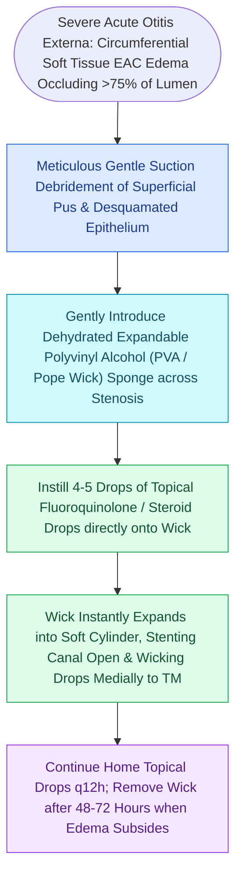

# Ear wick placement bridges severe canal edema to deliver topical antimicrobial drops to the medial external auditory canal

## Active Recall

> [!question]- Why must an ear wick be inserted dry under direct microscopic visualization rather than pre-moistened before insertion?
> *Answer / Clinical Rationale*: Pre-moistening causes immediate rapid sponge expansion and structural softening, rendering it too bulky and floppy to negotiate the narrow, tortuous stenotic canal. Dry insertion maintains maximum longitudinal column strength and minimal cross-sectional profile, permitting precise placement past the obstruction without blind trauma or painful canal wall shearing.

> [!question]- What are the key dangers of advancing an ear wick blindly in severe otitis externa?
> *Answer / Clinical Rationale*: Blind advancement risks plunging the rigid dry tip directly through an unseen, inflamed tympanic membrane into the middle ear space, causing traumatic ossicular chain disruption, inner ear injury, or severe labyrinthine trauma.

## Core Clinical & Mechanistic Principles
In severe [[Acute otitis externa is managed with topical antimicrobial-steroid drops and aural debridement|acute otitis externa]] (AOE), circumferential soft tissue edema and epithelial maceration frequently obliterate the external auditory canal (EAC) lumen. When the lumen is compressed to $<1\text{ mm}$ or completely occluded, instilled topical antibiotic and corticosteroid drops (such as ciprofloxacin-dexamethasone or ofloxacin) pool at the lateral meatus, preventing medication delivery to the medial canal skin and [[Uncomplicated acute otitis media in pediatric and adult patients is treated with first-line high-dose amoxicillin|tympanic membrane]]. Placement of an expandable synthetic sponge (e.g., Pope Oto-Wick) or dehydrated polyvinyl alcohol pack bridges the stenotic segment, serving as a conduit that absorbs drops laterally and diffuses them uniformly across the entire length of the medial canal through capillary action.

### Surgical Technique & Craft Nuances
1. **Preliminary Microscopic Debridement**:
   - Under binocular microscopy, gently suction superficial purulent debris, desquamated keratin, and cerumen using a 3 French or 5 French Frazier suction tip. Avoid aggressive scraping against exquisitely tender, friable canal walls.
2. **Wick Sizing & Dry Insertion**:
   - Grasp the proximal end of a dry, compressed Pope Oto-Wick firmly with smooth alligator forceps or Hartmann micro-forceps.
   - Align the flat axis of the wick with the longitudinal axis of the EAC (oriented anteroinferiorly).
   - Advance the wick smoothly under direct microscopic visualization across the point of maximal stenosis until the medial tip rests within $2\text{ mm}$ of the tympanic membrane. The lateral end must project $1\text{--}2\text{ mm}$ beyond the external meatus for ease of retrieval.
3. **Hydration & Activation**:
   - Immediately hydrate the wick *in situ* with 3–5 drops of topical otic suspension. The dehydrated sponge expands circumferentially 3- to 4-fold within 15–30 seconds, stenting the canal open and initiating continuous trans-sponge medication diffusion.
## References
1. Rosenfeld, R.M., Schwartz, S.R., Cannon, C.R., et al. (2014). Clinical Practice Guideline: Acute Otitis Externa. *Otolaryngol Head Neck Surg*, 150(1_suppl):S1-S24.
2. Naples, J.G., Brant, J.A., Ruckenstein, M.J. (2020). Infections of the External Ear. In Flint, P.W., et al. (Eds.), *Cummings Otolaryngology Head and Neck Surgery* 7e (pp. 2093-2100). Philadelphia, PA: Elsevier.
3. Linstrom, C.J., Lucente, F.E. (2013). Diseases of the External Ear. In Johnson, J.J., Rosen, C.A. (Eds.), *Bailey’s Head and Neck Surgery-Otolaryngology* 5e (pp. 2333-2357). Baltimore, MD: Lippincott Williams & Wilkins.

## Connected Concepts & Graph Traversal
- **Physiological Basis**: [[Acute otitis externa is managed with topical antimicrobial-steroid drops and aural debridement|Acute Otitis Externa Debridement & Drops]]
- **Differential Pathology**: [[Malignant necrotizing otitis externa is an invasive pseudomonal skull base osteomyelitis in elderly diabetic patients|Necrotizing Otitis Externa]]
- **Cartilage Infection**: [[Acute perichondritis of the auricle requires antipseudomonal therapy to prevent cartilage necrosis|Auricular Perichondritis]]
- **Foreign Body Alternative**: [[External auditory canal foreign bodies require atraumatic extraction under microscopic guidance to protect the tympanic membrane|EAC Foreign Body Extraction]]
- **Tympanic Membrane Safety**: [[Traumatic tympanic membrane perforations heal spontaneously in the majority of cases without early surgery|Traumatic TM Perforation]]
