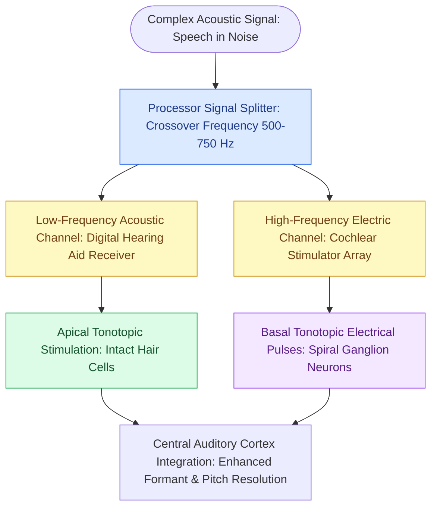

# Electroacoustic stimulation preserves residual low-frequency acoustic hearing while providing high-frequency electrical cochlear stimulation for steep high-frequency sensorineural loss

## Active Recall

> [!question]- What audiometric profile defines candidacy for electroacoustic stimulation (EAS) hybrid cochlear implantation?
> *Answer / Clinical Rationale*: EAS is indicated for patients with "ski-slope" sensorineural hearing loss characterized by preserved low-frequency hearing (pure-tone thresholds <= 60 dB HL at 125, 250, and 500 Hz) combined with severe-to-profound sensorineural hearing loss at high frequencies (>= 70 to 80 dB HL at 1500 Hz and above), with aided monosyllabic word recognition scores between 10% and 60% in the ear to be implanted.
>
> [!question]- How does acoustic preservation in the low frequencies dramatically improve patient performance compared to electric stimulation alone?
> *Answer / Clinical Rationale*: Preserved apical low-frequency acoustic hearing provides precise phase-locking, fine temporal structure, and harmonic pitch cues that current electrical speech processing strategies cannot replicate. This synergistic integration enables superior speech-in-noise perception, voice timbre recognition, vocal emotion discernment, and high-fidelity music appreciation.

## Core Clinical & Mechanistic Principles

Electroacoustic stimulation (EAS), also termed hybrid cochlear implantation, combines acoustic amplification for preserved low frequencies with electrical stimulation for deafened high frequencies in the same ear. Millions of individuals worldwide suffer from steep high-frequency sensorineural hearing loss resulting from acoustic trauma, presbycusis, or genetic ototoxic susceptibility. Conventional hearing aids provide inadequate benefit because amplifying frequencies above 1500 Hz into severe "dead regions" causes distortion, feedback, and acoustic smearing. Conversely, standard cochlear implantation historically sacrificed all residual acoustic hearing through deep basal cochlear trauma.

To accomplish true hearing preservation, EAS utilizes atraumatic surgical protocols paired with short, ultra-flexible, thin electrode arrays (e.g., 16 to 24 mm insertion depth). Implantation via [[Scala tympani electrode array placement preserves residual hearing and avoids basilar membrane translocation|scala tympani insertion]] confines electrical stimulation strictly to the basal turn where high-frequency spiral ganglion neurons reside, leaving the delicate apical fluid mechanics and organ of Corti unperturbed. The surgical approach favors an atraumatic [[Round window and extended round window insertions minimize intracochlear acoustic trauma|round window approach]], avoiding mechanical cochleostomy drilling near the spiral ligament.

In the external processor, sound is split at an adjustable crossover frequency (typically 500 to 750 Hz). Frequencies below the crossover are amplified acoustically by a built-in earphone receiver seated in the ear canal, stimulating residual apical outer and inner hair cells. Frequencies above the crossover are translated into electrical biphasic pulse trains delivered to basal electrodes. The central auditory system seamlessly integrates these disparate acoustic and electric sensory inputs into a coherent perceptual representation.

### "Soft Surgery" Protocol for Residual Hearing Preservation

1. **Systemic & Topical Steroid Priming**: High-dose intravenous dexamethasone (0.5 to 1.0 mg/kg) is administered prior to skin incision, and topical dexamethasone (10 mg/mL) or triamcinolone is bathed over the round window niche to suppress inflammatory cytokines and reactive apoptosis.
2. **Round Window Architecture**: The crista fenestrae and bony overhang of the round window niche are delicately shaved with a 0.6 mm diamond burr under continuous cold saline irrigation, preserving the secondary tympanic membrane.
3. **Membrane Incision vs Puncture**: A tiny micro-slit incision is placed in the anteroinferior quadrant of the round window membrane. Perilymph suctioning is strictly prohibited; acoustic trauma from micro-aspirators induces irreversible inner hair cell stereociliary shearing.
4. **Insertion Dynamics**: The flexible electrode array is introduced at an ultra-slow rate (< 1 mm/min), minimizing intracochlear fluid pressure spikes. Insertion depth is limited to 250 to 360 degrees of angular rotation (16 to 20 mm).
5. **Sealing the Fenestration**: The insertion aperture is sealed with a tiny cuff of autologous loose connective tissue or periosteum without packing foreign gelatin sponges into the middle ear.

## Connected Concepts & Graph Traversal
- **Rehabilitation Alternative**: [[Bimodal stimulation combines a contralateral hearing aid with an ipsilateral cochlear implant]]
- **Physiological Basis**: [[The traveling wave along the basilar membrane establishes tonotopic frequency organization]]
- **Etiological Profile**: [[Presbycusis produces symmetric high-frequency sensorineural loss with disproportionate speech-in-noise decline]]
- **Surgical Craft**: [[Scala tympani electrode array placement preserves residual hearing and avoids basilar membrane translocation]]
- **Infection Prophylaxis**: [[Streptococcus pneumoniae vaccination is mandatory prior to cochlear implantation to prevent post-implantation bacterial meningitis]]
