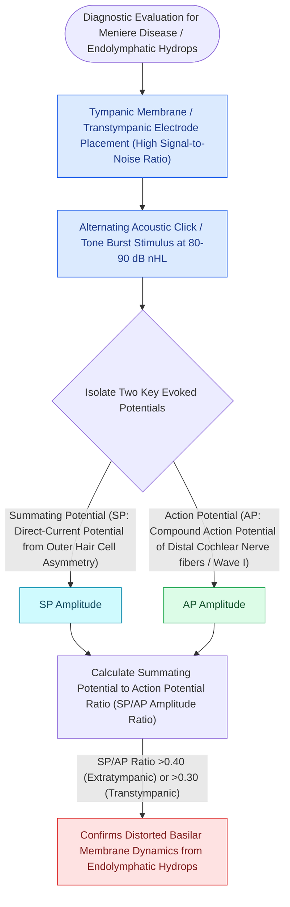

# Electrocochleography SP to AP ratio exceeding zero point four indicates endolymphatic hydrops

## Active Recall

> [!question]- What does an elevated Summating Potential (SP) to Action Potential (AP) ratio on ECochG indicate?
> *Answer / Clinical Rationale*: **Endolymphatic hydrops (Meniere's disease)**.

> [!question]- What is the diagnostic SP/AP ratio threshold on transtympanic ECochG?
> *Answer / Clinical Rationale*: An **$\text{SP/AP ratio} > 0.40$**.

## Core Clinical & Mechanistic Principles
**Electrocochleography (ECochG)** records electrical potentials generated by the cochlea and distal auditory nerve during the first $1\text{–}3\text{ ms}$ following acoustic stimulation:
- **The Three ECochG Potential Components**:
  1. **Cochlear Microphonic (CM)**: Alternating current (AC) receptor potential produced by outer hair cells, mimicking the stimulus waveform.
  2. **Summating Potential (SP)**: Direct current (DC) baseline shift produced by non-linear distortion of inner and outer hair cells.
  3. **Action Potential (AP)**: Compound action potential of the distal auditory nerve (identical to [[Auditory brainstem response waves I through V identify retrocochlear and brainstem pathology|ABR]] Wave I).
- **The SP/AP Ratio in Endolymphatic Hydrops (Meniere's Disease)**:
  - Hydrops increases endolymphatic volume and pressure, causing mechanical displacement of the basilar membrane toward the scala tympani.
  - This asymmetry increases the non-linear distortion of hair cells, producing an **abnormally enlarged Summating Potential (SP)**.
  - **Diagnostic Benchmark**: An **$\mathbf{SP/AP\text{ ratio} > 0.40}$ (transtympanic electrode) or $>0.45\text{–}0.50$ (extratympanic / TM electrode)** supports endolymphatic hydrops.

### Surgical Technique & Critical Safety Checks
- **Electrodes**: Transtympanic promontory needle electrode provides superior signal-to-noise ratio and reproducibility compared to extratympanic TM wick/gold foil electrodes.

## Connected Concepts & Graph Traversal
- **Endolymph Resorption Defect**: [[Endolymphatic hydrops results from impaired resorption of endolymph within the endolymphatic sac|Endolymphatic Hydrops]]
- **Clinical Symptom Triad**: [[Meniere disease is characterized by episodic vertigo, fluctuating low-frequency SNHL, tinnitus, and aural fullness|Meniere Disease]]
- **Endocochlear Potential Drive**: [[The stria vascularis generates the endocochlear potential of positive eighty millivolts|Endocochlear Potential]]
- **Third-Window Acoustic Screening**: [[Superior semicircular canal dehiscence SCDS presents with Tullio phenomenon and sound-induced vertigo|SCDS Elevated SP/AP Differential]]
- **Otolith Evoked Myogenic Potentials**: [[Cervical and ocular vestibular evoked myogenic potentials test saccular and utricular otolith function|cVEMP & oVEMP Otolith Diagnostics]]
