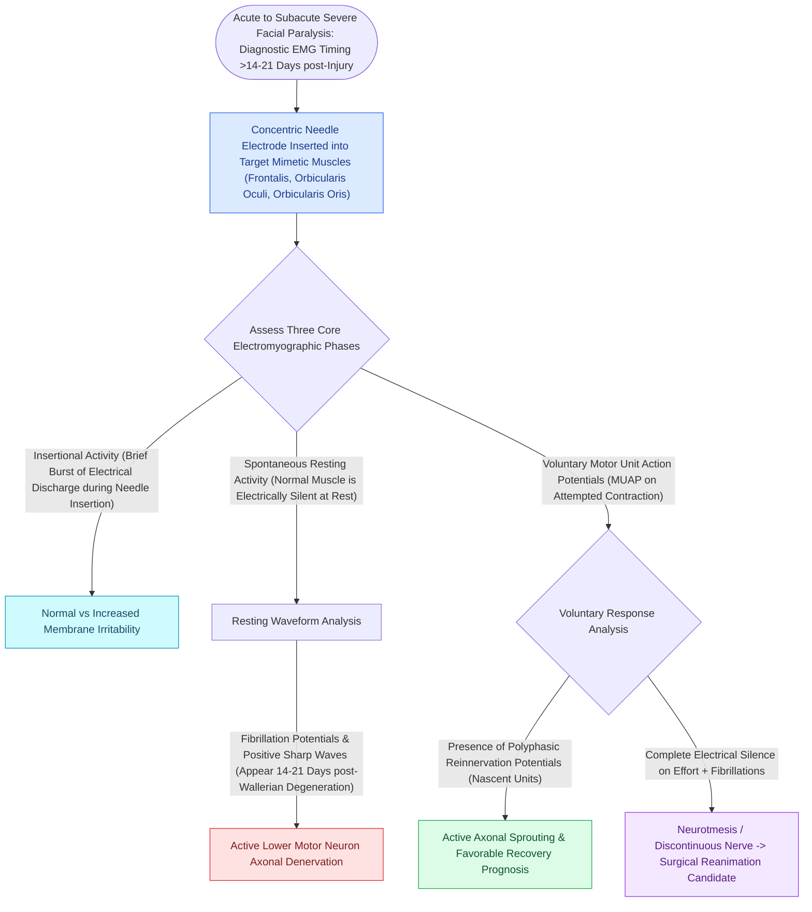

# Electromyography EMG detects voluntary motor unit potentials and fibrillations indicating denervation

## Active Recall

> [!question]- What does the presence of voluntary motor unit action potentials (MUAPs) on needle EMG indicate in a clinically paralyzed face?
> *Answer / Clinical Rationale*: It indicates **intact axonal continuity (neurapraxia)**, predicting excellent spontaneous functional recovery.

> [!question]- How long after an acute nerve injury do fibrillation potentials of denervation appear on EMG?
> *Answer / Clinical Rationale*: **$14\text{ to }21\text{ days}$** post-injury.

## Core Clinical & Mechanistic Principles
**Needle Electromyography (EMG)** records the electrical activity of [[Electroneuronography showing greater than ninety percent degeneration within fourteen days indicates severe facial nerve axonal injury|facial]] muscle fibers (orbicularis oculi, orbicularis oris) at rest and during voluntary contraction:
- **The Three Classic EMG Potentials**:
  1. **Voluntary Motor Unit Action Potentials (MUAPs)**:
     - Normal biphasic/triphasic potentials firing with voluntary facial effort.
     - **Presence of even a single voluntary MUAP** in a clinically paralyzed face indicates intact nerve continuity (neurapraxia) and guarantees excellent recovery, ruling out total axonotmesis.
  2. **Fibrillation Potentials & Positive Sharp Waves (Denervation Activity)**:
     - Spontaneous firing of hyper-excitable, denervated single muscle fibers at rest.
     - Appears **$14\text{–}21\text{ days}$ after axonal transection / degeneration** (once neuromuscular junctions degenerate).
  3. **Polyphasic (Nascent) Reinnervation Potentials**:
     - Complex, low-amplitude, multi-peaked potentials appearing **months after injury**, indicating newly sprouted immature axons re-innervating muscle motor endplates.

### Surgical Technique & Critical Safety Checks
- **Assessing Long-Term Muscle Receptivity**: In chronic facial paralysis ($>1\text{–}2\text{ years}$), presence of fibrillations confirms viable muscle that can receive a nerve transfer; complete electrical silence ("flatline") indicates irreversible muscular fibrosis and atrophy.

## Connected Concepts & Graph Traversal
- **Electroneuronography Degeneration**: [[Electroneuronography showing greater than ninety percent degeneration within fourteen days indicates severe facial nerve axonal injury|ENoG Evoked Compound Potentials]]
- **Clinical Severity Staging**: [[House-Brackmann grading system stratifies facial nerve function from Grade I normal to Grade VI total paralysis|House-Brackmann Grading Scale]]
- **Dynamic Smile Reanimation**: [[Masseteric nerve transfer to facial nerve branches restores rapid, powerful dynamic smile reanimation|Masseteric Nerve Transfer]]
- **🔗 Cable Graft Reinnervation (FPRS)**: [[Hypoglossal-facial nerve transfer restores resting facial symmetry and basal muscle tone|Hypoglossal-Facial Transfer]]
- **Intratemporal Nerve Anatomy**: [[The facial nerve traverses six distinct anatomical segments from the pons to the parotid gland|Fallopian Canal Segments]]
