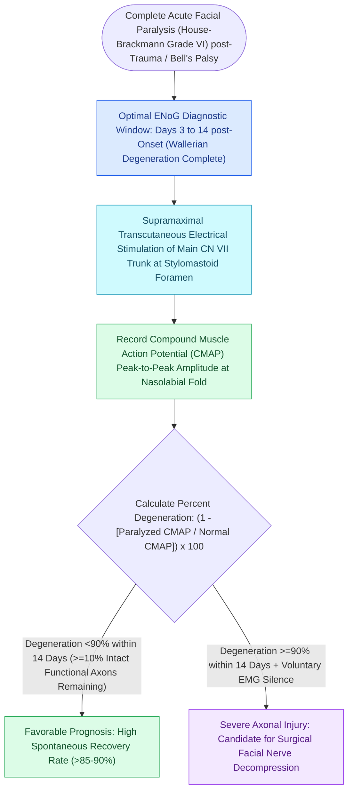

# Electroneuronography showing greater than ninety percent degeneration within fourteen days indicates severe facial nerve axonal injury

## Active Recall

> [!question]- Why is ENoG testing testing inaccurate and misleading if performed within the first 48 to 72 hours after complete facial paralysis onset?
> *Answer / Clinical Rationale*: Wallerian degeneration takes 48 to 72 hours to propagate distally from the intratemporal injury site (e.g., labyrinthine or tympanic segment) down to the extratemporal stylomastoid foramen and facial musculature. During this initial window, stimulating the distal nerve produces a normal CMAP, falsely underestimating severe proximal axonal disruption.

> [!question]- Why does ENoG lose its quantitative utility after 14 to 21 days post-paralysis?
> *Answer / Clinical Rationale*: Beyond 14 to 21 days, asynchronous axonal regeneration, collateral sprouting, and fibroblastic scarring cause desynchronized muscle firing, rendering CMAP amplitude comparison mathematically invalid. Electromyography (EMG) looking for fibrillation potentials and reinnervation motor units becomes the primary testing modality.

## Core Clinical & Mechanistic Principles
Electroneuronography (ENoG) provides an objective, quantitative electrophysiological measure of Wallerian degeneration in acute complete [[The House-Brackmann facial nerve grading system standardizes facial paralysis severity|facial nerve paralysis]] (House-Brackmann Grade VI) from [[Acute Bell's palsy presents with unilateral lower motor neuron facial paralysis treated with early oral steroids|Bell's palsy]] or [[Temporal bone longitudinal and transverse fractures cause delayed or immediate facial paralysis|temporal bone trauma]]. Transcutaneous supramaximal bipolar electrical stimulation is applied at the stylomastoid foramen, and the resulting compound muscle action potential (CMAP) is recorded over the nasolabial fold or orbicularis oris, comparing peak-to-peak amplitude on the paralyzed side to the healthy contralateral control.

Because Wallerian degeneration requires 48 to 72 hours to travel from an intratemporal injury site to the extratemporal recording electrodes, ENoG is uninformative before day 3. Between **day 3 and day 14**, the percentage of axonal degeneration directly dictates recovery prognosis and surgical candidacy:
$$\text{Percentage Degeneration} = \left(1 - \frac{\text{Paralyzed Side CMAP Amplitude}}{\text{Normal Side CMAP Amplitude}}\right) \times 100\%$$

### Electrophysiological Nuances & Fallopian Canal Decompression
- **The $90\%$ Degeneration Rule (Fisch Criterion)**:
  - When axonal degeneration remains $<90\%$, over 90% of patients achieve spontaneous return to House-Brackmann Grade I or II function without surgical intervention.
  - When degeneration reaches $\ge 90\%$ within 14 days, spontaneous recovery to Grade I drops below 50%, with high rates of severe permanent synkinesis (Grade III–IV).
- **Voluntary EMG Adjudication**:
  - Needle [[Electromyography EMG detects voluntary motor unit potentials and fibrillations indicating denervation|electromyography]] (EMG) is performed when ENoG shows $\ge 90\%$ loss. If active voluntary motor unit potentials are detected on needle EMG, intact axons traverse the lesion (neuroapraxia rather than neurotmesis), precluding surgical decompression.
## References
1. Baugh, R.F., Basura, G.J., Ishii, L.E., et al. (2013). Clinical Practice Guideline: Bell’s Palsy. *Otolaryngol Head Neck Surg*, 149(3_suppl):S1-S27.
2. Fisch, U. (1984). Prognostic value of electrical tests in acute facial paralysis. *Am J Otol*, 5(6):494-498.
3. Gantz, B.J., et al. (1999). Electroneurographic evaluation of facial nerve paralysis. *Laryngoscope*, 109(2 Pt 1):252-258.

## Connected Concepts & Graph Traversal
- **Physiological Basis**: [[Acute Bell's palsy presents with unilateral lower motor neuron facial paralysis treated with early oral steroids|Bell's Palsy Pathophysiology]]
- **Anatomical Substrate**: [[The facial nerve traverses six distinct anatomical segments from the pons to the parotid gland|Facial Nerve Fallopian Segments]]
- **🔗 Clinical Staging (FPRS)**: [[The House-Brackmann facial nerve grading system standardizes facial paralysis severity|House-Brackmann Grading Scale]]
- **Traumatic Etiology**: [[Temporal bone longitudinal and transverse fractures cause delayed or immediate facial paralysis|Temporal Bone Fractures]]
- **Critical Corneal Protection**: [[Lagophthalmos in facial nerve paralysis requires aggressive corneal lubrication, moisture chambers, and eyelid taping|Lagophthalmos Eye Care]]
