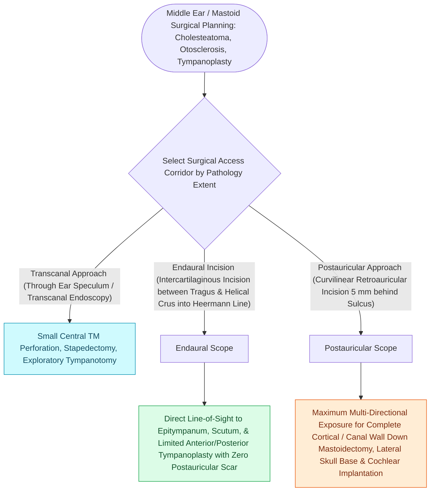

# Endaural and postauricular surgical approaches provide tailored exposure for middle ear pathology

## Active Recall

> [!question]- What anatomical space lacking cartilage is incised during an endaural approach?
> *Answer / Clinical Rationale*: The **incisura terminalis** (between the tragus and the crus of the helix).

> [!question]- Why is a postauricular approach preferred for cochlear implantation and comprehensive mastoidectomy?
> *Answer / Clinical Rationale*: It provides **maximum 3D surgical exposure** of the entire mastoid cortex, sinodural angle, and facial recess corridor.

## Core Clinical & Mechanistic Principles
Selecting the optimal surgical approach to the middle ear and mastoid depends on the disease extent, canal anatomy, and planned reconstruction:
- **Transcanal (Per-meatal) Approach**:
  - *Indication*: [[Stapedotomy utilizes a micro-drill or laser fenestration of the posterior footplate|Stapedotomy]], exploratory tympanotomy, small central perforations.
  - *Execution*: Speculum examination; tympanomeatal flap elevated via transcanal incisions.
- **Endaural Approach (Lempert Incision)**:
  - *Indication*: Epitympanotomy, limited mastoidectomy, [[Wide meatoplasty provides adequate aeration and easy cleaning of a canal wall down mastoid cavity|meatoplasty]], anterior/inferior canal wall exposure.
  - *Execution*: Superior vertical incision between tragus and helix into the incisura terminalis (preserves helical cartilage); connects to intercartilaginous canal incisions.
- **Postauricular (Retroauricular) Approach**:
  - *Indication*: Complete [[Complete cortical mastoidectomy unroofs the mastoid antrum and establishes dependent middle ear drainage|cortical mastoidectomy]], canal wall up/down mastoidectomy, cochlear implantation, lateral skull base surgery.
  - *Execution*: C-shaped incision $5\text{–}10\text{ mm}$ behind the postauricular crease; elevates periosteum ([[Mastoid obliteration with local muscle flaps or bioactive glass reduces cavity volume and discharge|Palva flap]]) to expose the entire mastoid cortex and Macewen's triangle.

### Surgical Technique & Critical Safety Checks
- **Incisura Terminalis Anatomy**: An avascular space between the tragus and helix lacking cartilage; incising here in an endaural approach avoids cartilage transection and chondritis.

## Connected Concepts & Graph Traversal
- **Surface Antral Projection**: [[The Macewen triangle and Henle spine indicate the surface projection of the mastoid antrum|Macewen Triangle]]
- **Tympanoplasty Techniques**: [[Underlay and overlay tympanoplasty techniques have distinct advantages and complication profiles|Underlay vs Overlay]]
- **Mastoid Aeration**: [[Complete cortical mastoidectomy unroofs the mastoid antrum and establishes dependent middle ear drainage|Cortical Mastoidectomy]]
- **Cartilage Graft Stiffening**: [[Cartilage island tympanoplasty resists negative middle ear pressure and recurrent retraction|Cartilage Island Tympanoplasty]]
- **EAC Canalplasty**: [[Canal wall down mastoidectomy lowers the facial ridge and exteriorizes the mastoid into the ear canal|Canal Wall Down Approach]]
