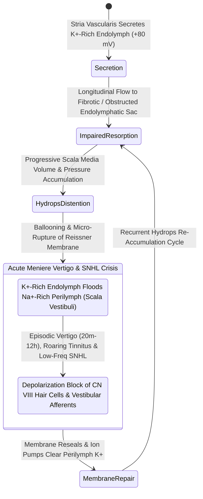

# Endolymphatic hydrops results from impaired resorption of endolymph within the endolymphatic sac

## Active Recall

> [!question]- What is the histopathological hallmark of Meniere's disease?
> *Answer / Clinical Rationale*: **Endolymphatic hydrops** (distension of the scala media and saccule with displacement of Reissner's membrane).

> [!question]- Why does rupture of Reissner's membrane cause acute vertigo and sensorineural dysfunction?
> *Answer / Clinical Rationale*: Because **potassium-rich endolymph mixes into the perilymph**, depolarizing the unmyelinated vestibular and cochlear nerve fibers and causing acute conduction block.

## Core Clinical & Mechanistic Principles
**Endolymphatic hydrops** is the histopathological hallmark of [[Meniere disease is characterized by episodic vertigo, fluctuating low-frequency SNHL, tinnitus, and aural fullness|Meniere's disease]], characterized by pathological distension of the endolymphatic compartment (scala media and otolith organs):
- **Pathophysiological Mechanisms of Fluid Dynamic Failure**:
  - Endolymph is produced by the **[[The stria vascularis generates the endocochlear potential of positive eighty millivolts|stria vascularis]]** in the cochlea and dark cells in the vestibular labyrinth.
  - Endolymph flows longitudinally via the endolymphatic duct to the **endolymphatic sac (ES)** on the posterior petrous ridge, where it is resorbed and immunologically regulated.
  - Impaired resorption (fibrosis, microvascular ischemia, or hypoplasia of the endolymphatic duct/sac) causes progressive **endolymph volume expansion and hypertension**.
- **The Schuknecht Membrane Rupture Theory**:
  1. Elevated endolymphatic pressure distends **Reissner's membrane** toward the scala vestibuli.
  2. Periodic microscopic **ruptures of Reissner's membrane** occur, allowing potassium-rich endolymph ($\text{K}^+ \approx 150\text{ mM}$) to mix with perilymph ($\text{Na}^+$-rich).
  3. High $\text{K}^+$ perilymph bathes the basolateral surfaces of hair cells and vestibular nerve fibers, causing **prolonged sustained depolarization block, acute vertigo, and temporary hearing loss**.

### Surgical Technique & Critical Safety Checks
- **Delayed Endolymphatic Hydrops**: Hydrops developing years or decades after profound sensorineural hearing loss in the same (ipsilateral) or opposite (contralateral) ear.

## Connected Concepts & Graph Traversal
- **Clinical Symptom Triad**: [[Meniere disease is characterized by episodic vertigo, fluctuating low-frequency SNHL, tinnitus, and aural fullness|Meniere Disease]]
- **Electrodiagnostic Testing**: [[Electrocochleography SP to AP ratio exceeding zero point four indicates endolymphatic hydrops|ECoG SP/AP Ratio]]
- **Endocochlear Potential**: [[The stria vascularis generates the endocochlear potential of positive eighty millivolts|Stria Vascularis]]
- **Surgical Decompression**: [[Endolymphatic sac decompression and shunt surgery alleviate hydrops while preserving auditory function|Endolymphatic Sac Shunt]]
- **Medical Osmotic Therapy**: [[Low-sodium diet, hydrochlorothiazide, and betahistine form the first-line medical therapy for Meniere disease|Medical Hydrops Therapy]]
