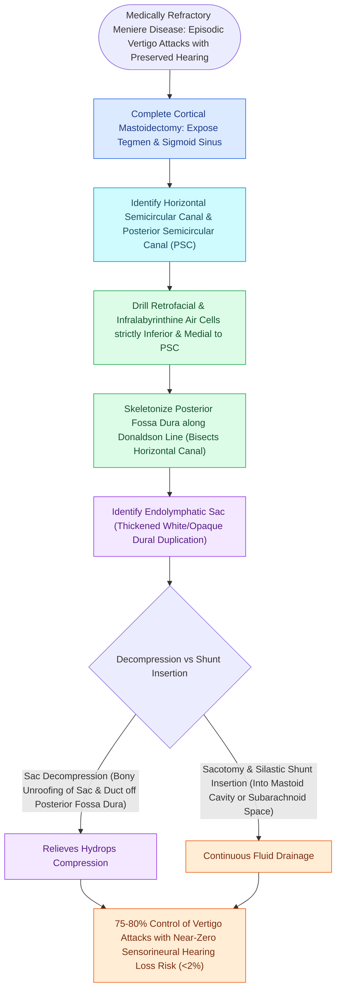

# Endolymphatic sac decompression and shunt surgery alleviate hydrops while preserving auditory function

## Active Recall

> [!question]- What is Donaldson's line, and what is its surgical significance?
> *Answer / Clinical Rationale*: An imaginary line through the **plane of the lateral semicircular canal bisecting the posterior canal**; the **endolymphatic sac always lies INFERIOR to this line**.

> [!question]- What is the hearing preservation rate of endolymphatic sac decompression surgery?
> *Answer / Clinical Rationale*: Greater than **$95\%$** (making it the safest surgical intervention for Meniere's disease).

## Core Clinical & Mechanistic Principles
**Endolymphatic Sac (ES) Surgery** (described by Georges Portmann in 1927) is the premier non-destructive, hearing-preserving surgical procedure for medically refractory [[Meniere disease is characterized by episodic vertigo, fluctuating low-frequency SNHL, tinnitus, and aural fullness|Meniere's disease]]:
- **Anatomical Landmarks of the Endolymphatic Sac**:
  - Situated on the posterior petrous surface, lying between the **posterior semicircular canal (PSCC)** and the **sigmoid sinus**.
  - **Donaldson's Line**: An imaginary horizontal line drawn through the plane of the **lateral semicircular canal (LSCC)** bisecting the posterior canal; the **endolymphatic sac always lies INFERIOR to Donaldson's line**.
- **Surgical Step-by-Step Execution**:
  1. Complete [[Complete cortical mastoidectomy unroofs the mastoid antrum and establishes dependent middle ear drainage|cortical mastoidectomy]]; skeletonize tegmen, sigmoid sinus, and bony labyrinth.
  2. Identify the hard white bone of the posterior semicircular canal.
  3. Draw Donaldson's line; drill the retrofacial bone inferior to the line over the posterior fossa dura.
  4. Expose the sac (appears as a thick, white, glistening duplication of the posterior fossa dura).
  5. **Decompression vs. Shunt**:
     - *Simple Decompression*: 360-degree bony unroofing of the sac.
     - *Endolymphatic-Mastoid Shunt*: Incise lateral wall of sac; insert Silastic sheet or valve drain into sac lumen to drain into the mastoid bowl.

### Surgical Technique & Critical Safety Checks
- **Outcomes**: Achieves vertigo control in **$70\text{–}80\%$** of patients with a **$>95\%$ hearing preservation rate**.

## Connected Concepts & Graph Traversal
- **Underlying Pathophysiology**: [[Endolymphatic hydrops results from impaired resorption of endolymph within the endolymphatic sac|Endolymphatic Hydrops]]
- **Clinical Meniere Triad**: [[Meniere disease is characterized by episodic vertigo, fluctuating low-frequency SNHL, tinnitus, and aural fullness|Meniere Disease]]
- **Anatomical Landmark**: [[Complete cortical mastoidectomy unroofs the mastoid antrum and establishes dependent middle ear drainage|Sinodural Angle & Donaldson's Line]]
- **Chemical Ablation Alternative**: [[Intratympanic dexamethasone and gentamicin provide non-ablative and chemical ablative control of Meniere vertigo|Intratympanic Perfusion]]
- **Electrodiagnostic Monitoring**: [[Electrocochleography SP to AP ratio exceeding zero point four indicates endolymphatic hydrops|ECoG Monitoring]]
