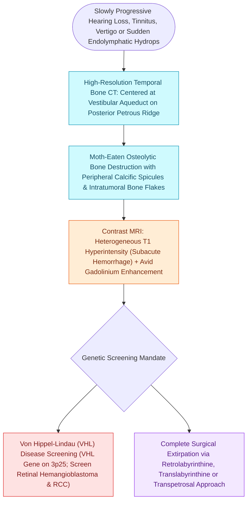

# Endolymphatic sac tumors present as destructive lesions of the posterior petrous ridge associated with VHL

## Active Recall

> [!question]- What hereditary genetic cancer syndrome is strongly associated with endolymphatic sac tumors (ELST)?
> *Answer / Clinical Rationale*: **Von Hippel-Lindau (VHL) disease** (mutation in the VHL gene on chromosome 3p25).

> [!question]- What is the characteristic CT appearance of an endolymphatic sac tumor?
> *Answer / Clinical Rationale*: Expansile, **'moth-eaten' permeative osteolytic bone destruction of the posterior petrous ridge** centered between the IAC and sigmoid sinus.

## Core Clinical & Mechanistic Principles
**Endolymphatic Sac Tumors (ELSTs / Heffner Tumors)** are rare, low-grade, locally aggressive adenocarcinomas arising from the epithelium of the endolymphatic duct or sac:
- **Strong Genetic Link to Von Hippel-Lindau (VHL) Disease**:
  - Associated with germline mutations in the **VHL tumor suppressor gene** on chromosome 3p25.
  - ELSTs occur in **$10\text{–}15\%$ of patients with VHL**, frequently presenting **bilaterally ($30\%$)**.
  - Often the *initial manifesting feature* of VHL before central nervous system hemangioblastomas or renal cell carcinomas are detected.
- **Clinical Presentation**:
  - Progressive or [[Idiopathic sudden sensorineural hearing loss requires prompt systemic corticosteroids and intratympanic salvage injection|sudden sensorineural hearing loss]], tinnitus, aural fullness, and vertigo, frequently misdiagnosed as [[Meniere disease is characterized by episodic vertigo, fluctuating low-frequency SNHL, tinnitus, and aural fullness|Meniere]]'s disease.
  - Late facial nerve weakness.
- **Radiological Pathognomonic Features**:
  - **High-Resolution CT**: "Moth-eaten", expansile, permeative bone erosion of the **posterior petrous ridge centered between the IAC and the sigmoid sinus** (the site of the vestibular aqueduct / fovea endolymphatica).
  - **MRI**: Heterogeneous hyperintensity on T1-weighted images (due to subacute hemorrhage / cholesterol crystals) with avid heterogeneous post-contrast enhancement.

### Surgical Technique & Critical Safety Checks
- **Surgical Management**: Complete wide surgical excision via translabyrinthine or [[The retrosigmoid suboccipital approach allows hearing preservation for small to medium vestibular schwannomas|retrosigmoid approach]]; radiation therapy reserved for unresectable residual disease.

## Connected Concepts & Graph Traversal
- **Hydrops Pathophysiology**: [[Endolymphatic hydrops results from impaired resorption of endolymph within the endolymphatic sac|Endolymphatic Hydrops]]
- **Surgical Skull Base Corridor**: [[The translabyrinthine approach provides direct exposure of the internal auditory canal with complete hearing sacrifice|Translabyrinthine Approach]]
- **Radiological Differential**: [[Jugular paragangliomas arise from the glomus body in the adventitia of the jugular bulb|Jugular Foramen Tumors]]
- **Facial Nerve Monitoring**: [[Intraoperative facial nerve and cochlear nerve monitoring minimize cranial nerve morbidity in skull base surgery|Intraoperative CN VII Monitoring]]
- **Hearing Preservation Route**: [[The retrosigmoid suboccipital approach allows hearing preservation for small to medium vestibular schwannomas|Retrosigmoid Approach]]
