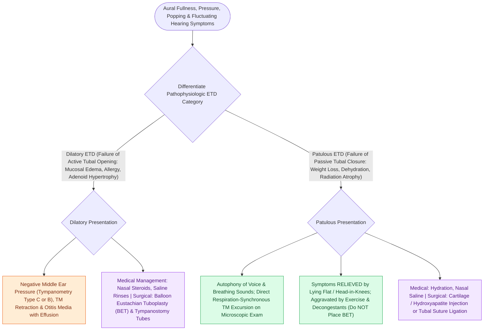

# Eustachian tube dysfunction divides into dilatory and patulous forms with opposite treatment goals

## Active Recall

> [!question]- A patient hears their own breathing, better when lying down. Dilatory or patulous — and why does position matter?
> *Answer / Clinical Rationale*: **Patulous**; recumbency congests peritubal venous plexus and passively closes the incompetent valve.

> [!question]- What must precede balloon tuboplasty for unilateral adult dilatory ETD?
> *Answer / Clinical Rationale*: Nasopharyngoscopy — a postnasal-space tumor must be excluded before instrumenting the tube.

## Core Clinical & Mechanistic Principles
- **Dilatory ETD**: failed tubal opening (tensor veli palatini-mediated) with negative middle ear pressure, retraction, and effusion; **patulous ETD**: a tube that will not close, producing **autophony of one's own breathing and voice** relieved when supine or with head-dependent positioning.
- The autophony discriminator: patulous patients hear their **breathing**; third-window ([[Superior semicircular canal dehiscence SCDS presents with Tullio phenomenon and sound-induced vertigo|SCDS]]) patients hear somatic sounds (eyes, heartbeat) without respiratory autophony and without positional relief.
- Patulous associations: significant weight loss (Ostmann fat pad atrophy), pregnancy/estrogen states, dehydration.
- Diagnosis is largely clinical plus tympanometry; observing medial drum excursion with respiration confirms patulous disease.

### Management & Critical Safety Checks
- Refractory dilatory ETD: **balloon eustachian tuboplasty** of the cartilaginous tube after nasopharyngeal exam excludes neoplasm; treat rhinitis/reflux contributors first.
- Patulous ETD is treated in the opposite direction: hydration, avoiding decongestants, and augmentation of the tubal valve (injection or shim) for severe cases.

## Connected Concepts & Graph Traversal
- **Immittance Diagnosis**: [[Tympanometry classifies middle ear compliance and pressure into Jerger Types A, As, Ad, B, and C|Jerger Immittance Curves]]
- **Middle Ear Negative Pressure**: [[Cartilage island tympanoplasty resists negative middle ear pressure and recurrent retraction|Cartilage Island Tympanoplasty]]
- **Adult Effusion Red Flag**: [[Adult unilateral otitis media with effusion mandates nasopharyngoscopy to exclude nasopharyngeal carcinoma|Nasopharyngoscopy in Adult OME]]
- **Retraction Pocket Genesis**: [[Primary acquired cholesteatoma arises from retraction pocket invagination of the pars flaccida into Prussak space|Prussak Space Cholesteatoma]]
- **Acoustic Impedance Matching**: [[The middle ear transformer ratio provides twenty-seven decibels of acoustic impedance matching|Middle Ear Transformer Ratio]]
