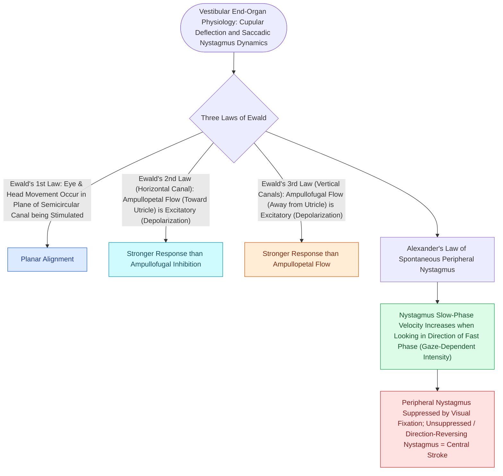

# Ewald's laws and Alexander's law govern the directional dynamics and intensity of vestibular nystagmus

## Active Recall

> [!question]- What are Ewald's Three Laws of semicircular canal stimulation and endolymph flow?
> *Answer / Clinical Rationale*: - **Ewald's 1st Law**: The plane of induced nystagmus corresponds precisely to the anatomical **plane of the semicircular canal being stimulated** (horizontal, superior/anterior, or posterior). - **Ewald's 2nd Law (Horizontal Canal)**: **Ampullopetal endolymph flow** (flowing *toward* the ampulla) causes **excitation / depolarization** and generates a significantly greater neural response than inhibitory ampullofugal flow (*away from* the ampulla). - **Ewald's 3rd Law (Vertical Canals)**: **Ampullofugal endolymph flow** (flowing *away from* the ampulla) causes **excitation / depolarization** in the superior and posterior canals, producing a greater neural response than ampullopetal flow.

> [!question]- How does Alexander's Law define the intensity grades (1st, 2nd, and 3rd degree) of peripheral vestibular nystagmus?
> *Answer / Clinical Rationale*: **Alexander's Law** states that the **intensity (frequency and slow-phase velocity) of spontaneous peripheral vestibular nystagmus increases when the patient gazes in the direction of the fast phase (quick component)**. - **1st Degree Nystagmus**: Present *only* when gazing in the direction of the fast phase. - **2nd Degree Nystagmus**: Present in *neutral (straight-ahead) gaze* AND *fast-phase gaze*. - **3rd Degree Nystagmus**: Present in *all three gaze positions* (neutral, fast-phase, and slow-phase gaze), exhibiting the greatest intensity when looking in the fast-phase direction.

> [!question]- What five clinical features differentiate peripheral vestibular nystagmus from central nystagmus?
> *Answer / Clinical Rationale*: (1) **Direction**: Peripheral is *unidirectional, horizontal-torsional*; central can be *purely vertical (downbeat/upbeat), purely torsional, or direction-changing on eccentric gaze*. (2) **Visual Fixation**: Peripheral is *suppressed / inhibited by visual fixation*; central is *unsuppressed or enhanced*. (3) **Alexander's Law**: Peripheral *always follows Alexander's law*; central *frequently violates it*. (4) **Associated Symptoms**: Peripheral exhibits severe vertigo, nausea, and autonomic symptoms proportional to nystagmus; central exhibits mild vertigo despite prominent nystagmus with neurologic signs (ataxia, dysmetria). (5) **Fatigue & Latency**: Peripheral exhibits latency and fatigability on positional testing; central has no latency and is non-fatiguing.

## Core Clinical & Mechanistic Principles

[[Bithermal caloric testing calculates Jongkees formula to quantify unilateral vestibular paresis|Vestibular]] physiology relies on resting tonic firing rates ($\approx 70-100\text{ action potentials/second}$) in the primary vestibular afferents of the **crista ampullaris**. Stereocilia deflection toward the **kinocilium** depolarizes the hair cell (excitation), while deflection away hyperpolarizes it (inhibition):

## Connected Concepts & Graph Traversal
- **BPPV Canalithiasis**: [[Benign paroxysmal positional vertigo BPPV results from canalithiasis or cupulolithiasis in semicircular canals|BPPV Semicircular Canal Pathophysiology]]
- **Dix-Hallpike & Epley**: [[The Dix-Hallpike maneuver produces torsional upbeating nystagmus in posterior canal BPPV|Dix-Hallpike & Alexander Dynamics]]
- **Bithermal Caloric Testing**: [[Bithermal caloric testing calculates Jongkees formula to quantify unilateral vestibular paresis|Jongkees Caloric Paresis Formula]]
- **HINTS Bedside Examination**: [[The HINTS examination separates vestibular neuritis from posterior circulation stroke in acute vestibular syndrome|HINTS Exam & Stroke Differentiation]]
- **Video Head Impulse Test (vHIT)**: [[The video head impulse test vHIT identifies high-frequency angular vestibulo-ocular reflex deficits|vHIT Dynamic VOR Assessment]]
- **Vestibular Neuritis & Recovery**: [[Vestibular neuritis causes acute spontaneous prolonged vertigo without auditory symptoms|Vestibular Neuritis Compensation]]
