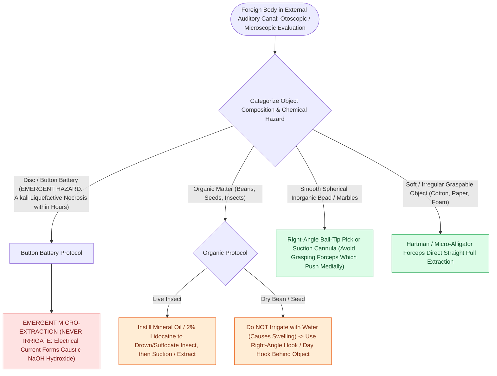

# External auditory canal foreign bodies require atraumatic extraction under microscopic guidance to protect the tympanic membrane

## Active Recall

> [!question]- Why should grasping alligator forceps be avoided when attempting to extract a round, smooth bead or marble from the ear canal?
> *Answer / Clinical Rationale*: Grasping forces applied to the convex surface of a smooth, spherical object cause the forceps tips to slip and propel the object deeper past the **isthmus** of the canal, impacting it tightly against the tympanic membrane and risking eardrum perforation or ossicular disruption. A right-angle hook passed behind the object is the instrument of choice.

> [!question]- What is the immediate bedside step when a patient presents with a live insect fluttering inside the external auditory canal?
> *Answer / Clinical Rationale*: Instill **mineral oil** or 2% lidocaine into the ear canal immediately. This rapidly suffocates and drowns the insect, halting wing fluttering and movement against the highly sensitive tympanic membrane, allowing painless atraumatic extraction.

## Core Clinical & Mechanistic Principles

**External auditory canal (EAC) foreign bodies (FBs)** are common in pediatric patients (toddlers exploring orifices) and cognitively impaired or adult patients (cotton swab tips, hearing aid domes, insects). Objects fall into three mechanical categories:
1. **Inanimate Non-Spherical / Graspable**: Paper, cotton, foam, beads with holes.
2. **Inanimate Smooth / Spherical**: Popcorn kernels, marbles, BBs, round beads (high propensity to be pushed medially past the **isthmus of the canal**).
3. **Organic / Biological & Chemical Hazards**: Live insects, beans/seeds (which swell when exposed to water/drops), and **button batteries** (alkaline liquefaction necrosis requiring emergent extraction within hours).

The EAC possesses a narrow anatomical constriction—the **isthmus**—at the junction of the lateral cartilaginous third and medial bony two-thirds. Inadvertent blind probing with cotton swabs or blunt forceps frequently wedges spherical objects past the isthmus into the anterior tympanic recess, causing exquisite pain, canal lacerations, [[Traumatic tympanic membrane perforations heal spontaneously in the majority of cases without early surgery|tympanic membrane perforation]], or ossicular dislocation. Binocular operating microscopy provides essential depth perception, illumination, and bimanual control.

### Surgical Technique & Craft Nuance: Instrument Selection & Extraction

1. **Microscopic Visualization**: Use an operating microscope and appropriate-sized metallic ear speculum. An uncooperative child should be safely immobilized with a papoose board or planned for general anesthesia / sedation in the operating room rather than risking blind canal trauma.
2. **Smooth & Spherical Objects**: Do **NOT** use grasping alligator forceps (which slip off the curved surface and project the object deeper). Instead, use a **0.5 mm or 1.0 mm right-angle blunt hook** or Day ear loop. The hook is carefully introduced in a flat profile through the gap between the canal wall and object, advanced slightly medial to the object, rotated 90 degrees behind it, and gently drawn laterally along the canal floor.
3. **Live Insects**: Instill **mineral oil**, baby oil, or 2% viscous lidocaine into the canal to immediately suffocate and immobilize the insect prior to removal with micro-forceps or Frazier suction.
4. **Button Batteries**: True otologic emergencies. Electrolytic reactions generate hydroxide ions at the negative pole, inducing alkaline liquefaction necrosis of the canal skin and tympanic bone within 1–2 hours. Do **NOT** instill eardrops or saline (which completes the electrical circuit and accelerates burn depth). Remove immediately under microscope.
### Key Consultation Supplies
- Coaxial surgical headlight, loupes, or binocular operating microscope (preferred)
- Metallic ear speculums (sizes 3, 4, 5 mm)
- Right-angle micro-hooks (0.5 mm and 1.0 mm)
- Day / Billeau ear loop curettes
- Hartman / Wullstein alligator micro-forceps and micro-cup forceps
- Frazier suction tips (size 5 Fr and 7 Fr) with thumb-control port
- Mineral oil or 2% lidocaine solution (for insect immobilization)
- Ototopical antibiotic drops (ciprofloxacin-dexamethasone or ofloxacin 0.3%)

> [!example]- **Operative Note Template: Bedside external auditory canal foreign body removal**
> **PROCEDURE**: Bedside external auditory canal [[Nasal foreign bodies presenting with unilateral foul-smelling rhinorrhea mandate urgent removal with particular vigilance for button batteries|foreign]] body removal
> **PRE-PROCEDURAL DIAGNOSIS**: Foreign body of the [right/left] external auditory canal
> **POST-PROCEDURAL DIAGNOSIS**: Foreign body of the [right/left] external auditory canal status-post successful extraction
> **SURGEON**: [Surgeon Name, MD]
> **ASSISTANT**: [Resident/Fellow Name, MD]
>
> **PROCEDURE IN DETAIL**:
> Informed consent was obtained from the patient/parent. The patient was positioned supine with the head rotated to expose the affected ear. Under direct visualization using the binocular operating microscope, an appropriately sized ear speculum was inserted.
>
> The foreign body ([describe object, e.g., smooth bead / popcorn kernel / insect]) was visualized in the mid-to-medial external auditory canal. A 0.5 mm right-angle micro-hook was carefully advanced in a flat orientation between the superior canal wall and the foreign body, rotated 90 degrees behind the object, and gently drawn laterally along the canal floor, successfully delivering the foreign body atraumatically as a single unit.
>
> Post-extraction microscopic examination of the external auditory canal and tympanic membrane was performed. The tympanic membrane was completely intact with normal landmarks and no perforation. Mild superficial canal erythema without laceration was noted. Ciprofloxacin-dexamethasone otic drops (4 drops) were instilled into the canal. The patient tolerated the procedure well without complications.

## References
1. Friedman, E.M. (2016). Videos in Clinical Medicine. Removal of Foreign Bodies from the Ear and Nose. *N Engl J Med*, 374(7):e7.
2. Lotterman, S., Sohal, M. (2020). Ear Foreign Body Removal. In: *StatPearls*. Treasure Island (FL): StatPearls Publishing.
3. Olson, M.D., Saw, J., Visscher, S., Balakrishnan, K. (2018). Cost comparison and safety of emergency department conscious sedation for the removal of ear foreign bodies. *Int J Pediatr Otorhinolaryngol*, 110:140-143.

## Connected Concepts & Graph Traversal
- **🔗 Critical Emergency Protocol (Pediatrics)**: [[Nasal foreign bodies presenting with unilateral foul-smelling rhinorrhea mandate urgent removal with particular vigilance for button batteries|Button Battery Emergency]]
- **Iatrogenic Complication Rescue**: [[Traumatic tympanic membrane perforations heal spontaneously in the majority of cases without early surgery|Tympanic Membrane Trauma]]
- **Infectious Sequela**: [[Acute otitis externa is managed with topical antimicrobial-steroid drops and aural debridement|Acute Otitis Externa]]
- **Anatomical Foundation**: [[Live insect foreign bodies in the ear canal require mineral oil immobilization prior to microscopic extraction|Live Insect EAC Removal]]
- **Surgical Craft**: [[Active middle ear implants drive ossicular vibration via floating mass transducers to rehabilitate sensorineural and mixed hearing loss without external canal occlusion|Active Middle Ear Implants]]
