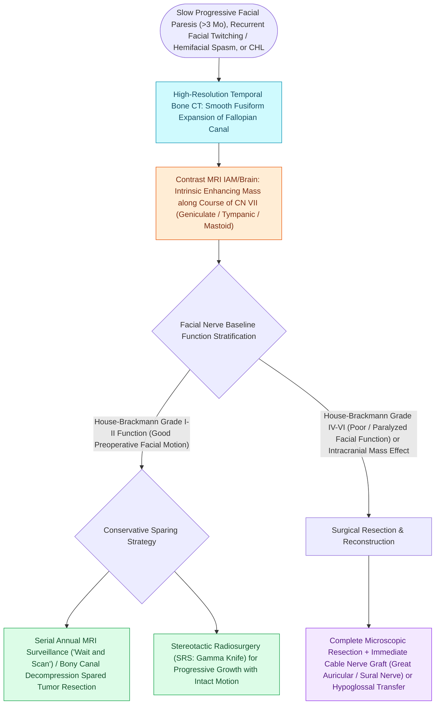

# Facial nerve schwannomas present with slow progressive paralysis or facial twitching along the Fallopian canal

## Active Recall

> [!question]- What clinical symptom is characteristically seen in facial nerve schwannomas but virtually never in vestibular schwannomas?
> *Answer / Clinical Rationale*: **Facial twitching / facial hyperkinesis / hemifacial spasm**.

> [!question]- What is the preferred management for a small facial nerve schwannoma in a patient with House-Brackmann Grade I or II function?
> *Answer / Clinical Rationale*: **Conservative observation (wait-and-scan with serial MRI)** to preserve good facial nerve function.

## Core Clinical & Mechanistic Principles
**Facial Nerve Schwannomas (Neuromas)** are rare, slow-growing benign nerve sheath tumors arising from Schwann cells anywhere along the course of CN VII:
- **Predilection Sites**:
  - The **geniculate ganglion ($50\text{–}60\%$)** and the **tympanic/mastoid segments** are the most common locations.
  - Multi-segmental involvement ("dumbbell" tumors spanning the middle and posterior cranial fossae) is common.
- **Clinical Presentation**:
  1. **Slowly Progressive Facial Weakness** (over months to years; distinct from sudden [[Acute Bell's palsy presents with unilateral lower motor neuron facial paralysis treated with early oral steroids|Bell's palsy]]).
  2. **Facial Hyperkinesis / Twitching / Hemifacial Spasm** (present in $15\text{–}25\%$; virtually never seen in vestibular schwannomas).
  3. **Recurrent "Bell's Palsy" Episodes** (with incomplete recovery between attacks).
  4. Conductive or sensorineural hearing loss (due to ossicular erosion or cochlear compression).
- **High-Resolution CT & MRI Characteristics**:
  - **CT**: Smooth, expansile bony remodeling and widening of the [[The facial nerve traverses six distinct anatomical segments from the pons to the parotid gland|Fallopian canal]] / geniculate fossa.
  - **MRI**: T1 isointense, T2 hyperintense, avidly enhancing mass tracking along the course of the facial canal.

### Surgical Technique & Critical Safety Checks
- **Management Strategy**:
  - If facial function is **good (HB I–II)**: Conservative observation ("wait-and-scan") or stereotactic radiosurgery to preserve function.
  - If facial function is **poor (HB IV–VI) or tumor is massive**: Surgical resection with **immediate cable nerve grafting** (GAN or sural nerve).

## Connected Concepts & Graph Traversal
- **Intratemporal Fallopian Segments**: [[The facial nerve traverses six distinct anatomical segments from the pons to the parotid gland|CN VII Anatomical Segments]]
- **Clinical Functional Staging**: [[House-Brackmann grading system stratifies facial nerve function from Grade I normal to Grade VI total paralysis|House-Brackmann Scale]]
- **Differential CPA Neoplasm**: [[Vestibular schwannomas arise from the Schwann cell sheath of the inferior or superior vestibular nerve|Vestibular Schwannoma Differential]]
- **Surgical Epineurial Repair**: [[Immediate direct epineurial end-to-end repair is the gold standard for transected facial nerve injury|Epineurial Nerve Repair]]
- **Dynamic Reanimation**: [[Masseteric nerve transfer to facial nerve branches restores rapid, powerful dynamic smile reanimation|Masseteric Nerve Transfer]]
