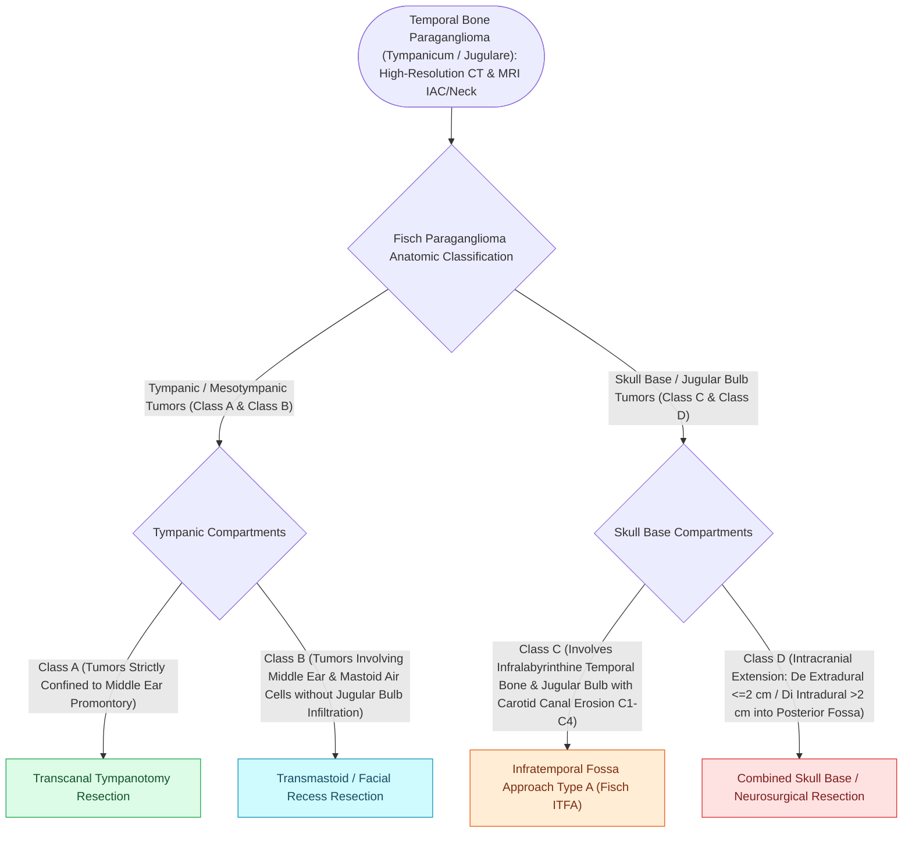

# Fisch classification categorizes temporal bone and skull base paragangliomas from Class A to Class D

## Active Recall

> [!question]- What defines a Fisch Class C temporal bone paraganglioma?
> *Answer / Clinical Rationale*: Tumor that **erodes the bony plate over the jugular bulb and invades the carotid canal**.

> [!question]- What is the difference between Fisch Class De and Class Di intracranial extension?
> *Answer / Clinical Rationale*: **Class De indicates extradural extension**; **Class Di indicates intradural subarachnoid extension** into the posterior or middle cranial fossa.

## Core Clinical & Mechanistic Principles
The **Fisch Classification System** is the universally accepted staging system for temporal bone and lateral skull base paragangliomas, dictating the required surgical approach:
- **Class A (Glomus Tympanicum)**:
  - Tumor is strictly confined to the middle ear promontory; completely visible on otoscopy.
  - *Surgical Approach*: Transcanal exploratory tympanotomy.
- **Class B (Glomus Tympanomastoideum)**:
  - Tumor involves the middle ear, hypotympanum, and mastoid air cells, but **does NOT erode the bone over the jugular bulb**.
  - *Surgical Approach*: Transmastoid / [[Posterior tympanotomy facial recess approach opens the corridor between CN VII and chorda tympani|facial recess approach]] $\pm$ canal wall down.
- **Class C (Glomus Jugulare / Infralabyrinthine)**:
  - Tumor destroys the bone of the **jugular bulb and carotid canal**:
    - **C1**: Destroys bone over the jugular bulb and vertical carotid canal.
    - **C2**: Invades the vertical carotid canal between the carotid genu and bifurcation.
    - **C3**: Invades the horizontal carotid canal to the foramen lacerum.
    - **C4**: Invades the cavernous sinus.
  - *Surgical Approach*: **Fisch Infratemporal Fossa Approach Type A (ITFA-A)**.
- **Class D (Intracranial Extension)**:
  - **De1 / De2**: Extradural intracranial extension ($<2\text{ cm}$ vs. $>2\text{ cm}$).
  - **Di1 / Di2 / Di3**: Intradural intracranial extension ($<2\text{ cm}$, $2\text{–}4\text{ cm}$, $>4\text{ cm}$).

### Surgical Technique & Critical Safety Checks
- **Surgical Selection**: Class A/B are managed otologically; Class C/D mandate lateral skull base infratemporal approaches with vascular control.

## Connected Concepts & Graph Traversal
- **Glomus Jugulare Pathology**: [[Jugular paragangliomas arise from the glomus body in the adventitia of the jugular bulb|Glomus Jugulare Pathology]]
- **Surgical Transposition Approach**: [[Fisch infratemporal fossa approach Type A mobilizes the facial nerve and exposes the jugular foramen|Infratemporal Fossa Type A]]
- **Preoperative Devascularization**: [[Preoperative embolization reduces intraoperative blood loss in hypervascular glomus jugulare tumors|Preoperative Angiographic Embolization]]
- **Pulsatile Vascular Symptom**: [[Pulsatile tinnitus is differentiated into arterial and venous etiologies by auscultation, jugular compression, and targeted vascular imaging|Pulsatile Tinnitus Workup]]
- **Lower Cranial Neuropathies**: [[Cranial nerve polyneuropathies of the skull base are localized by specific anatomical foramen involvement|Jugular Foramen Polyneuropathies]]
