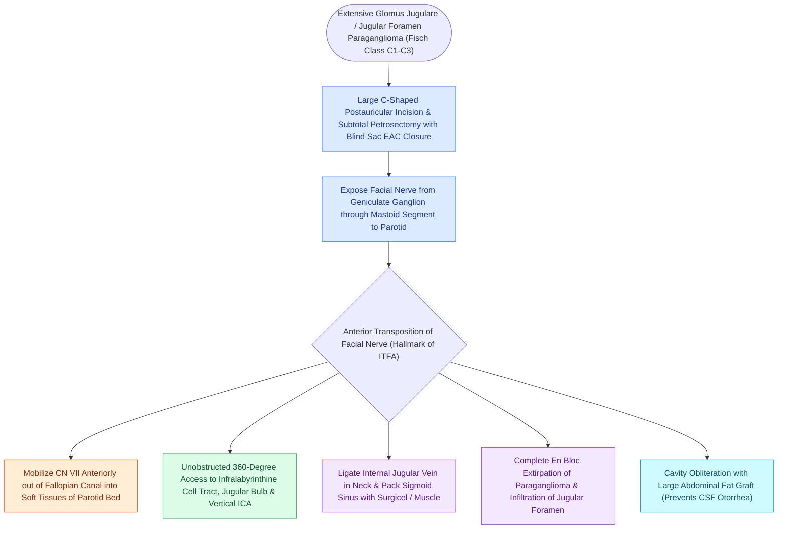

# Fisch infratemporal fossa approach Type A mobilizes the facial nerve and exposes the jugular foramen

## Active Recall

> [!question]- Why is anterior transposition (rerouting) of the facial nerve required in the Fisch Type A approach?
> *Answer / Clinical Rationale*: Because the vertical mastoid segment of CN VII lies **directly over the lateral surface of the jugular bulb**, blocking access to the jugular foramen and infralabyrinthine space.

> [!question]- What is the expected long-term facial nerve function following anterior rerouting in a Fisch Type A procedure?
> *Answer / Clinical Rationale*: Recovery to **House-Brackmann Grade II or III** (mild-to-moderate weakness with synkinesis).

## Core Clinical & Mechanistic Principles
The **Fisch Infratemporal Fossa Approach Type A (ITFA-A)** is the benchmark lateral skull base approach for resecting Fisch Class C and D [[Jugular paragangliomas arise from the glomus body in the adventitia of the jugular bulb|glomus jugulare]] tumors:
- **Core Surgical Principle**:
  - The descending vertical segment of the **facial nerve (CN VII)** crosses directly over the lateral surface of the jugular bulb, blocking surgical access to the jugular foramen.
  - ITFA-A performs **permanent anterior transposition (rerouting) of the facial nerve**, opening unobstructed lateral access to the jugular bulb, internal carotid artery, and lower cranial nerves.
- **Surgical Step-by-Step Execution**:
  1. **C-shaped Retroauricular Incision & Blind-Sac Canal Closure**: Transsect and evert the external auditory canal in a two-layer blind sac; perform complete subtotal petrosectomy.
  2. **Neck Dissection & Vascular Control**: Expose the Internal Carotid Artery (ICA), Internal Jugular Vein (IJV), and CN IX, X, XI, and XII in the upper neck; ligate the IJV.
  3. **Facial Nerve Mobilization (Anterior Rerouting)**:
     - Decompress CN VII from the [[The first genu marks the location of the geniculate ganglion and origin of the greater superficial petrosal nerve|geniculate ganglion]] down to the parotid gland.
     - Divide the chorda tympani and greater superficial petrosal nerve.
     - Elevate CN VII completely out of the [[The facial nerve traverses six distinct anatomical segments from the pons to the parotid gland|Fallopian canal]] and **transposition it anteriorly into a newly drilled groove in the parotid / zygomatic root**.
  4. **Sigmoid Sinus & Jugular Bulb Resection**: Extradurally pack or clip the sigmoid sinus; open the jugular bulb, resect the tumor from the vertical ICA, and obliterate the petrous cavity with an **abdominal fat graft**.

### Surgical Technique & Critical Safety Checks
- **Facial Function Outcome**: Anterior rerouting causes transient House-Brackmann Grade III/IV paresis, recovering to **[[House-Brackmann grading system stratifies facial nerve function from Grade I normal to Grade VI total paralysis|HB Grade]] II or III in $>80\%$** within 6–12 months.

## Connected Concepts & Graph Traversal
- **Tumor Staging System**: [[Fisch classification categorizes temporal bone and skull base paragangliomas from Class A to Class D|Fisch Classification]]
- **Glomus Jugulare Target**: [[Jugular paragangliomas arise from the glomus body in the adventitia of the jugular bulb|Jugular Paragangliomas]]
- **Facial Nerve Transposition Craft**: [[The facial nerve traverses six distinct anatomical segments from the pons to the parotid gland|CN VII Mastoid Segment Transposition]]
- **Endovascular Pre-Treatment**: [[Preoperative embolization reduces intraoperative blood loss in hypervascular glomus jugulare tumors|Preoperative Embolization]]
- **Lower Cranial Nerve Deficits**: [[Cranial nerve polyneuropathies of the skull base are localized by specific anatomical foramen involvement|Jugular Foramen Cranial Nerves]]
- **Extended Petroclival Approach**: [[Fisch infratemporal fossa approach Type B and Type C expose the petrous apex, clivus, and infratemporal fossa by mobilizing the zygomatic arch and temporalis muscle|Fisch ITF Type B & C]]
- **Jugular Foramen Schwannoma Differential**: [[Jugular foramen schwannomas are classified by the Kaye-Pellet system into intracranial, intraforaminal, and extracranial dumbbell lesions managed with tailored skull base approaches|Kaye-Pellet Jugular Foramen Schwannomas]]
- **Shared Facial Nerve Rerouting Technique**: [[The transcochlear approach expands the translabyrinthine corridor through posterior facial nerve rerouting and cochlear drill-out to access the prepontine space and ventral clivus|Transcochlear Approach]]
