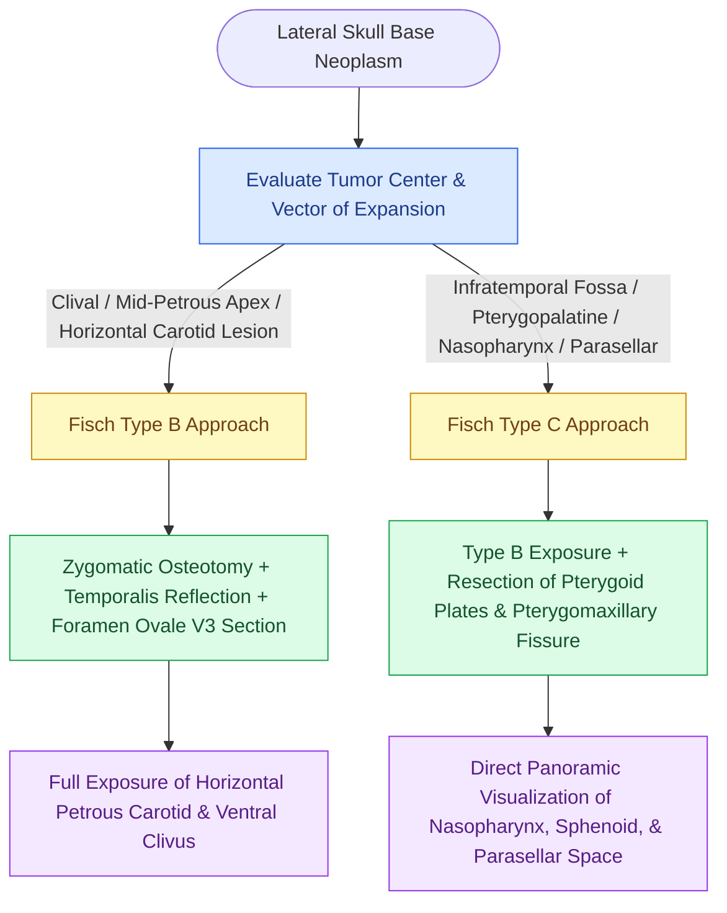

# Fisch infratemporal fossa approach Type B and Type C expose the petrous apex, clivus, and infratemporal fossa by mobilizing the zygomatic arch and temporalis muscle

## Active Recall

> [!question]- What anatomic structures distinguish the exposure and indications of a Fisch Infratemporal Fossa Approach Type B from Type A?
> *Answer / Clinical Rationale*: While the Fisch Type A approach is directed primarily at the jugular foramen and infralabyrinthine temporal bone (requiring permanent anterior transposition of the facial nerve to resect glomus jugulare tumors), the **Fisch Type B approach** is directed anteriorly to the horizontal internal carotid artery, petrous apex, and mid-clivus. Type B does not require facial nerve rerouting; instead, it utilizes a subtemporal-preauricular incision, temporary osteotomy of the zygomatic arch, inferior reflection of the temporalis muscle, and transection of the mandibular nerve (V3) at the foramen ovale to unroof the horizontal petrous carotid canal.
>
> [!question]- How does the Fisch Type C approach extend the dissection beyond Type B, and what are its clinical indications?
> *Answer / Clinical Rationale*: The **Fisch Type C approach** extends anteriorly from the Type B corridor by resecting the pterygoid plates, pterygoid muscles, and the posterior maxillary wall down to the pterygomaxillary fissure, accompanied by permanent surgical obliteration of the cartilaginous Eustachian tube. It is indicated for extensive neoplasms involving the infratemporal fossa, nasopharynx, parasellar region, and sphenoid body (e.g., juvenile nasopharyngeal angiofibromas with skull base invasion, adenoid cystic carcinomas, or extensive clival chordomas).

## Core Clinical & Mechanistic Principles

The surgical management of deep lateral and central skull base neoplasms is defined by the three classic lateral corridors developed by Ugo Fisch: Types A, B, and C. While [[Fisch infratemporal fossa approach Type A mobilizes the facial nerve and exposes the jugular foramen|Fisch Type A approach]] was designed specifically for jugular foramen tumors, **Fisch Type B and Type C approaches** provide access to the anterior petrous apex, horizontal carotid canal, infratemporal fossa, sphenoid sinus, and nasopharynx. Staging temporal bone and skull base neoplasms according to the [[Fisch classification categorizes temporal bone and skull base paragangliomas from Class A to Class D|Fisch classification of skull base tumors]] dictates whether these anterior corridors are required.

The **Fisch Type B approach** is an extradural subtemporal-preauricular route. It exposes the horizontal segment of the intrapetrous internal carotid artery (ICA) throughout its entire course from the carotid genu to the foramen lacerum, providing wide exposure of the petrous apex, basisphenoid, and mid-clivus. Key technical maneuvers include osteotomy of the zygomatic arch (reflected inferiorly with the masseter attachment), inferior reflection of the temporalis muscle, subtemporal craniectomy, and division of the middle meningeal artery and mandibular nerve ($V_3$) at their skull base exits. Because the surgical axis is anterior to the mastoid, cranial nerve VII remains safely undisturbed within the Fallopian canal.

The **Fisch Type C approach** expands the Type B corridor further anteriorly and medially. By drilling away the base of the pterygoid processes, resecting the lateral and medial pterygoid plates, and removing the posterior antral wall, the surgeon converts the infratemporal fossa and nasopharynx into a single continuous operative cavity. The cartilaginous Eustachian tube is resected and permanently plugged with bone wax or muscle to prevent persistent postoperative cerebrospinal fluid rhinorrhea.

### Operative Technique: Fisch Type B and Type C

1. **Incision and Soft Tissue Mobilization**: An extended hemicoronal-preauricular incision curves into the cervical region. The frontal branch of the facial nerve is protected in the superficial temporal fascia. The external auditory canal is closed as a blind sac.
2. **Zygomatic Osteotomy & Temporalis Reflection**: The zygomatic arch is exposed and two parallel osteotomies are made (anteriorly at the zygomatic body and posteriorly at the root of the zygoma). The osteotomized segment is displaced inferiorly. The temporalis muscle is elevated off the squamous temporal bone and reflected into the neck.
3. **Subtemporal Craniotomy & Mastoidectomy**: A subtemporal craniotomy is paired with a radical subtotal mastoidectomy. The middle fossa dura is elevated off the petrous roof.
4. **Foramen Spinosum and Foramen Ovale Section**: The middle meningeal artery is coagulated and divided at the foramen spinosum. The mandibular division of the trigeminal nerve ($V_3$) is dissected at the foramen ovale, doubly ligated, and transected to allow deep subtemporal dural retraction.
5. **Horizontal Carotid Skeletonization**: Bone covering the horizontal intrapetrous internal carotid artery is drilled away with continuous diamond irrigation, exposing 360 degrees of the arterial wall from the vertical genu to the foramen lacerum.
6. **Type C Extension (Pterygoid Resection)**: For Type C exposure, the pterygoid plates are burred down flush with the skull base, the tensor and levator veli palatini muscles are detached, the cartilaginous Eustachian tube is excised, and the posterior wall of the maxillary antrum is opened to gain unobstructed entry into the nasopharynx and pterygopalatine fossa.

## Connected Concepts & Graph Traversal
- **Infratemporal Alternative**: [[Fisch infratemporal fossa approach Type A mobilizes the facial nerve and exposes the jugular foramen]]
- **Petrous Apex Drainage**: [[Infracochlear and infralabyrinthine approaches establish hearing-preserving drainage pathways for petrous apex cholesterol granulomas inferior to the otic capsule]]
- **Prepontine Route**: [[The transcochlear approach expands the translabyrinthine corridor through posterior facial nerve rerouting and cochlear drill-out to access the prepontine space and ventral clivus]]
- **Skull Base Corridor**: [[The translabyrinthine approach provides direct exposure of the internal auditory canal with complete hearing sacrifice]]
- **Complication Rescue**: [[High-stakes lateral skull base neurotologic complications require rapid multimodal emergency salvage]]
