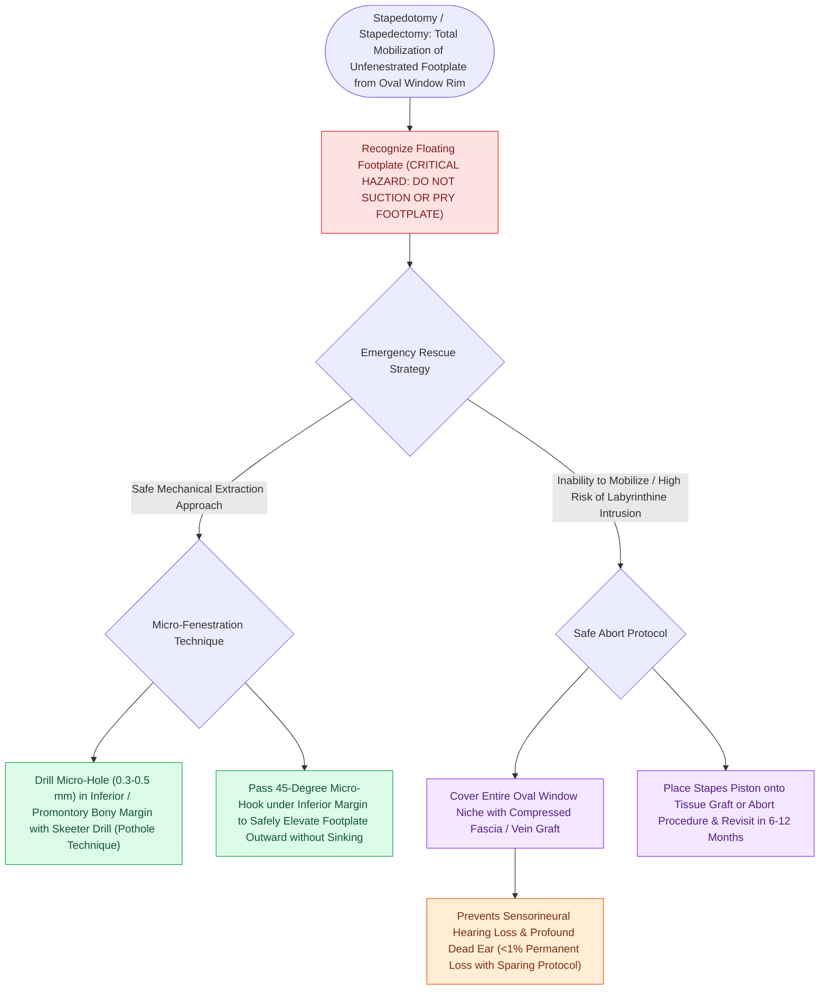

# Floating footplate complication during stapedectomy is managed with small inferior fenestration or vein graft

## Active Recall

> [!question]- Why is direct suction near a floating footplate strictly prohibited?
> *Answer / Clinical Rationale*: Suction will **draw the footplate and perilymph into the suction tip**, causing immediate catastrophic avulsion of the membranous labyrinth and permanent deafness.

> [!question]- What surgical maneuver is used to retrieve a floating footplate if a laser is unavailable?
> *Answer / Clinical Rationale*: Drill a **small control hole in the inferior margin of the promontory**, slide a fine micro-hook beneath the footplate, and gently elevate it outward.

## Core Clinical & Mechanistic Principles
A **floating footplate** occurs when the entire stapes footplate becomes completely mobilized and detaches from the annular ligament *before* a fenestration has been made:
- **Mechanisms & Risk Factors**:
  - Occurs during manual manipulation, attempted crural fracture, or mechanical drilling of an early otosclerotic lesion where anterior fixation is loose.
  - The completely loose footplate floats freely on the underlying perilymph and easily submerges into the vestibule (**depressed footplate**).
- **The "DO NOT SUCTION" Mandate**:
  - Never apply suction near a floating footplate; suction will immediately aspirate the footplate and perilymph into the suction tip, causing complete irreversible deafness.
- **Rescue Protocols**:
  1. **Laser Fenestration (Preferred)**: If a laser is available, create a small fenestration through the floating footplate without physical contact.
  2. **Micro-Hook "Pot-Hole" Extraction**: Drill a tiny "pot-hole" or control hole in the inferior bony promontory / margin of the oval window niche; slide a fine $0.3\text{-mm}$ right-angle hook beneath the footplate and gently elevate it outward.
  3. **Total Vestibule Seal**: If the footplate is submerged, do not chase it into the vestibule; immediately seal the oval window with a large **fascia / vein graft** and place a Robinson bucket or [[Stapedotomy utilizes a micro-drill or laser fenestration of the posterior footplate|piston prosthesis]] onto the graft.

### Surgical Technique & Critical Safety Checks
- **Outcome**: Leaving a submerged footplate fragment undisturbed in the vestibule often heals without hearing loss; chasing it with instruments causes total sensorineural destruction.

## Connected Concepts & Graph Traversal
- **Stapes Fixation Primary Pathology**: [[Otosclerosis is characterized by abnormal bone remodeling of the otic capsule causing stapes fixation|Otosclerosis Footplate Pathology]]
- **Surgical Laser Fenestration**: [[Laser stapedotomy reduces mechanical trauma and footplate mobilization compared to manual perforators|Laser Stapedotomy Safety]]
- **Congenital Perilymph Gush**: [[Gushing footplate indicates a congenital perilymph fistula from an abnormally patent cochlear aqueduct|Gushing Footplate Complication]]
- **Prosthetic Distance Landmark**: [[The distance from the incus long process to the stapes footplate averages four to four point five millimeters|Piston Length Sizing]]
- **Audiometric Carhart Notch**: [[Carhart notch presents as an artificial bone-conduction dip at two thousand Hertz in stapes fixation|Carhart Notch Resolution]]
