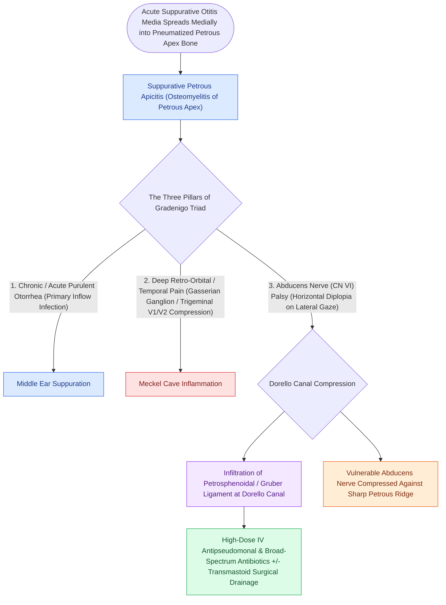

# Gradenigo triad of otorrhea, retroorbital pain, and abducens nerve palsy indicates suppurative petrous apicitis

## Active Recall

> [!question]- Which exact anatomical canal and ligament are involved in the abducens nerve palsy of Gradenigo's triad?
> *Answer / Clinical Rationale*: The abducens nerve ($CN\text{ VI}$) passes through **Dorello's canal**, bounded by the petrous apex tip laterally and the **petrosphenoidal (petroclinoid) ligament of Gruber** superiorly. Inflammatory osteitis and venous thrombophlebitis at the apex cause direct compressive neuropathy and ischemic paresis of $CN\text{ VI}$.

> [!question]- Why does petrous apicitis cause pain referred to the retro-orbital region rather than the ear alone, and why is petrositis much rarer than coalescent mastoiditis?
> *Answer / Clinical Rationale*: **Meckel's cave**, which houses the trigeminal (Gasserian) ganglion, rests directly on the superior surface of the petrous apex; apical osteomyelitis irritates the adjacent ganglion and ophthalmic division ($V_1$), referring deep pain into the retro-orbital distribution. Petrositis is rare because the petrous apex is pneumatized in only **$\sim 30\%$ of temporal bones**.

## Core Clinical & Mechanistic Principles
Suppurative **petrous apicitis (Gradenigo syndrome)** occurs when infection from [[Uncomplicated acute otitis media in pediatric and adult patients is treated with first-line high-dose amoxicillin|acute otitis media]] or [[Acute coalescent mastoiditis causes trabecular osteoclasis and subperiosteal abscess formation|coalescent mastoiditis]] tracks medially through pneumatized cell tracts (subarcuate, perilabyrinthine, infralabyrinthine, or peritubal tracts) into the petrous apex of the temporal bone. Because only approximately **30% of temporal bones** have a pneumatized petrous apex, suppurative petrositis is rare compared to mastoiditis; when it occurs, entrapment of infection in this rigid pyramidal apex produces the classic **Gradenigo Triad**:

1. **Persistent Suppurative Otorrhea**: Due to underlying middle ear and mastoid purulence.
2. **Deep Retro-orbital or Facial Pain**: Due to inflammatory irritation of the [[Trigeminal neuralgia causes paroxysmal lancinating facial pain treated with carbamazepine and microvascular decompression|trigeminal ganglion (Gasserian ganglion)]] and ophthalmic division ($V_1$) residing in Meckel's cave on the anterosuperior surface of the petrous apex.
3. **Ipsilateral Abducens Nerve ($CN\text{ VI}$) Palsy**: Producing lateral rectus weakness and horizontal diplopia as the nerve passes under the petrosphenoidal ligament (Gruber's ligament) within **Dorello's canal** adjacent to the inflamed apex tip.

### Diagnostic Evaluation, Differential & Management Algorithm
- **Imaging Modalities & Petrous Apex Differential**:
  - **High-Resolution Temporal Bone CT**: Demonstrates opacification and coalescent cortical bone trabecular erosion in the pneumatized petrous apex and defines drainable cell tracts.
  - **Contrast-Enhanced MRI Brain/IAC**: Demonstrates $T_1$ hypointense, $T_2$ hyperintense fluid with peripheral rim enhancement in Meckel's cave and Dorello's canal (differentiating suppurative apicitis from petrous apex cholesterol granuloma, congenital cholesteatoma, chondrosarcoma, and metastasis), while ruling out dural venous sinus thrombosis and epidural abscess.
- **Medical & Surgical Management**:
  - **First-Line Medical Therapy**: High-dose intravenous broad-spectrum/antipseudomonal antibiotics crossing the blood-brain barrier (e.g., ceftriaxone or cefepime/ceftazidime plus vancomycin) combined with urgent [[Pediatric acute mastoiditis with subperiosteal abscess requires intravenous ceftriaxone, myringotomy tube placement, and cortical mastoidectomy|myringotomy]] and ventilation tube placement.
  - **Surgical Petrous Apex Drainage**: Refractory abscess or progressive cranial neuropathy requires surgical drainage along air-cell tracts (**infracochlear**, **infralabyrinthine**, **subarcuate**, or **middle cranial fossa** corridors; translabyrinthine if non-serviceable hearing) selected according to hearing status and CT pneumatization anatomy (see [[Petrous apex cholesteatoma requires infracochlear, translabyrinthine, or middle cranial fossa exteriorization|Petrous Apex Drainage Corridors]]).
## References
1. Arts, H.A., Adams, M.E. (2013). Intratemporal and Intracranial [[Otogenic intracranial complications escalate from meningitis to sigmoid sinus thrombosis and brain abscess|Complications of Otitis Media]]. In Johnson, J.J., Rosen, C.A. (Eds.), *Bailey’s Head and Neck Surgery-Otolaryngology* 5e (pp. 2399-2409). Baltimore, MD: Lippincott Williams & Wilkins.
2. Schilder, A.G., Rosenfeld, R.M., Venekamp, R.P. (2020). Acute Otitis Media and Otitis Media with Effusion. In Flint, P.W., et al. (Eds.), *Cummings Otolaryngology Head and Neck Surgery* 7e (pp. 2956-2969). Philadelphia, PA: Elsevier.
3. Connor, S.E., et al. (2008). Imaging of petrous apicitis. *Clin Radiol*, 63(7):794-803.

## Connected Concepts & Graph Traversal
- **Physiological Basis**: [[Acute coalescent mastoiditis causes trabecular osteoclasis and subperiosteal abscess formation|Coalescent Mastoiditis]]
- **Petrous Apex Drainage Corridors**: [[Petrous apex cholesteatoma requires infracochlear, translabyrinthine, or middle cranial fossa exteriorization|Infracochlear & Infralabyrinthine Petrous Drainage]]
- **Dural Venous Complication**: [[Lateral sinus thrombophlebitis presents with picket fence fevers and Griesinger sign requiring intravenous antibiotics and mastoidectomy|Lateral Sinus Thrombophlebitis]]
- **Dorello Canal Anatomy**: [[Cranial nerve polyneuropathies of the skull base are localized by specific anatomical foramen involvement|CN VI Dorello Canal Compression]]
- **Intracranial Infection Spread**: [[Otogenic intracranial complications escalate from meningitis to sigmoid sinus thrombosis and brain abscess|Otogenic Intracranial Complications]]
- **Underlying Precursor**: [[Uncomplicated acute otitis media in pediatric and adult patients is treated with first-line high-dose amoxicillin|Acute Otitis Media]]
