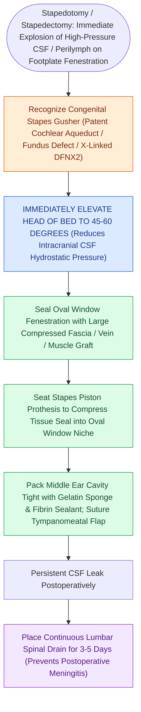

# Gushing footplate indicates a congenital perilymph fistula from an abnormally patent cochlear aqueduct

## Active Recall

> [!question]- What genetic syndrome and temporal bone anomaly are classically associated with a high-risk stapes gusher?
> *Answer / Clinical Rationale*: **X-linked deafness (POU3F4 mutation / Incomplete Partition Type III)**, characterized by an absent bony partition between the IAC fundus and the cochlea.

> [!question]- What are the immediate surgical and medical actions for managing an intraoperative stapes gusher?
> *Answer / Clinical Rationale*: **Elevate the head of bed (30–45 degrees)**, **pack the oval window with a tight muscle/fascia plug**, and place a **lumbar subarachnoid drain**.

## Core Clinical & Mechanistic Principles
A **stapes gusher (perilymph gusher)** is a rare, dramatic intraoperative emergency characterized by profuse, high-pressure outflow of cerebrospinal fluid (CSF) immediately upon fenestrating the stapes [[Stapedotomy utilizes a micro-drill or laser fenestration of the posterior footplate|footplate]]:
- **Pathophysiological Mechanisms**:
  1. **Abnormally Patent Cochlear Aqueduct**: Provides direct, wide communication between the subarachnoid space of the posterior fossa and the perilymph of the scala tympani.
  2. **Congenital Defect of the Internal Auditory Canal (IAC) Fundus**: Associated with **X-linked deafness (DFNX2 / POU3F4 mutation / Incomplete Partition Type III)**, where the cribriform plate between the IAC and cochlea is absent.
- **Immediate Operating Room Crisis Protocol**:
  1. **Elevate Head of Bed ($30\text{–}45^\circ$)**: Immediately lowers intracranial CSF hydrostatic pressure.
  2. **Control Suction & Clear Field**: Maintain suction without applying direct pressure into the vestibule.
  3. **Immediate Oval Window Packing**: Plug the fenestra with a tight **fascia / muscle plug or adipose tissue**, held securely in place with the stapes prosthesis or Gelfoam.
  4. **Emergency Lumbar Drain**: Place a continuous lumbar subarachnoid drain to divert CSF at $10\text{–}15\text{ mL/hr}$ for 3–5 days.

### Surgical Technique & Critical Safety Checks
- **Preoperative CT Clue**: Absence of bone separating the fundus of the IAC from the basal turn of the cochlea (Incomplete Partition Type III) is a major red flag for stapes gusher.

## Connected Concepts & Graph Traversal
- **Stapes Surgery Context**: [[Stapedotomy utilizes a micro-drill or laser fenestration of the posterior footplate|Stapedotomy Fenestration]]
- **Floating Footplate Crisis**: [[Floating footplate complication during stapedectomy is managed with small inferior fenestration or vein graft|Floating Footplate Complication]]
- **Otic Capsule Constants**: [[The otic capsule is an immutable endochondral bone that provides fixed surgical reference landmarks|Otic Capsule Anomalies]]
- **Inner Ear Dysplasias**: [[Inner ear malformations are classified by Jackler and Sennaroglu based on embryonic arrest timing and cochleovestibular architecture|IP-I & Mondini Perilymph Fistula]]
- **CSF Fistula Management**: [[Cerebrospinal fluid CSF leak and pseudomeningocele require lumbar drainage, fat obliteration, and re-exploration|CSF Leak Lumbar Drainage]]
