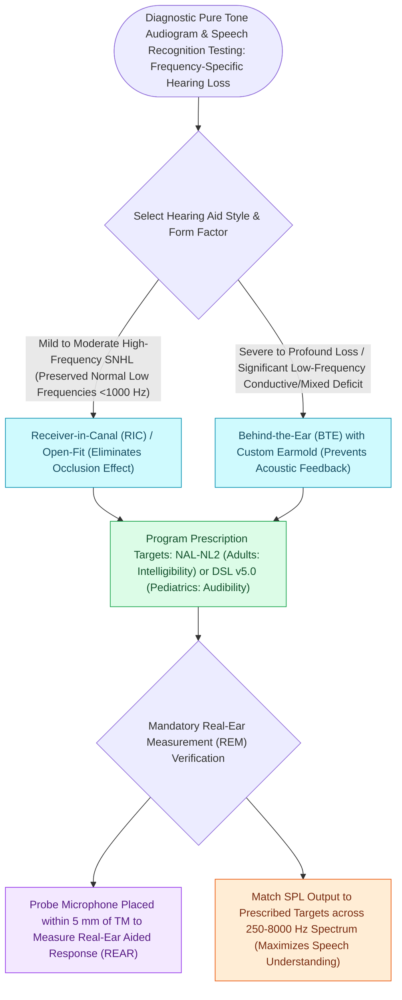

# Hearing aid selection is driven by audiometric configuration and verified with real-ear measurement

## Active Recall

> [!question]- What does real-ear measurement verify that first-fit software cannot?
> *Answer / Clinical Rationale*: Actual ear-canal SPL against prescriptive targets in that patient's canal acoustics — first-fit predictions routinely deviate from measured output.

> [!question]- What is a BiCROS fitting and its indication?
> *Answer / Clinical Rationale*: Microphone on the unaidable ear transmitting to an aided better ear that also has hearing loss — asymmetric loss with one unaidable side.

## Core Clinical & Mechanistic Principles
- Style follows configuration: receiver-in-canal with open domes for high-frequency loss (preserves natural low-frequency [[Bimodal stimulation combines a contralateral hearing aid with an ipsilateral cochlear implant|hearing]], avoids occlusion), closed/custom fittings for flatter or severe losses needing gain without feedback.
- **Real-ear (probe microphone) verification** against prescriptive targets (NAL-NL2, DSL for children) is the difference between a fitted aid and a sold aid; first-fit software alone routinely misses targets.
- **CROS/BiCROS** systems route signal from an unaidable ear to the better ear — the head-shadow solution for single-sided deafness, alongside bone-conduction and implant options.
- OTC hearing aids serve mild-to-moderate adult loss; the counseling point is candidacy screening, since an OTC device cannot detect the asymmetry or effusion behind the complaint.

### Management & Critical Safety Checks
- Set expectations explicitly: acclimatization takes weeks, noise remains the hardest environment, and directional microphones plus remote microphone accessories address it better than gain does.
- Failure of well-verified aids (poor aided word recognition) is the trigger for implant evaluation, not for more gain.

## Connected Concepts & Graph Traversal
- **Masking & Threshold Accuracy**: [[Audiometric masking with the plateau method prevents shadow responses from the non-test ear|Hood Plateau Masking]]
- **Presbycusis Configuration**: [[Presbycusis produces symmetric high-frequency sensorineural loss with disproportionate speech-in-noise decline|Presbycusis High-Frequency Loss]]
- **Bimodal CI Combination**: [[Bimodal stimulation combines a contralateral hearing aid with an ipsilateral cochlear implant|Bimodal Stimulation]]
- **Acoustic Bone Conduction**: [[Bone-anchored hearing implants BAHA stimulate the cochlea directly via bone conduction pathways|BAHA Implants]]
- **Tinnitus Masking Benefit**: [[Chronic subjective tinnitus is managed with cognitive behavioral and sound-based therapy rather than cure|Sound Therapy for Tinnitus]]
