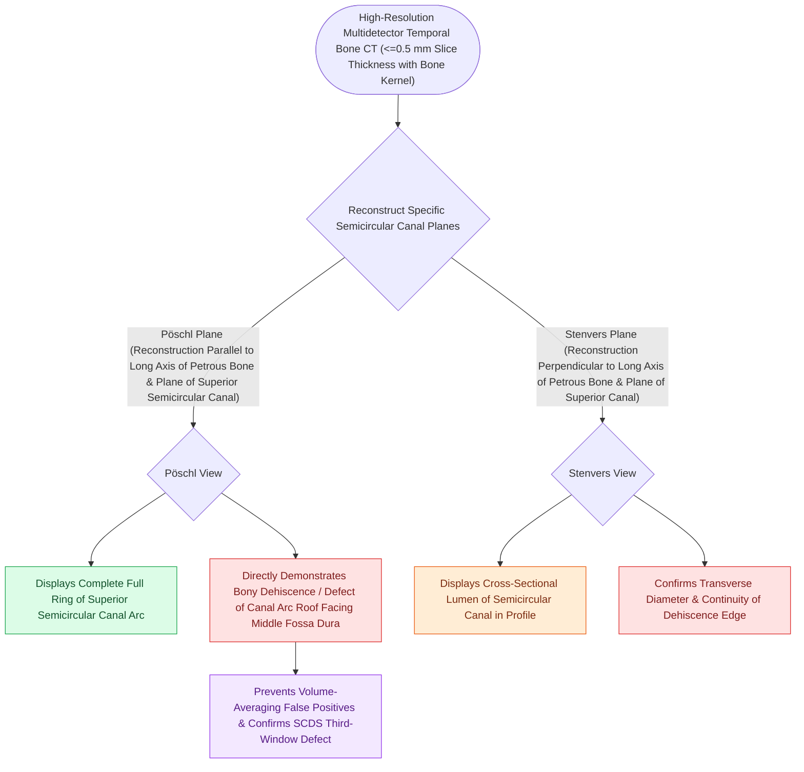

# High-resolution temporal bone CT with Poschl and Stenvers reformatting confirms superior canal dehiscence

## Active Recall

> [!question]- What oblique CT plane is oriented parallel to the long axis of the superior semicircular canal?
> *Answer / Clinical Rationale*: The **Pöschl plane**.

> [!question]- What oblique CT plane is oriented perpendicular to the superior semicircular canal?
> *Answer / Clinical Rationale*: The **Stenvers plane**.

## Core Clinical & Mechanistic Principles
Standard axial and coronal CT scans frequently produce false-positive diagnoses of SCDS due to volume averaging of thin tegmen bone. Diagnostic confirmation requires **sub-millimeter ($0.5\text{–}0.6\text{-mm}$) High-Resolution Temporal Bone CT** with dedicated oblique reformats:
- **Pöschl Plane (Parallel to the Superior Semicircular Canal)**:
  - Reconstructed in an oblique sagittal plane **parallel to the long axis of the petrous bone / superior canal**.
  - Demonstrates the entire $360^\circ$ ring of the superior semicircular canal ("donut view").
  - Directly visualizes the **length and true defect margin of the bony dehiscence** at the apex of the canal.
- **Stenvers Plane (Perpendicular to the Superior Semicircular Canal)**:
  - Reconstructed in an oblique coronal plane **perpendicular to the petrous ridge and superior canal**.
  - Demonstrates the cross-section of the canal lumen and confirms the **absence of overlying cortical bone**.

### Surgical Technique & Critical Safety Checks
- **Diagnostic Confirmation Criteria**: Defect must be documented on **BOTH Pöschl and Stenvers planes**, supported by **lowered [[Cervical and ocular vestibular evoked myogenic potentials test saccular and utricular otolith function|VEMP]] thresholds ($<70\text{ dB nHL}$)**.

## Connected Concepts & Graph Traversal
- **SCDS Clinical Syndrome**: [[Superior semicircular canal dehiscence SCDS presents with Tullio phenomenon and sound-induced vertigo|SSCD Tullio Phenomenon]]
- **Surgical Resurfacing & Plugging**: [[Middle cranial fossa and transmastoid canal plugging or resurfacing repair superior canal dehiscence|MCF vs Transmastoid Repair]]
- **Otolith Evoked Diagnostics**: [[cVEMP evaluates the saccule and inferior vestibular nerve via uncrossed sternocleidomastoid inhibition|cVEMP Hypersensitivity Thresholds]]
- **Third-Window Acoustic Imbalance**: [[Pulsatile tinnitus is differentiated into arterial and venous etiologies by auscultation, jugular compression, and targeted vascular imaging|Third-Window Pulsatile Tinnitus]]
- **Otic Capsule Anatomy**: [[The otic capsule is an immutable endochondral bone that provides fixed surgical reference landmarks|Otic Capsule Integrity]]
